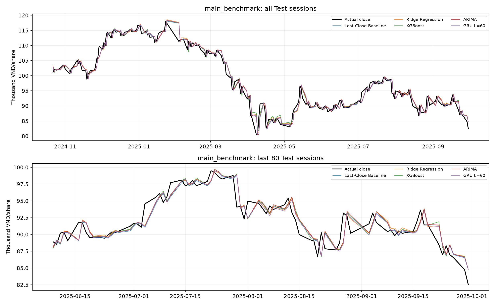

# Dự báo biến động cổ phiếu FPT ở phiên kế tiếp bằng học máy và mô hình chuỗi thời gian

Đồ án môn CS114 — nhóm Lê Vũ Thiêm Hoàng (25520584), Nguyễn Tấn Dũng (25520367), Lưu Hoàng Minh Duy (25520424).

- **Một mục tiêu, hai đầu ra:** chỉ học log return; giá và hướng đều suy ra từ cùng dự báo. Không còn mô hình phân loại riêng.
- **Lựa chọn bằng Train CV:** ARIMA có CV RMSE thấp nhất trong năm đại diện (0.017192); Test MAE giá 1.2392. Baseline đạt MAE 1.2250, nên mô hình được CV chọn chưa vượt baseline về MAE trên giai đoạn Test.
- **Thêm dữ liệu chưa tự động tốt hơn:** XGBoost 32 → 43 biến có Test RMSE log return 0.018754 → 0.020089; đúng hướng 51.98% → 48.02%. GRU chọn **GRU L=60** bằng CV.

## 1. Bài toán

Một mô hình dự báo `r(t+1) = ln(C(t+1)/C(t))`; giá = `C(t) × exp(r dự báo)`, hướng = dấu của dự báo. Bằng 0 là Đứng giá. Không có mô hình phân loại riêng hoặc xác suất tăng.

## 2. Dữ liệu

4.671 phiên OHLCV FPT, **02/01/2007–30/09/2025**. Snapshot VCI/vnstock; dữ liệu bổ trợ DNSE, Investing.com, World Bank và công bố FPT. Ba cấp 32/38/43 biến ghép theo ngày có thể biết, không điền ngược. Ngành ICT bị loại vì không đủ độ phủ. Xem [nguồn và quy tắc dữ liệu](data/README.md).

## 3. Đặc điểm chuỗi thời gian

ADF bác bỏ nghiệm đơn vị của log return (p ≈ 1,05 × 10⁻¹⁷), nhưng KPSS vẫn bác bỏ dừng mức (p ≈ 0,0164). Kết quả hỗ trợ dùng biến động tương đối, không bảo đảm dự báo tốt. [Bảng kiểm định và ACF/PACF](docs/REPORT.md#3-đặc-điểm-chuỗi-thời-gian); STL ở phụ lục.

## 4. Năm phương pháp

**Last-Close → Ridge → XGBoost → ARIMA → GRU.** Mỗi phương pháp đại diện một cách suy nghĩ: giữ nguyên, tuyến tính, cây phi tuyến, lịch sử chuỗi, bộ nhớ tuần tự. SARIMAX chỉ là đối sánh mở rộng với ARIMA trong thí nghiệm 2.

## 5. Đánh giá

Train 1.325 / Test 234 mẫu; Test từ 22/10/2024 đến 30/09/2025. Train dùng CV 5 fold, `gap=1`; chọn theo RMSE log return. Độ chính xác hướng chấm 227 phiên đổi giá, dự báo 0 tính sai. Bộ chuẩn hóa chỉ học Train; artefact đánh giá tách khỏi bản học lại để dự báo.

## 6. Ba thí nghiệm và kết quả chính

1. So sánh năm phương pháp trên cùng ngày, mô hình ML/GRU dùng 32 biến; ARIMA chỉ dùng log return.
2. XGBoost cố định cấu hình, thêm dữ liệu **32 → 38 → 43**; đối sánh thêm ARIMA/SARIMAX.
3. GRU **L=20 so với L=60**, chọn bằng CV.

| Mô hình / cấu hình | CV RMSE log return | Test MAE giá (nghìn VND) | Test RMSE giá (nghìn VND) | Đúng hướng (%) | Dung sai ±1% (%) |
|---|---:|---:|---:|---:|---:|
| Last-Close Baseline | 0.017250 ± 0.003429 | 1.2250 | 1.7398 | 0.00% | 54.70% |
| Ridge Regression | 0.017612 ± 0.003467 | 1.2455 | 1.7534 | 52.42% | 52.99% |
| XGBoost | 0.017750 ± 0.002956 | 1.2621 | 1.7774 | 51.98% | 52.56% |
| ARIMA | 0.017192 ± 0.003481 | 1.2392 | 1.7537 | 48.90% | 54.27% |
| GRU L=60 | 0.017716 ± 0.003444 | 1.2213 | 1.7384 | 54.19% | 54.27% |

CV hiển thị trung bình ± độ lệch chuẩn qua 5 fold. Bảng chi tiết: [main](reports/main_benchmark.csv), [ablation](reports/ablation.csv), [ARIMA/SARIMAX](reports/statistical_extension.csv), [GRU](reports/lookback.csv). Có **9 cấu hình Test duy nhất, 10 artefact mô hình** gồm bản học lại.



## 7. Giải thích và phân tích lỗi

Permutation Importance là phần chính; SHAP là phụ lục. [Báo cáo](docs/REPORT.md) trình bày 3 ca sai số lớn nhất với biến động FPT/VN-Index cùng phiên, tách quan sát khỏi giả thuyết nguyên nhân. Các giới hạn và hướng phát triển được tập hợp tại [cuối báo cáo](docs/REPORT.md#giới-hạn-nghiên-cứu--hướng-phát-triển).

### Cài đặt và chạy

```bash
python -m pip install -r requirements.txt
python src/fetch_data.py --verify
python src/fetch_supplemental.py --from-cache
python src/eda.py
python src/prepare.py
python src/time_series_analysis.py
python src/train.py
python src/explain.py
python src/predict.py
python -m pytest -q
```

Lệnh mặc định tái lập snapshot, không cần tải lại nguồn. Môi trường thực nghiệm: Python 3.14, CPU, seed 42; phiên bản thư viện tại [environment_versions.json](reports/environment_versions.json). Tải mới giá bằng `python src/fetch_data.py --download --start 2007-01-01 --end 2025-09-30` có thể đổi phiên bản giá điều chỉnh; khi đó phải kiểm toán và chạy lại.

Chạy theo ô tại [00_RUN_ALL.ipynb](notebooks/00_RUN_ALL.ipynb), hoặc từng notebook 01–09 theo [hướng dẫn](notebooks/README.md). Notebook gọi hàm trong `src/` để chỉ có một nơi định nghĩa thuật toán. Huấn luyện CV chạy trên CPU và lâu hơn các bước đọc dữ liệu.

```text
src/          thu thập, đặc trưng, chuẩn bị, metrics, train, sequence_models,
              time_series_analysis, plots, explain, predict
notebooks/    00 chạy toàn bộ; 01–09 giải thích và chạy từng bước
data/         raw snapshot và processed do pipeline tạo
reports/      CV, 3 thí nghiệm, dự báo từng phiên, kiểm toán, ca lỗi
models/       evaluation/ (9 bản Train-only), best_regressor.joblib
figures/      EDA, ACF/PACF, 3 thí nghiệm, permutation; phụ lục SHAP/STL
docs/         REPORT.md, PROPOSAL.md, cs114_proposal.tex/.pdf
tests/        kiểm định dữ liệu, thời gian, cửa sổ, đầu ra và artefact
```

[Proposal Markdown](docs/PROPOSAL.md) · [Proposal PDF](docs/cs114_proposal.pdf). Cẩm nang riêng bị Git bỏ qua.
