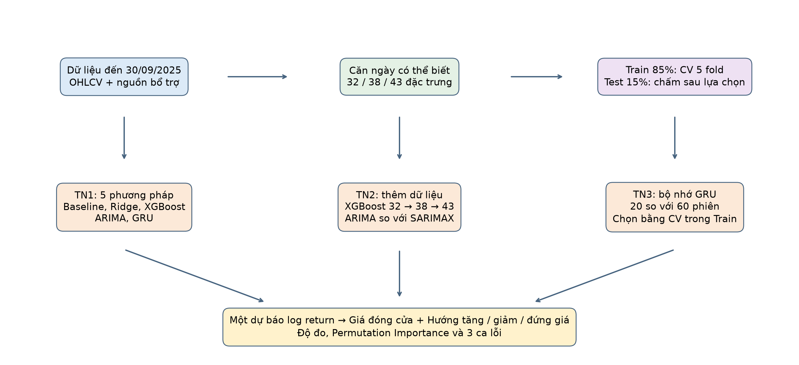

# ĐỀ XUẤT Ý TƯỞNG ĐỒ ÁN MÔN HỌC CS114

**ĐẠI HỌC QUỐC GIA THÀNH PHỐ HỒ CHÍ MINH — TRƯỜNG ĐẠI HỌC CÔNG NGHỆ THÔNG TIN**

**Đề tài: Dự báo biến động cổ phiếu FPT ở phiên kế tiếp bằng học máy và mô hình chuỗi thời gian**

| STT | Họ và tên | MSSV |
|---|---|---|
| 1 | Lê Vũ Thiêm Hoàng | 25520584 |
| 2 | Nguyễn Tấn Dũng | 25520367 |
| 3 | Lưu Hoàng Minh Duy | 25520424 |

THÀNH PHỐ HỒ CHÍ MINH, NĂM 2026

## 1. Bài toán và mục tiêu

Nhóm dự báo biến động FPT của phiên kế tiếp ngay sau khi phiên hiện tại đóng cửa. Đề tài thống nhất một mục tiêu lợi nhuận logarit, rồi suy ra giá đóng cửa và hướng biến động. Cách này giúp so sánh các tư duy mô hình hóa trong cùng một quy trình, phù hợp phạm vi đồ án ba sinh viên.

$$r_{t+1}=\ln(C_{t+1}/C_t),\qquad \widehat C_{t+1}=C_t\exp(\widehat r_{t+1}).$$

| Đầu ra | Ý nghĩa |
|---|---|
| Phiên mục tiêu | Phiên giao dịch quan sát được kế tiếp |
| Log return dự báo | Biên độ biến động tương đối, không phải xác suất |
| Giá đóng cửa dự báo | Giá suy ra, nghìn VND/cổ phiếu |
| Hướng dự báo | Tăng nếu dương, Giảm nếu âm, Đứng giá nếu bằng 0 |
| Mô hình / cấp dữ liệu | Phương pháp và đầu vào đã tạo dự báo |

## 2. Dữ liệu và phương pháp thu thập

OHLCV FPT từ VCI/vnstock có 4.671 phiên, 02/01/2007–30/09/2025. Mốc cuối cố định giúp đồng bộ nguồn và phiên bản thí nghiệm. Nhóm chuẩn hóa snapshot bổ trợ từ DNSE (VN-Index), Investing.com (USD/VND, XAU/USD, lịch CPI), World Bank (GDP danh nghĩa USD), VCI và công bố FPT (báo cáo quý, số cổ phiếu). Vàng quy đổi là VND/ounce vàng quốc tế.

Ba cấp dữ liệu gồm 32 biến giá/kỹ thuật; 38 biến khi thêm thị trường/vĩ mô; 43 biến khi thêm tài chính FPT. Dữ liệu chỉ có hiệu lực từ thời điểm có thể biết: ngày + 1; CPI từ lịch công bố + 1; quý giả định trễ 45 ngày; GDP năm trễ 180 ngày. Số cổ phiếu dùng lịch công bố/tham chiếu riêng + 1 ngày. Không điền ngược hoặc nội suy qua kỳ tương lai.

Nguồn ngành Simply Wall St chỉ có 33 mốc từ 2016, thiếu độ phủ và thành phần lịch sử. Nhóm loại nhóm ngành, không tạo dòng thí nghiệm rỗng. Cohort chung yêu cầu 60 phiên liên tiếp đủ dữ liệu, còn 1.559 mẫu có nhãn.

## 3. Đặc điểm chuỗi thời gian

Nhóm dùng ADF/KPSS và ACF/PACF trên lịch sử đến cuối Train để khảo sát xu thế và phụ thuộc theo độ trễ. Kết quả hiện có: ADF của log return p ≈ 1,05 × 10⁻¹⁷, KPSS p ≈ 0,0164. Hai kiểm định đặt giả thuyết gốc khác nhau; không kết luận log return dừng hoàn toàn.

Mục tiêu tương đối giúp mô hình dự báo biến động thay vì ngoại suy mức giá. Nhóm kiểm chứng hiệu quả bằng sai số thực nghiệm, không coi kiểm định tính dừng là chứng minh mô hình sẽ dự báo tốt. Phân rã STL quy ước 5 phiên được đặt ở phụ lục mô tả.

## 4. Năm phương pháp đại diện

| Phương pháp | Câu hỏi nghiên cứu | Cấu hình khảo sát |
|---|---|---|
| Last-Close Baseline | Giữ giá hôm nay đã đủ tốt chưa? | Log return luôn bằng 0 |
| Ridge Regression | Quan hệ tuyến tính có kiểm soát trọng số có hữu ích không? | StandardScaler + Ridge, alpha 10 hoặc 100 |
| XGBoost Regressor | Quy tắc phi tuyến có cải thiện không? | 120 cây, sâu 2 hoặc 3, learning rate 0,04 |
| ARIMA | Lịch sử lợi nhuận tự nó dự báo được gì? | Bậc (0,0,0) hoặc (1,0,0), có hằng số |
| GRU | Học bộ nhớ nhiều phiên có hữu ích không? | 1 lớp, 16 nút ẩn, L=20 hoặc 60, 12 epoch |

Công nghệ gồm Python, pandas, scikit-learn, XGBoost, statsmodels, PyTorch và Jupyter. Cấu hình khảo sát nhỏ để nhóm có thể giải thích và tái lập. SARIMAX được dùng riêng trong đối sánh ngoại sinh, không làm tăng số dòng của bảng năm phương pháp chính.

## 5. Thiết kế đánh giá

85% mẫu đầu là Train, 15% cuối là Test (kết thúc 30/09/2025). Trong Train dùng 5-fold TimeSeriesSplit, gap 1 hàng. Chọn bằng RMSE log return CV trung bình nhỏ nhất, báo cáo thêm độ lệch chuẩn; sau đó fit Train và chấm Test. Mọi bộ chuẩn hóa chỉ học dữ liệu Train của từng lượt.

Bảng chính gồm tên phương pháp và năm độ đo: CV RMSE log return, Test MAE giá, Test RMSE giá, đúng hướng, dung sai ±1%. CSV bổ sung MAPE giá và dung sai ±0,5%/±2%. Đúng hướng chấm các phiên thực tế tăng/giảm; dự báo 0 tính sai. Các metric giá giữ cả phiên đứng giá.

Mô hình dự báo mới nhất được học lại sau khi lưu kết quả; artefact Test được giữ riêng. ARIMA/SARIMAX dự báo từng bước với tham số cố định và chỉ cập nhật trạng thái sau khi quan sát kết quả phiên.

## 6. Ba thí nghiệm và sản phẩm dự kiến

1. So sánh Last-Close, Ridge, XGBoost, ARIMA và GRU trên cùng các ngày; mô hình bảng/GRU dùng 32 biến, ARIMA chỉ dùng lịch sử log return.
2. Giữ XGBoost và cấu hình chọn trên 32 biến, lần lượt thêm dữ liệu thành 38/43 biến. Đặt đối sánh ARIMA/SARIMAX ngay trong phần này.
3. Giữ kiến trúc GRU, so sánh bộ nhớ 20 và 60 phiên; lựa chọn bằng CV trước khi xem Test.

Sản phẩm gồm pipeline có kiểm thử, notebook từng bước, bảng CV/Test và biểu đồ giá thực tế so với dự báo trên toàn Test và 80 phiên cuối. Nhóm báo cáo cả trường hợp phương pháp phức tạp chưa vượt baseline giữ nguyên giá. Chi tiết kết quả được cập nhật trong [REPORT.md](REPORT.md).

## 7. Giải thích mô hình và phân tích ca lỗi

Permutation Importance trên XGBoost là nội dung giải thích chính: tráo một cột rồi đo sai số tăng bao nhiêu. SHAP dùng nền Train được đưa vào phụ lục. Nhóm trích ba phiên có sai số giá tuyệt đối lớn nhất của mô hình chọn bằng CV, so với biến động FPT và VN-Index để mô tả bối cảnh. Không chỉnh lại mô hình theo giải thích Test.

Định hướng tiếp theo là kiểm tra giai đoạn mới, ngày công bố thực tế và nhiều seed. Phạm vi diễn giải và các giới hạn chung tập hợp tại [cuối báo cáo](REPORT.md#giới-hạn-nghiên-cứu--hướng-phát-triển).
