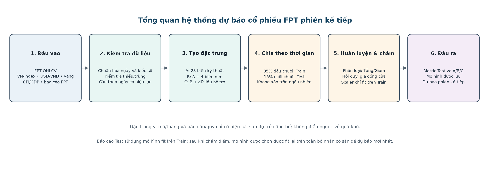

# ĐẠI HỌC QUỐC GIA THÀNH PHỐ HỒ CHÍ MINH
## TRƯỜNG ĐẠI HỌC CÔNG NGHỆ THÔNG TIN

 

# ĐỀ XUẤT HƯỚNG NGHIÊN CỨU ĐỀ TÀI
### Đồ án môn học Machine Learning

**Lĩnh vực:** Khoa học Dữ liệu & Trí tuệ Nhân tạo

## ỨNG DỤNG CÁC MÔ HÌNH HỌC MÁY ĐỂ DỰ ĐOÁN XU HƯỚNG VÀ GIÁ ĐÓNG CỬA CỔ PHIẾU FPT PHIÊN KẾ TIẾP

| STT | Họ và tên | MSSV |
|---:|---|---|
| 1 | Lê Vũ Thiêm Hoàng | 25520584 |

 

**THÀNH PHỐ HỒ CHÍ MINH, NĂM 2026**

---

## Mục lục

1. Đặt vấn đề
2. Mục tiêu của đề tài
3. Phạm vi và đối tượng nghiên cứu
4. Đầu vào và đầu ra dự kiến
5. Hướng tiếp cận và công nghệ dự kiến
6. Cách đánh giá dự kiến
7. Kết quả dự kiến
8. Nội dung nhóm mong muốn được giảng viên góp ý

---

## 1. Đặt vấn đề

Giá cổ phiếu biến động theo kết quả kinh doanh, thông tin doanh nghiệp, cung cầu thị trường và các yếu tố kinh tế rộng hơn. Cổ phiếu FPT có lịch sử giao dịch dài, đồng thời có thể thu thập dữ liệu theo ngày và tạo ra một bài toán học máy có đầu vào, nhãn và cách đánh giá rõ ràng.

Đề tài đặt câu hỏi: khi chỉ biết dữ liệu đến lúc đóng cửa phiên (t), các mô hình học máy có dự báo được hướng thay đổi và mức giá đóng cửa của FPT ở phiên giao dịch kế tiếp hay không? Nhóm bắt đầu từ giá, khối lượng và chỉ báo kỹ thuật; sau đó dự kiến kiểm tra riêng tác động của nến OHLC và các nguồn bổ trợ như VN-Index, tỷ giá, vàng, CPI, GDP và báo cáo tài chính. Dữ liệu tần suất thấp chỉ được đưa vào sau thời điểm công bố để không sử dụng thông tin mà nhà đầu tư chưa thể biết tại thời điểm dự báo.

Khó khăn chính là các nguồn có tần suất và phạm vi lịch sử khác nhau. Giá FPT được ghi theo phiên hằng ngày, trong khi CPI thường theo tháng, GDP và báo cáo tài chính theo quý. Nguồn dữ liệu cũng có giới hạn truy cập và có thể hiệu chỉnh lại lịch sử. Vì vậy, đề tài xem việc ghi nhận nguồn, ngày dữ liệu có hiệu lực, phạm vi quan sát và giới hạn của từng phép thử là một phần của phương pháp nghiên cứu.

Sản phẩm là hệ thống thực nghiệm học thuật hỗ trợ phân tích định lượng. Kết quả của mô hình không được xem là lời khuyên đầu tư và không thay thế quyết định của nhà đầu tư.

## 2. Mục tiêu của đề tài

**Mục tiêu chung:** Xây dựng một quy trình tái lập được để huấn luyện và đánh giá mô hình học máy dự báo hướng biến động và giá đóng cửa FPT ở phiên kế tiếp, đồng thời đo lường tác động của việc bổ sung từng nhóm đặc trưng.

**Mục tiêu cụ thể:**

1. Khảo sát dữ liệu OHLCV lịch sử của FPT và khả năng bổ sung dữ liệu thị trường, vĩ mô, báo cáo tài chính trong phạm vi đến ngày 30/09/2026.
2. Xây dựng quy trình kiểm tra, tiền xử lý và trích xuất đặc trưng chỉ từ thông tin có thể biết tại thời điểm dự báo; kiểm thử việc ngăn rò rỉ dữ liệu tương lai.
3. Huấn luyện và đối sánh các mô hình phân loại hướng Tăng/Giảm và hồi quy giá phiên kế tiếp bằng phép chia Train/Test theo thứ tự thời gian.
4. Thực hiện so sánh loại bỏ/bổ sung nhóm đặc trưng (Ablation Study) và phân tích các trường hợp mô hình dự báo sai.

## 3. Phạm vi và đối tượng nghiên cứu

- **Đối tượng:** Chuỗi dữ liệu giao dịch mã cổ phiếu FPT trên HOSE.
- **Thời gian nghiên cứu:** Từ phiên đầu tiên trong snapshot ngày 02/01/2007 đến phiên 30/09/2026.
- **Đơn vị dự báo:** Một quan sát tại cuối phiên (t), dự báo phiên giao dịch FPT kế tiếp (t+1). “Phiên kế tiếp” là phiên có mặt trong dữ liệu, không phải ngày lịch kế tiếp.
- **Bài toán chính:** Phân loại close phiên (t+1) tăng hay giảm so với close phiên (t). Các phiên đứng giá được giữ trong dữ liệu gốc nhưng loại khỏi huấn luyện và chấm điểm phân loại.
- **Bài toán bổ trợ:** Hồi quy giá close phiên (t+1), với mục tiêu kiểm tra sai số giá và so sánh với baseline giữ nguyên close.
- **Nhóm dữ liệu:** Bộ A gồm 23 đặc trưng kỹ thuật từ close và volume; bộ B bổ sung bốn đặc trưng nến từ open, high, low; bộ C dự kiến bổ sung dữ liệu thị trường, vĩ mô và báo cáo tài chính sau khi kiểm chứng được nguồn và phạm vi.
- **Giới hạn:** Một mã cổ phiếu và một bước dự báo ngắn hạn không đại diện cho toàn bộ thị trường hoặc hiệu quả giao dịch dài hạn.

## 4. Đầu vào và đầu ra dự kiến

### 4.1. Đầu vào

| Nhóm | Dữ liệu | Cách dùng |
|---|---|---|
| Giao dịch FPT | `time, open, high, low, close, volume` | Tạo đặc trưng theo phiên; đơn vị giá của snapshot là nghìn VND/cổ phiếu, volume là số cổ phiếu |
| Kỹ thuật | Lợi nhuận trễ, SMA/EMA, RSI, MACD, Bollinger Bands, biến động, thay đổi volume | Bộ A, chỉ dùng hiện tại và quá khứ |
| Nến OHLC | Biên độ nến, thân nến, khoảng trống giá mở cửa, vị trí close trong biên độ | Bổ sung vào bộ B; tính từ phiên hiện tại và close phiên trước |
| Thị trường | VN-Index, tỷ giá USD/VND, giá vàng | Chỉ dùng nếu nguồn trả dữ liệu hợp lệ và ngày quan sát có thể căn chỉnh an toàn |
| Vĩ mô | CPI và GDP Việt Nam | Căn chỉnh theo ngày có thể biết; CPI chậm 10 ngày kể từ kỳ đo, GDP chậm 45 ngày theo giả định bảo thủ |
| Doanh nghiệp | Doanh thu thuần, lợi nhuận gộp, EBIT và lợi nhuận sau thuế nếu nguồn trả đúng chỉ tiêu | Dùng theo quý và chỉ có hiệu lực sau tối thiểu 45 ngày kể từ cuối kỳ; biến không có nguồn xác nhận được loại khỏi bộ C |

Pipeline dự kiến được minh họa dưới đây. Các nguồn bổ trợ chưa được đưa vào kết quả thực nghiệm cho đến khi có dữ liệu thực, kiểm tra được phạm vi và xác nhận được quyền truy cập.

### 4.2. Đầu ra

| Trường | Ý nghĩa |
|---|---|
| `Target Session` | Phiên giao dịch mục tiêu kế tiếp |
| `Predicted Direction` | Nhãn dự báo Tăng hoặc Giảm |
| `Confidence Score` | Xác suất mô hình ước tính cho lớp Tăng, có điều kiện trên hai lớp Tăng/Giảm |
| `Predicted Close Price` | Giá đóng cửa ước tính cho phiên mục tiêu, đơn vị nghìn VND/cổ phiếu |
| `Explain / Key Signals` | Tên nhóm đặc trưng được dùng và các tín hiệu đầu vào để trình bày kết quả; không diễn giải thành quan hệ nhân quả |

Ngoài dự báo mới nhất, pipeline sinh bảng metric Test, ma trận nhầm lẫn, dự báo theo từng phiên và bảng so sánh các nhóm đặc trưng.

## 5. Hướng tiếp cận và công nghệ dự kiến

Quy trình gồm các bước: thu thập/đọc snapshot → kiểm toán OHLCV → tạo đặc trưng quá khứ → căn chỉnh dữ liệu bổ trợ theo thời điểm có thể biết → chia Train/Test theo ngày mục tiêu → huấn luyện → đánh giá → lưu mô hình và dự đoán phiên kế tiếp.

Nhóm dự kiến dùng Python, pandas, NumPy, matplotlib, scikit-learn, joblib và vnstock. Theo tài liệu Vnstock, dữ liệu nến FPT và VN-Index có thể lấy qua lớp `Market()`; giá hàng hóa thế giới có thể truy xuất qua `Market().commodity()`. Các chức năng báo cáo tài chính nằm trong `Fundamental()`; tài liệu hiện hành giới hạn số kỳ theo quyền tài khoản. Dữ liệu CPI, GDP và tỷ giá nội địa qua `Macro()` cần quyền mở rộng. Nguồn và quyền thực tế cần được ghi lại khi nhóm chạy thu thập. [Tài liệu Market](https://vnstocks.com/docs/vnstock/thi-truong-market), [tài liệu Fundamental](https://vnstocks.com/docs/vnstock/co-ban-fundamental), [tài liệu Macro](https://vnstocks.com/docs/vnstock/vi-mo-macro).

**Nguyên tắc thực nghiệm:**

- Bắt đầu từ Majority Baseline cho phân loại và Last-Close Baseline cho hồi quy.
- So sánh mô hình tuyến tính: Logistic Regression, Linear Regression.
- So sánh mô hình cây: Random Forest và HistGradientBoosting.
- Dùng cùng mốc thời gian Test cho A và B để đo tác động của bốn biến nến. Bộ C chỉ so sánh trên phần lịch sử mà các trường dữ liệu bổ trợ thực sự có sẵn; báo cáo phải ghi rõ mốc bắt đầu và số mẫu của bộ C.
- Đặt StandardScaler trong Pipeline của mô hình tuyến tính để scaler chỉ học trung bình và độ lệch chuẩn từ Train.
- Tính các đặc trưng theo hướng lùi thời gian; không dùng `backfill` để lấp khoảng trống dữ liệu bổ trợ.
- Sau khi ghi nhận kết quả Train/Test, có thể huấn luyện lại mô hình được chọn trên toàn bộ nhãn hiện có để tạo dự báo mới nhất. Metric Test vẫn là kết quả của mô hình chỉ fit trên Train.
- Quy tắc lựa chọn trong phiên bản hiện tại chọn mô hình theo Balanced Accuracy Test cho phân loại và MAE Test cho hồi quy theo yêu cầu so sánh trực tiếp. Vì Test được dùng để chọn mô hình, điểm của mô hình được chọn có thể lạc quan; đây là giới hạn cần nói rõ khi bảo vệ.

Tài liệu Vnstock ghi nhận nến cổ phiếu được biểu diễn theo nghìn đồng, chỉ số theo điểm; các nguồn có thể điều chỉnh lịch sử khác nhau. Nhóm giữ snapshot, hash và nguồn dữ liệu để kết quả có thể kiểm toán. [Tài liệu dữ liệu thị trường](https://vnstocks.com/docs/vnstock/thi-truong-market).

## 6. Cách đánh giá dự kiến

### Chia tập

Tập dữ liệu được sắp theo ngày mục tiêu: 85% mẫu đầu tiên dùng làm Train, 15% cuối dùng làm Test. Với snapshot hiện tại, Train kết thúc tại target session 20/10/2023; Test kéo dài từ 23/10/2023 đến 30/09/2026. Không xáo trộn ngẫu nhiên. Phép chia dựa trên toàn bộ kết quả phiên kế tiếp; các phiên đứng giá sau đó bị loại riêng khỏi bài toán phân loại.

### Bảng chấm điểm hướng Tăng/Giảm

- Accuracy: tỷ lệ dự đoán đúng trên tổng số phiên.
- Balanced Accuracy: trung bình khả năng nhận đúng của lớp Giảm và lớp Tăng, giảm thiên lệch do chênh lệch số mẫu.
- Precision, Recall và F1-score: mô tả chất lượng nhận diện lớp Tăng.
- ROC-AUC: đo khả năng xếp hạng phiên Tăng cao hơn phiên Giảm trên các ngưỡng xác suất.
- Ma trận nhầm lẫn: cho biết số lần dự đoán Giảm/Tăng đúng và sai.

### Bảng chấm điểm giá đóng cửa

- MAE và RMSE đo độ lớn sai số giá; MAPE đo sai số tương đối theo phần trăm.
- Directional Accuracy đo số phiên mô hình dự đoán đúng chiều tăng/giảm khi giá thực tế có thay đổi.
- Tolerance Accuracy đo tỷ lệ giá dự đoán nằm trong ±0,5%, ±1% và ±2% so với giá thực tế.

HOSE công bố biên độ dao động thông thường ±7% so với giá tham chiếu cho cổ phiếu; có các trường hợp ngoại lệ theo quy định. Đây là bối cảnh về biên độ thị trường, không phải ngưỡng đảm bảo dự báo ±7% là “đủ tốt”. Sai số 0,5%/1%/2% được báo riêng để người đọc thấy mức gần nhau của dự đoán và giá thực tế. [Tài liệu biên độ giá HOSE](https://staticfile.hsx.vn/Uploads/UploadDocuments/2372201/4.Bien%20do%20dao%20dong%20gia.pdf).

## 7. Kết quả dự kiến

1. Pipeline thu thập/chuẩn hóa/kiểm toán OHLCV và xử lý dữ liệu bổ trợ theo ngày hiệu lực.
2. Bộ mô hình phân loại và hồi quy, kèm lệnh tạo dự báo phiên kế tiếp.
3. Báo cáo thực nghiệm gồm bảng Train/Test, so sánh A/B/C khi dữ liệu C đủ điều kiện, tolerance accuracy, ma trận nhầm lẫn và biểu đồ.
4. Phân tích ưu, nhược điểm, ảnh hưởng của phạm vi đặc trưng, các lỗi điển hình và giới hạn dữ liệu.

Kết quả kiểm tra hiện có trên snapshot OHLCV cho thấy bộ A đạt Balanced Accuracy 52,91% với HistGradientBoosting; bộ B đạt 54,00% với Random Forest trên cùng Test. Đây mới là so sánh A/B. Bộ C chưa có kết quả vì kết nối API từ môi trường thực thi hiện tại không lấy được chính sách truy cập; nhóm sẽ không suy diễn metric khi chưa thu thập được dữ liệu bổ trợ. Kết quả chi tiết được lưu trong báo cáo thực nghiệm.

## 8. Nội dung nhóm mong muốn được giảng viên góp ý

1. Đề tài nên giữ phạm vi phân tích sâu một mã FPT hay mở rộng sang một số mã cùng ngành ICT?
2. Với dự báo theo ngày, mức độ cần thiết của dữ liệu vĩ mô và báo cáo tài chính theo quý là bao nhiêu nếu ngày công bố chưa luôn được cung cấp đầy đủ?
3. Đồ án nên tập trung so sánh các mô hình học máy trên dữ liệu bảng hay cần mở rộng sang Deep Learning như LSTM/Transformer?
4. Cần ưu tiên tiêu chí đánh giá và mức kết quả tối thiểu nào để phù hợp với yêu cầu của học phần, nhất là khi thị trường có nhiễu và Test gần mức ngẫu nhiên?
