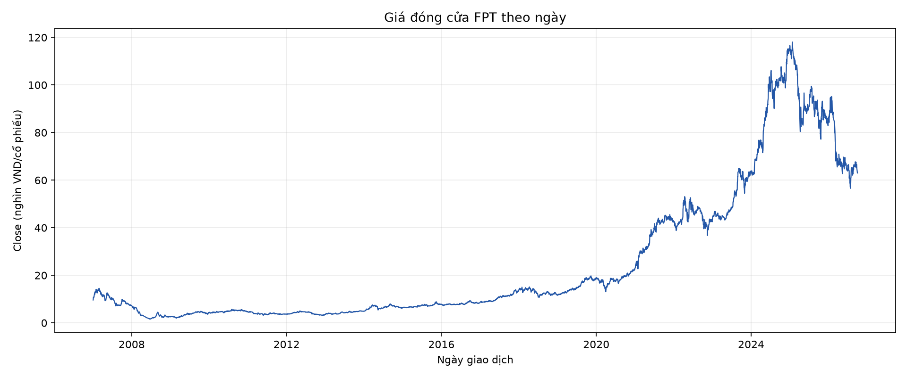
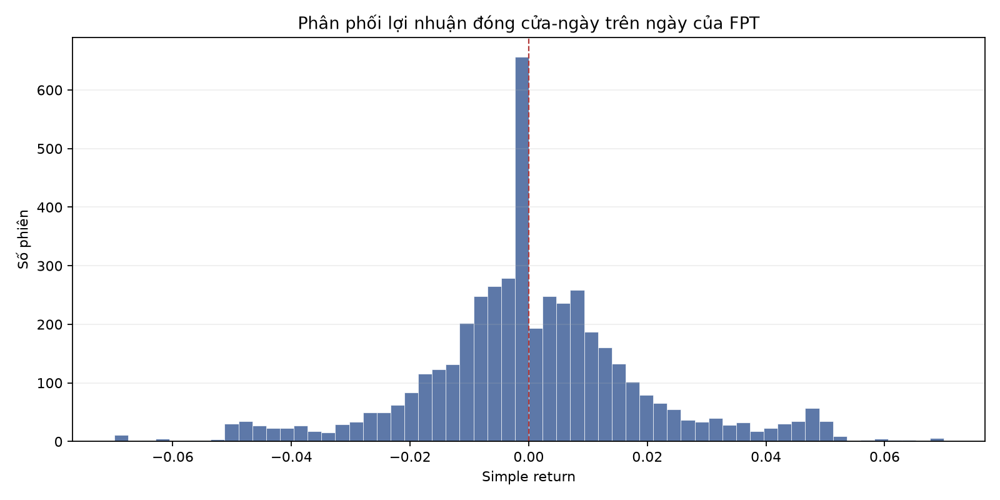
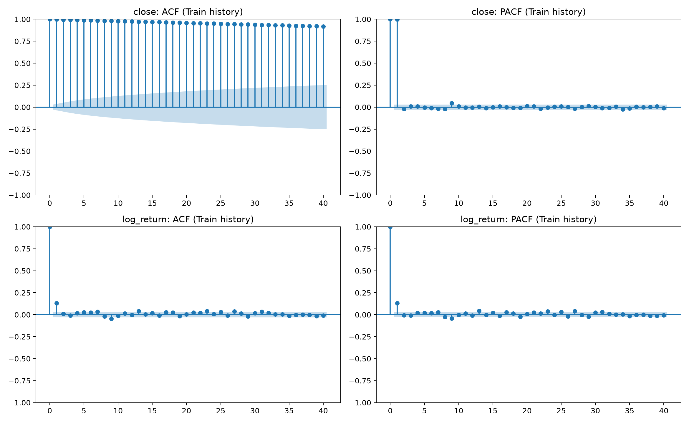
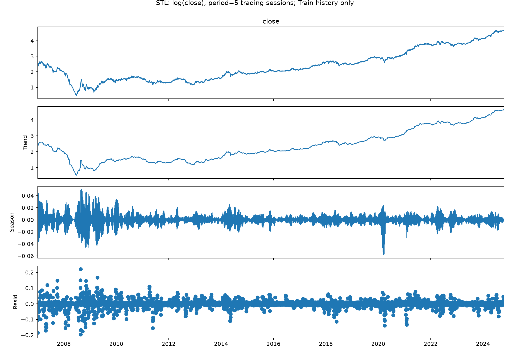
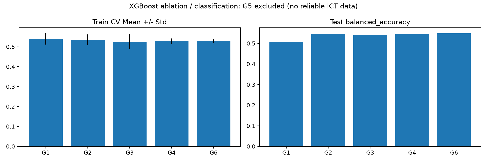
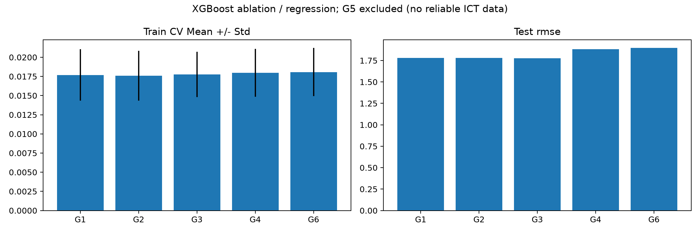
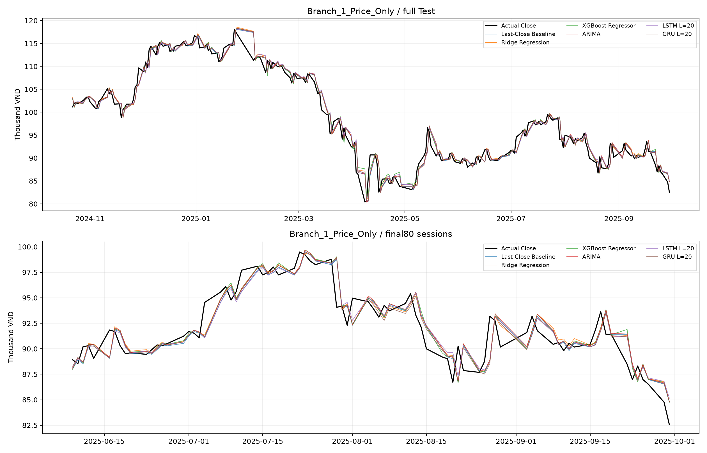
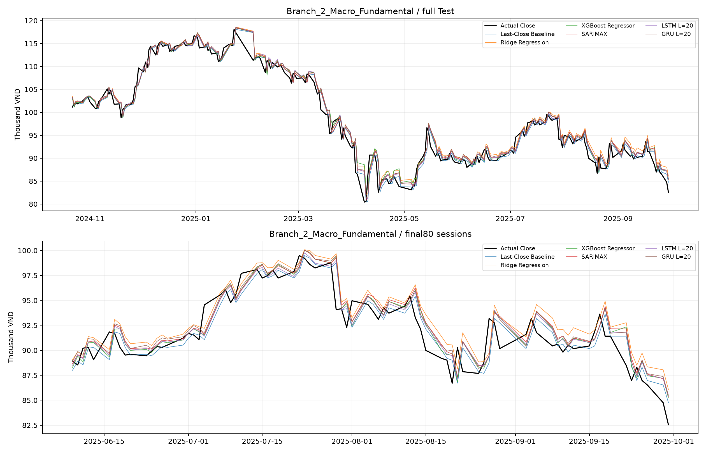
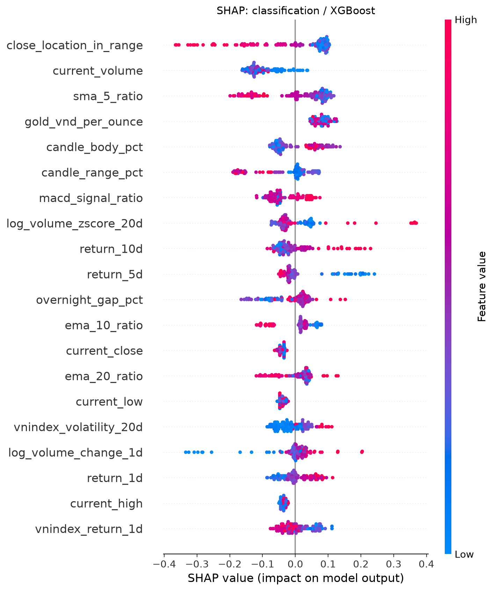
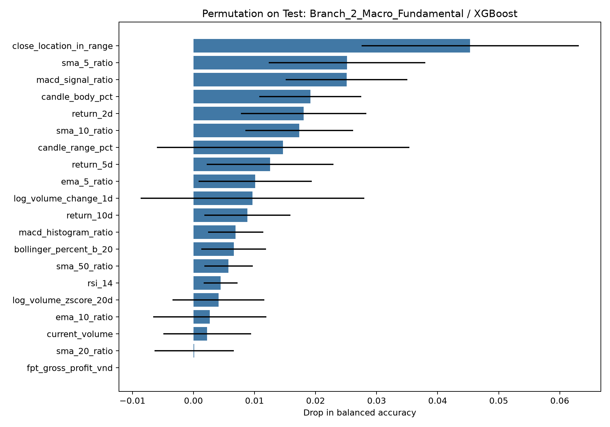

# Báo cáo CS114: Dự báo FPT ở phiên kế tiếp

Biên tập ngày 10/11/2026 từ kết quả thực nghiệm đã cố định. Dữ liệu nghiên cứu kết thúc ngày **30/09/2025**. Đợt rà soát này thay cách trình bày và tổ chức code, giữ nguyên số liệu thực nghiệm.

## Tóm tắt các phát hiện chính (Key Findings)

1. **Dự báo log return giúp mô hình cây làm việc trên thang biến động tương đối.** Ở Nhánh 1, MAE giá của Random Forest, XGBoost và HistGradientBoosting lần lượt là **1,2593; 1,2621; 1,3017 nghìn VND**, gần ARIMA (**1,2392**) và Ridge (**1,2455**). Giá dự báo được neo vào giá phiên hiện tại bằng công thức nhân với `exp(log return dự báo)`, thay vì buộc cây xuất trực tiếp một mức giá đã gặp trong Train.
2. **Thêm dữ liệu đa nguồn có tác động khác nhau lên hai bài toán.** Trong ablation XGBoost, G3 → G6 đưa Balanced Accuracy Test từ **54,03% lên 54,88%** (+0,85 điểm phần trăm), nhưng RMSE log return tăng từ **0,018754 lên 0,020089**. Trên CV, Balanced Accuracy cũng tăng nhẹ từ **52,57% lên 52,83%**. Đây là kết quả phù hợp với việc cần đánh giá riêng hướng và biên độ biến động khi dùng dữ liệu có tần suất thưa.
3. **Log return có bằng chứng mạnh chống nghiệm đơn vị nhưng chưa đáp ứng giả thuyết dừng mức của KPSS.** Trên lịch sử Train, ADF có **p ≈ 1,05 × 10⁻¹⁷**, còn KPSS có **p ≈ 0,0164**. Hai giả thuyết gốc đều bị bác bỏ ở mức 5%; cần phân biệt kiểm tra nghiệm đơn vị với kiểm tra tính dừng quanh một mức trung bình.

## 1. Bài toán, dữ liệu và đặc trưng

Tại cuối phiên `t`, hệ thống dự báo hướng Tăng/Giảm và lợi nhuận logarit của phiên quan sát kế tiếp. Nhãn hướng là 1 nếu `C(t+1) > C(t)`, 0 nếu giảm; phiên đứng giá được bỏ riêng khi chấm phân loại. Hồi quy giữ cả phiên đứng giá:

$$r_{t+1}=\ln(C_{t+1}/C_t),\qquad \widehat C_{t+1}=C_t\exp(\widehat r_{t+1}).$$

Giá có đơn vị **nghìn VND/cổ phiếu**; khối lượng là số cổ phiếu. Ví dụ, log return dự báo bằng 0 tương ứng giữ nguyên giá phiên hiện tại.

### Kiểm toán và nguồn dữ liệu

| Nội dung | Kết quả |
|---|---|
| Giá FPT | 4.671 phiên, 02/01/2007–30/09/2025; VCI qua vnstock |
| Ô thiếu / ngày trùng | 0 / 0 |
| Volume bằng 0 / OHLC bất nhất | 2 / 3; các dòng bất nhất thuộc năm 2007 và 2009 |
| Chuyển tiếp Tăng / Giảm / Đứng giá | 2.118 / 2.074 / 478 |
| VN-Index | 4.635 phiên cùng khoảng ngày; nguồn DNSE, đơn vị điểm |
| USD/VND, vàng và CPI | Bản xuất Investing.com; vàng quốc tế quy đổi thành VND/ounce |
| GDP | GDP năm danh nghĩa bằng USD, nguồn World Bank |
| Tài chính FPT | Doanh thu thuần, lợi nhuận gộp, EBIT, lợi nhuận sau thuế cổ đông công ty mẹ, cổ phiếu lưu hành; nguồn VCI và công bố doanh nghiệp |
| Ngành ICT | 33 snapshot từ 06/02/2016 đến 24/07/2025; loại 3 biến ngành khỏi mô hình chính |

Giữ bản xuất nguồn để chuẩn hóa lại offline. Dữ liệu ngày và CPI được dùng sau ngày quan sát/công bố 1 ngày lịch; báo cáo quý trễ 45 ngày, GDP năm trễ 180 ngày. Chỉ ghép lùi từ ngày có hiệu lực; dữ liệu quá hạn bị xem là thiếu. Ngưỡng tuổi dữ liệu lần lượt là 10 ngày cho chuỗi ngày, 65 ngày cho CPI, 150 ngày cho quý và 550 ngày cho GDP. Chi tiết nguồn, đơn vị và phép căn thang giá nằm trong [tài liệu dữ liệu](../data/README.md), [kiểm toán](../reports/data_audit.json) và [lineage](../reports/data_lineage.json).

Nhánh 1 có **32 biến**: 23 chỉ báo từ close/volume, 4 đặc trưng nến và 5 trường OHLCV hiện tại. Nhánh 2 có **43 biến**, thêm 11 biến thị trường, vĩ mô và tài chính. VN-Index đại diện thị trường chung. Kiểm toán ngành ở [sector_coverage_audit.json](../reports/sector_coverage_audit.json).

## 2. Thiết kế thực nghiệm và chống rò rỉ dữ liệu

Cả hai nhánh, các nhóm ablation và các độ dài cửa sổ dùng cùng **1.559 mẫu có nhãn**. Điều kiện chọn mẫu là có đủ 60 phiên liên tiếp với các đầu vào cần thiết. Lịch sử bối cảnh vẫn giữ chỉ số phiên gốc để mạng tuần tự không nối hai ngày cách nhau bởi khoảng thiếu dữ liệu thành hai phiên liền nhau.

| Tập | Số mẫu hồi quy | Khoảng ngày mục tiêu |
|---|---:|---|
| Train, 85% đầu | 1.325 | 03/04/2019–21/10/2024 |
| Test, 15% cuối | 234 | 22/10/2024–30/09/2025 |

Test phân loại còn **227 phiên**, gồm 112 phiên Tăng và 115 phiên Giảm. Ngày chia được xác định trước khi bỏ nhãn đứng giá. Nhãn `next_close`, `next_log_return` và `direction` được giữ ngoài danh sách đầu vào.

Trong Train, `TimeSeriesSplit` tạo **5 fold**, cửa sổ học mở rộng và chừa **1 hàng** ở ranh giới (`gap=1`). Mỗi lượt học lại bộ chuẩn hóa trong Train của fold; mô hình tuyến tính đặt `StandardScaler` trong `Pipeline`. Chọn hướng theo **Balanced Accuracy CV cao nhất**, chọn hồi quy theo **RMSE log return CV thấp nhất**. Sau đó fit toàn bộ Train và chấm Test. CV Mean ± Std là trung bình và độ lệch chuẩn mẫu qua 5 fold (`ddof=1`).

`models/evaluation/` giữ mô hình chỉ học Train để chấm điểm. `models/best_*.joblib` học lại toàn bộ nhãn sau khi cố định đánh giá để tạo dự báo mới nhất. Mốc thời gian và cấu hình nằm trong [split_metadata.json](../reports/split_metadata.json) và [evaluation_manifest.json](../reports/evaluation_manifest.json).

### Mô hình và lưới tham số

| Họ | Thiết lập được khảo sát trên Train |
|---|---|
| Baseline | Majority đoán lớp phổ biến; Last-Close dự báo log return bằng 0 |
| Tuyến tính | Logistic: C = 0,1 hoặc 1, cân bằng lớp; Linear; Ridge: alpha = 10 hoặc 100 |
| SVM | SVC: C = 0,1 hoặc 1; SVR: C = 0,01 hoặc 0,1, epsilon = 0,002 |
| Random Forest | 120 cây, độ sâu 3 hoặc 6, tối thiểu 15 mẫu ở lá |
| XGBoost | 120 cây, độ sâu 2 hoặc 3, tốc độ học 0,04; tỷ lệ lấy mẫu hàng/cột 0,85; min_child_weight = 8; reg_lambda = 3 |
| HistGradientBoosting | 120 vòng, 7 hoặc 15 lá, tốc độ học 0,04, L2 = 2; tắt dừng sớm tự động |
| ARIMA / SARIMAX | Bậc (0,0,0) hoặc (1,0,0) trên log return; SARIMAX dùng 11 biến ngoại sinh, không thêm thành phần mùa vụ |
| LSTM / GRU | 1 lớp, 16 nút ẩn; L = 10, 20, 30, 60; 12 epoch; batch 64; Adam, tốc độ học 0,001; weight decay 0,0001; chặn chuẩn gradient ở 1; seed 42; CPU |

Hồi quy mạng tuần tự nhân mục tiêu với 100 trong tối ưu rồi chia lại khi xuất dự báo. SVC xuất điểm biên để tính ROC-AUC. ARIMA/SARIMAX dự báo log return rồi suy ra hướng bằng dấu của dự báo; điểm này cũng dùng cho AUC. Mô hình thống kê giữ tham số đã fit, chỉ cập nhật trạng thái sau khi quan sát kết quả từng phiên; imputer và scaler ngoại sinh chỉ học từ lịch sử Train. **40/40 lượt fit thống kê trong CV hội tụ.**

## 3. Phân tích chuỗi thời gian

Kiểm định chính dùng lịch sử giá đến cuối Train: 4.437 mức giá và 4.436 log return. Mô tả toàn snapshot được lưu riêng trong CSV, không dùng để chọn lưới mô hình.

| Chuỗi | Kiểm định | Thống kê | p-value | Kết luận ở mức 5% |
|---|---|---:|---:|---|
| Close | ADF | 4,8215 | 1,0000 | Không bác bỏ nghiệm đơn vị |
| Close | KPSS | 6,7466 | < 0,01 | Bác bỏ tính dừng mức |
| Log return | ADF | −10,1030 | 1,05 × 10⁻¹⁷ | Bác bỏ nghiệm đơn vị |
| Log return | KPSS | 0,6688 | 0,0164 | Bác bỏ tính dừng mức |

ADF có giả thuyết gốc là chuỗi có nghiệm đơn vị. KPSS với `regression="c"` có giả thuyết gốc là chuỗi dừng quanh một hằng số. Vì vậy cùng p-value nhỏ dẫn đến hai kết luận khác nhau. Với close, KPSS trả giá trị biên 0,01 và cảnh báo p-value thực còn nhỏ hơn. Tham khảo định nghĩa trong tài liệu [ADF](https://www.statsmodels.org/stable/generated/statsmodels.tsa.stattools.adfuller.html) và [KPSS](https://www.statsmodels.org/stable/generated/statsmodels.tsa.stattools.kpss.html).

ACF/PACF vẽ 40 độ trễ với khoảng tham chiếu 95%. Phân rã STL dùng log(close) trên Train và chu kỳ quy ước 5 phiên; các thành phần xu hướng, mùa vụ và phần dư chỉ phục vụ mô tả.

## 4. Bảng đối sánh chính

Mỗi nhánh có **9 đại diện cho mỗi bài toán**, chọn hoàn toàn bằng CV trong Train. LSTM/GRU giữ một L tốt nhất; hồi quy gộp Linear và Ridge thành một họ và CV chọn Ridge ở cả hai nhánh. Cấu hình còn lại vẫn giữ nguyên trong [30 dòng phân loại](../reports/classification_test_metrics.csv), [32 dòng hồi quy](../reports/regression_test_metrics.csv) và [CV đầy đủ](../reports/cv_summary.csv).

### 4.1. Phân loại hướng

Acc = Accuracy; BA = Balanced Accuracy; P/R/F1 tính cho lớp Tăng. AUC được biểu diễn theo thang phần trăm, ví dụ 55,06% tương ứng 0,5506. Các cột Test chỉ được ghép sau bước chọn đại diện. Dấu **[CV chọn]** đánh dấu mô hình được chọn cho công cụ dự báo, không phải mô hình có điểm Test cao nhất.

**Nhánh 1 — Giá và kỹ thuật**

| Mô hình | CV BA ± Std | Test Acc | Test BA | P | R | F1 | AUC |
| --- | --- | --- | --- | --- | --- | --- | --- |
| Majority Baseline | 50.00% ± 0.00% | 49.34% | 50.00% | 49.34% | 100.00% | 66.08% | 50.00% |
| Logistic Regression | 53.47% ± 2.26% | 57.27% | 57.21% | 57.28% | 52.68% | 54.88% | 56.77% |
| SVC | 51.32% ± 3.54% | 48.90% | 49.08% | 48.61% | 62.50% | 54.69% | 49.80% |
| Random Forest | 51.96% ± 1.75% | 52.42% | 52.29% | 52.22% | 41.96% | 46.53% | 59.01% |
| XGBoost | 52.57% ± 3.64% | 53.74% | 54.03% | 52.15% | 75.89% | 61.82% | 52.43% |
| HistGradientBoosting **[CV chọn]** | 55.05% ± 1.90% | 52.86% | 52.92% | 52.03% | 57.14% | 54.47% | 55.06% |
| ARIMA | 50.06% ± 0.13% | 48.90% | 49.54% | 49.11% | 98.21% | 65.48% | 47.25% |
| LSTM L=30 | 52.24% ± 3.44% | 54.19% | 54.34% | 52.86% | 66.07% | 58.73% | 53.18% |
| GRU L=20 | 54.19% ± 2.66% | 58.15% | 58.24% | 56.59% | 65.18% | 60.58% | 56.29% |

**Nhánh 2 — Giá, thị trường, vĩ mô và tài chính**

| Mô hình | CV BA ± Std | Test Acc | Test BA | P | R | F1 | AUC |
| --- | --- | --- | --- | --- | --- | --- | --- |
| Majority Baseline | 50.00% ± 0.00% | 49.34% | 50.00% | 49.34% | 100.00% | 66.08% | 50.00% |
| Logistic Regression | 51.43% ± 1.16% | 50.22% | 50.72% | 49.75% | 88.39% | 63.67% | 50.09% |
| SVC | 51.41% ± 3.32% | 50.66% | 51.05% | 50.00% | 80.36% | 61.64% | 49.34% |
| Random Forest | 52.41% ± 2.49% | 55.51% | 55.45% | 55.34% | 50.89% | 53.02% | 59.56% |
| XGBoost | 52.83% ± 0.96% | 54.63% | 54.88% | 52.87% | 74.11% | 61.71% | 52.20% |
| HistGradientBoosting | 53.43% ± 2.61% | 51.98% | 52.19% | 51.01% | 67.86% | 58.24% | 52.91% |
| SARIMAX | 49.88% ± 2.54% | 49.34% | 50.00% | 49.34% | 100.00% | 66.08% | 51.79% |
| LSTM L=20 | 50.98% ± 1.95% | 48.90% | 49.45% | 49.04% | 91.07% | 63.75% | 51.69% |
| GRU L=20 | 52.14% ± 2.52% | 49.34% | 49.92% | 49.30% | 93.75% | 64.62% | 51.45% |

Mô hình được chọn là **HistGradientBoosting Nhánh 1**, CV BA **55,05% ± 1,90%**, Test Accuracy **52,86%**, BA **52,92%**. GRU L = 20 ở cùng nhánh có BA Test 58,24%, nhưng CV BA thấp hơn nên không thay thế lựa chọn đã khóa.

Confusion matrix của mô hình được chọn, hàng là thực tế và cột là dự báo:

| | Dự báo Giảm | Dự báo Tăng |
|---|---:|---:|
| Thực tế Giảm | 56 (TN) | 59 (FP) |
| Thực tế Tăng | 48 (FN) | 64 (TP) |

Accuracy = (56 + 64) / 227 = 52,86%. BA = (56/115 + 64/112) / 2 = 52,92%. Toàn bộ ma trận nằm trong [confusion_matrices.csv](../reports/confusion_matrices.csv).

### 4.2. Hồi quy log return và quy đổi giá

CV và cột RMSE log dùng đơn vị log return thập phân. MAE/RMSE giá dùng **nghìn VND/cổ phiếu**, làm tròn 4 chữ số. DA là tỷ lệ đúng hướng suy từ giá dự báo, tính trên 227 phiên không đứng giá. Ba số trong cột dung sai lần lượt ứng với **±0,5% / ±1,0% / ±2,0%** so với giá thật trên 234 phiên. MAPE và dung sai được tính trên giá dương đã khôi phục; không chia sai số cho log return gần 0.

**Nhánh 1 — Giá và kỹ thuật**

| Mô hình | CV RMSE log ± Std | Test RMSE log | MAE giá | RMSE giá | MAPE | DA | Dung sai 0,5 / 1 / 2% |
| --- | --- | --- | --- | --- | --- | --- | --- |
| Last-Close Baseline | 0.017250 ± 0.003429 | 0.018398 | 1.2250 | 1.7398 | 1.27% | 0.00% | 32.91% / 54.70% / 81.62% |
| Ridge Regression | 0.017612 ± 0.003467 | 0.018468 | 1.2455 | 1.7534 | 1.29% | 52.42% | 30.77% / 52.99% / 81.20% |
| SVR | 0.017427 ± 0.003505 | 0.019316 | 1.3146 | 1.8323 | 1.37% | 47.14% | 26.07% / 52.56% / 80.77% |
| Random Forest | 0.017391 ± 0.003317 | 0.018807 | 1.2593 | 1.7811 | 1.31% | 48.02% | 32.05% / 54.27% / 80.34% |
| XGBoost | 0.017750 ± 0.002956 | 0.018754 | 1.2621 | 1.7774 | 1.31% | 51.98% | 31.62% / 52.56% / 81.20% |
| HistGradientBoosting | 0.017941 ± 0.003198 | 0.019546 | 1.3017 | 1.8547 | 1.36% | 53.30% | 33.76% / 52.14% / 76.50% |
| ARIMA **[CV chọn]** | 0.017192 ± 0.003481 | 0.018520 | 1.2392 | 1.7537 | 1.29% | 48.90% | 33.76% / 54.27% / 81.62% |
| LSTM L=60 | 0.017470 ± 0.003361 | 0.018682 | 1.2537 | 1.7700 | 1.30% | 52.86% | 30.34% / 55.13% / 81.62% |
| GRU L=60 | 0.017716 ± 0.003444 | 0.018371 | 1.2213 | 1.7384 | 1.27% | 54.19% | 33.76% / 54.27% / 82.05% |

**Nhánh 2 — Giá, thị trường, vĩ mô và tài chính**

| Mô hình | CV RMSE log ± Std | Test RMSE log | MAE giá | RMSE giá | MAPE | DA | Dung sai 0,5 / 1 / 2% |
| --- | --- | --- | --- | --- | --- | --- | --- |
| Last-Close Baseline | 0.017250 ± 0.003429 | 0.018398 | 1.2250 | 1.7398 | 1.27% | 0.00% | 32.91% / 54.70% / 81.62% |
| Ridge Regression | 0.019341 ± 0.004452 | 0.021247 | 1.4893 | 2.0011 | 1.57% | 48.90% | 26.07% / 41.45% / 73.50% |
| SVR | 0.017348 ± 0.003440 | 0.019303 | 1.3198 | 1.8309 | 1.37% | 48.02% | 27.78% / 48.72% / 79.91% |
| Random Forest | 0.017437 ± 0.003327 | 0.018959 | 1.2699 | 1.7943 | 1.32% | 48.90% | 30.77% / 54.70% / 80.34% |
| XGBoost | 0.018068 ± 0.003150 | 0.020089 | 1.3671 | 1.8966 | 1.43% | 48.02% | 27.78% / 48.29% / 76.92% |
| HistGradientBoosting | 0.018098 ± 0.003245 | 0.021395 | 1.4856 | 2.0203 | 1.56% | 48.90% | 24.79% / 45.30% / 73.08% |
| SARIMAX | 0.018948 ± 0.004381 | 0.019311 | 1.3093 | 1.8247 | 1.37% | 49.34% | 31.20% / 51.71% / 76.50% |
| LSTM L=10 | 0.017514 ± 0.003480 | 0.019184 | 1.3050 | 1.8186 | 1.36% | 48.46% | 29.91% / 50.85% / 80.77% |
| GRU L=60 | 0.017273 ± 0.003338 | 0.019784 | 1.3617 | 1.8736 | 1.42% | 48.02% | 28.21% / 45.73% / 76.07% |

CV chọn **ARIMA Nhánh 1** với RMSE log **0,017192 ± 0,003481**. Test có MAE **1,2392**, RMSE giá **1,7537** và dung sai ±1% **54,27%**. Last-Close có MAE thấp hơn (**1,2250**) nhưng DA bằng **0,00%**: dự báo đứng giá không thể trùng chiều của các phiên thật sự tăng hoặc giảm. Đây là lý do hai bài toán cần được chấm riêng.

## 5. Khảo sát độ dài cửa sổ trượt

Bảng dưới chỉ dùng **CV Mean ± Std** để so L. Dòng phân loại trình bày BA theo %, dòng hồi quy trình bày RMSE log return thập phân. Ô in đậm có trung bình CV tốt nhất trong hàng; Std được đọc riêng để đánh giá độ dao động giữa các fold.

| Nhánh, mạng | Độ đo CV | L = 10 | L = 20 | L = 30 | L = 60 |
| --- | --- | --- | --- | --- | --- |
| N1, LSTM | Hướng, BA ↑ | 51.59% ± 3.56% | 51.94% ± 3.62% | **52.24% ± 3.44%** | 51.46% ± 3.98% |
| N1, GRU | Hướng, BA ↑ | 52.91% ± 2.33% | **54.19% ± 2.66%** | 54.03% ± 2.59% | 53.49% ± 2.13% |
| N2, LSTM | Hướng, BA ↑ | 50.07% ± 1.00% | **50.98% ± 1.95%** | 50.87% ± 1.90% | 50.48% ± 2.17% |
| N2, GRU | Hướng, BA ↑ | 51.56% ± 2.16% | **52.14% ± 2.52%** | 51.83% ± 2.29% | 51.30% ± 2.14% |
| N1, LSTM | Lợi nhuận, RMSE ↓ | 0.017494 ± 0.003384 | 0.017494 ± 0.003381 | 0.017495 ± 0.003375 | **0.017470 ± 0.003361** |
| N1, GRU | Lợi nhuận, RMSE ↓ | 0.017790 ± 0.003465 | 0.017791 ± 0.003469 | 0.017781 ± 0.003465 | **0.017716 ± 0.003444** |
| N2, LSTM | Lợi nhuận, RMSE ↓ | **0.017514 ± 0.003480** | 0.017545 ± 0.003476 | 0.017514 ± 0.003457 | 0.017530 ± 0.003425 |
| N2, GRU | Lợi nhuận, RMSE ↓ | 0.017311 ± 0.003313 | 0.017291 ± 0.003306 | 0.017282 ± 0.003335 | **0.017273 ± 0.003338** |

**Nhận xét trực tiếp:** với phân loại, L = 20 được chọn cho 3/4 tổ hợp nhánh–mạng; LSTM Nhánh 1 chọn L = 30. Với hồi quy, L = 60 lại tốt nhất ở 3/4 tổ hợp, còn LSTM Nhánh 2 chọn L = 10 với chênh lệch rất nhỏ so với L = 30. Cửa sổ ngắn hơn có thể giảm phần lịch sử ít liên quan đến hướng ngày kế tiếp, còn cửa sổ dài có thể giúp làm mượt ước lượng biên độ. Các khả năng này là cách diễn giải để kiểm tra tiếp, không thay thế bảng số. Không thể kết luận L = 10 hoặc 20 luôn ổn định hơn L = 60 từ thực nghiệm hiện tại.

## 6. Ablation theo nhóm đầu vào

Giữ XGBoost, cùng các ngày đánh giá và cùng quy tắc chọn tham số bằng CV; chỉ đổi nhóm đầu vào. G5 được ghi rõ là loại khỏi thí nghiệm. Nhánh 1 tương ứng G3, Nhánh 2 tương ứng G6.

| Nhóm | Đầu vào tích lũy | Biến | CV BA ± Std | Test BA | CV RMSE log ± Std | Test RMSE log |
| --- | --- | --- | --- | --- | --- | --- |
| G1 | Giá/khối lượng và biến trễ | 9 | 53.90% ± 2.81% | 50.70% | 0.017692 ± 0.003372 | 0.018808 |
| G2 | + chỉ báo kỹ thuật | 25 | 53.49% ± 2.69% | 54.73% | 0.017581 ± 0.003254 | 0.018784 |
| G3 | + OHLC và nến | 32 | 52.57% ± 3.64% | 54.03% | 0.017750 ± 0.002956 | 0.018754 |
| G4 | + thị trường và vĩ mô | 38 | 52.77% ± 1.37% | 54.47% | 0.017971 ± 0.003144 | 0.019921 |
| G5 | Ngành ICT: excluded | — | — | — | — | — |
| G6 | + tài chính FPT | 43 | 52.83% ± 0.96% | 54.88% | 0.018068 ± 0.003150 | 0.020089 |

G1 → G2 tăng BA Test từ **50,70% lên 54,73%**; G2 → G3 giảm nhẹ về **54,03%**. G3 → G6 tăng **0,85 điểm phần trăm**, đồng thời RMSE log Test tăng khoảng **7,12%**. RMSE đo căn trung bình bình phương sai số, không đồng nhất với phương sai sai số; báo cáo dùng đúng tên độ đo này. Nhóm dữ liệu bổ trợ có ích cho hướng ở mức nhỏ trong so sánh này, nhưng chưa cải thiện biên độ lợi nhuận.

## 7. Đường dự báo và giải thích mô hình

Mỗi điểm trên đường là dự báo một phiên sau khi có dữ liệu phiên trước. Khung trên bao phủ Test; khung dưới phóng to 80 phiên cuối. Hình giữ LSTM/GRU L = 20 làm cấu hình minh họa cố định; đại diện chọn bằng CV nằm trong bảng chính.

Giải thích dùng mô hình tốt nhất theo CV trong hai họ cây được hỗ trợ: **XGBoost Nhánh 2** cho phân loại và **Random Forest Nhánh 1** cho hồi quy. SHAP sử dụng tối đa 100 mẫu Train làm dữ liệu nền và 150 mẫu Test để giải thích. Permutation importance lặp 10 lần với seed 42, dùng BA cho hướng và điểm âm RMSE log return cho hồi quy. Sai lệch cộng tính SHAP tối đa lần lượt khoảng 2,52 × 10⁻⁷ và 1,06 × 10⁻¹⁰.

Ở phân loại, ba biến đứng đầu theo trung bình trị tuyệt đối SHAP là **vị trí close trong biên độ nến**, **volume hiện tại** và **SMA 5 ratio**. Permutation cho vị trí close đứng đầu, giảm trung bình **4,53 điểm phần trăm BA** khi đảo cột này. Hai cách đo trả lời hai câu hỏi khác nhau: SHAP phân bổ đầu ra, còn permutation chấm mức giảm hiệu năng khi phá thông tin của cột.

Các bảng và ảnh hồi quy nằm trong `reports/` và `figures/`; cấu hình giải thích ghi tại [explainability_summary.json](../reports/explainability_summary.json).

## 8. Tái lập và cấu trúc chương trình

| Thành phần | Trách nhiệm |
|---|---|
| `fetch_data.py`, `fetch_supplemental.py` | Kiểm định/chuẩn hóa nguồn và ghép theo ngày có hiệu lực |
| `features.py`, `prepare.py` | Tạo biến quá khứ, nhãn phiên sau và tập ngày chung |
| `eda.py`, `time_series_analysis.py` | Kiểm toán dữ liệu và phân tích chuỗi thời gian |
| `train.py`, `sequence_models.py` | Danh mục mô hình, CV, Test, mạng tuần tự và mô hình thống kê |
| `benchmark_tables.py` | Chọn 9 đại diện mỗi nhánh bằng CV rồi ghép điểm Test để trình bày |
| `explain.py`, `predict.py` | Giải thích mô hình và dự báo từ artefact đã lưu |
| `tests/`, `notebooks/` | Kiểm thử logic và 10 notebook có giải thích từng bước |

Lệnh tái lập nằm trong [README](../README.md). Kết quả dự báo cuối từ snapshot 30/09/2025: close đầu vào **82,54**; xác suất lớp Tăng **52,78%**; log return dự báo **0,00033714**; giá quy đổi **82,5678 nghìn VND**. Đây là đầu ra của hai mô hình được chọn riêng. Phiên mục tiêu là phiên giao dịch kế tiếp sau ngày snapshot, không tự cộng một ngày lịch.

Kiểm định sau refactor: **49/49 kiểm thử đạt**, **10/10 notebook chạy trọn vẹn**; 16 CSV kết quả khớp trong dung sai 1e-10 và 6 JSON kiểm tra giống hệt. Dữ liệu và mô hình chính thức giữ nguyên. Biên dịch Proposal không có cảnh báo căn lề; chi tiết tại [polish_validation.json](../reports/polish_validation.json).

## Giới hạn nghiên cứu & Hướng phát triển

1. **Phạm vi kiểm chứng:** một mã cổ phiếu, một mốc Test và một seed cho mạng học sâu. Các ngày Test đã từng được xem ở phiên bản cũ; lần chạy này loại Test khỏi lựa chọn mô hình, nhưng chưa phải một giai đoạn hoàn toàn chưa từng quan sát. Cần khóa mô hình và kiểm chứng ở giai đoạn mới, lặp nhiều seed, mở rộng nhiều mã và báo cáo độ bất định.
2. **Xuất xứ theo thời điểm:** độ trễ quý 45 ngày và GDP 180 ngày là giả định khi thiếu lịch công bố; giá/GDP có thể đã được điều chỉnh lại. Cần bổ sung ngày công bố thực và phiên bản dữ liệu lịch sử. Loại nguồn ICT thiếu độ phủ; không suy diễn kết quả cho ngành chưa có dữ liệu.
3. **Khả năng so sánh:** mô hình thống kê sử dụng các phiên bối cảnh bên trong khoảng Train để giữ chuỗi liên tục, trong khi mô hình bảng học các hàng đủ đầu vào. Cùng ngày chấm không có nghĩa số quan sát fit bằng nhau. CV có các fold phụ thuộc thời gian; Std không phải khoảng tin cậy độc lập.
4. **Diễn giải thực nghiệm:** chưa có thử nghiệm ghép cặp giữ nguyên mọi điều kiện để định lượng riêng mức giảm MAE do đổi từ giá sang log return. Cách đổi mục tiêu khắc phục ràng buộc thang giá đầu ra của cây, không bảo đảm giải quyết mọi dạng ngoại suy. Chênh lệch ablation và SHAP/permutation mô tả hành vi dự báo, **không chứng minh quan hệ nhân quả**. Biến tương quan chia sẻ tín hiệu; đảo cột cũng phá cấu trúc thời gian. Cần lặp trên nhiều giai đoạn và bổ sung permutation theo khối.
5. **Chẩn đoán chuỗi:** KPSS ở đây kiểm tra tính dừng mức, không phải tính dừng chặt và không trực tiếp xác nhận cụm biến động. Muốn kết luận volatility clustering cần thêm ACF của lợi nhuận bình phương/trị tuyệt đối hoặc kiểm định ARCH. STL với chu kỳ 5 chỉ là mô tả, chưa xác lập mùa vụ kinh tế.
6. **Ứng dụng:** dự án chưa tính phí giao dịch, trượt giá hoặc kiểm định chiến lược. Xác suất lớp Tăng chưa được đánh giá hiệu chỉnh xác suất. Sản phẩm phục vụ học tập và phân tích, **không phải khuyến nghị đầu tư**. Hướng phát triển là đánh giá hiệu chỉnh, chi phí thực tế và dữ liệu ngoài mẫu trước khi xem xét ứng dụng.
