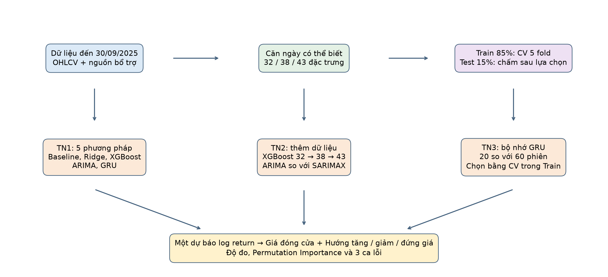
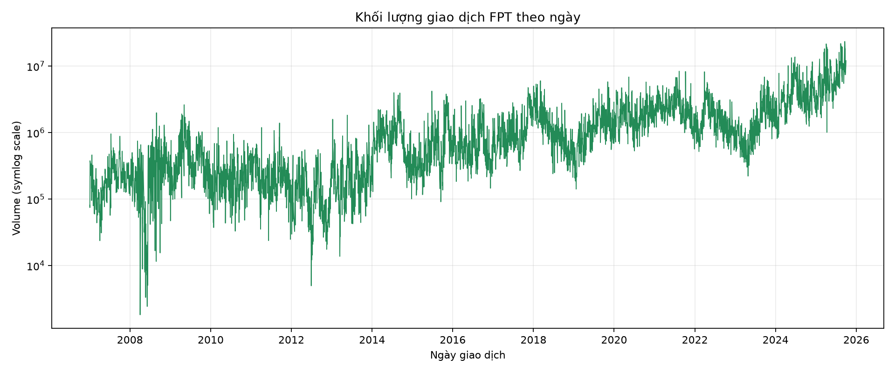
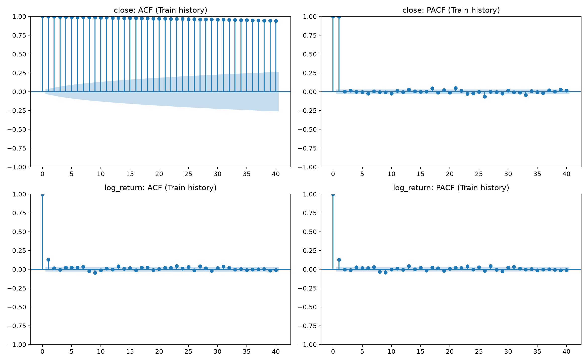
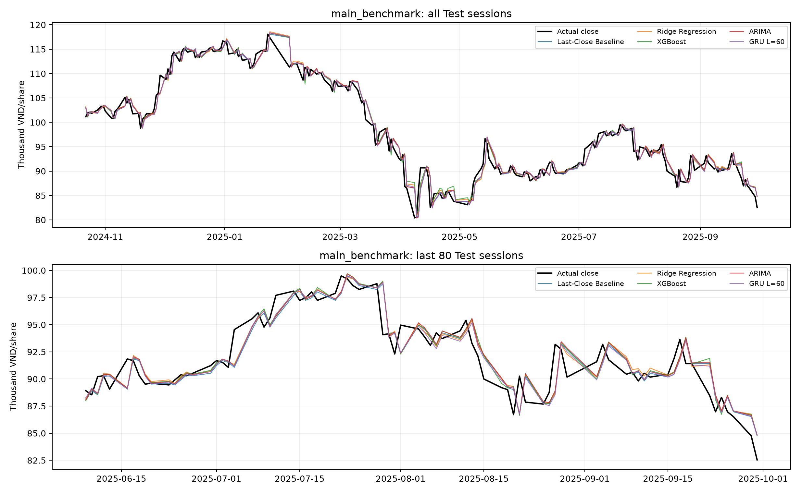
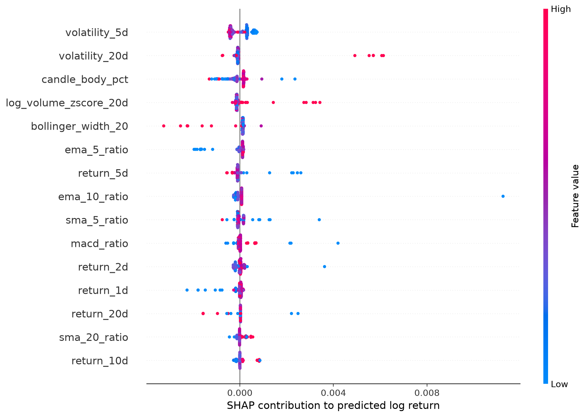

# Dự báo biến động cổ phiếu FPT ở phiên kế tiếp bằng học máy và mô hình chuỗi thời gian

Báo cáo đồ án CS114. Cửa sổ đánh giá chung theo ngày mục tiêu từ 07/08/2013 đến 30/09/2025, gồm 3.031 nhãn. [Toàn bộ kết quả Test](../reports/all_test_metrics.csv)

## Kết quả chính

- **ARIMA(0,0,0) đứng đầu khi chọn trên Train** với RMSE log return trung bình 0,015860. Trên Test, MAE giá của ARIMA là 1,1106 nghìn VND/cổ phiếu, sát Last-Close (1,1097). XGBoost 32 biến có RMSE giá thấp nhất (1,5610).
- **Dữ liệu thị trường và vĩ mô cải thiện tỷ lệ đúng hướng trong lần thử XGBoost.** Số dự báo đúng tăng từ 233 lên 242 trên 440 phiên đổi giá (52,95% → 55,00%). Sai số giá tăng nhẹ, và thêm bốn chỉ tiêu tài chính đưa tỷ lệ đúng hướng về 52,95%.
- **Cửa sổ GRU 60 phiên cho RMSE log return CV thấp hơn nhẹ cửa sổ 20 phiên.** Hai cấu hình có MAE giá trên Test lần lượt là 1,1114 và 1,1131 nghìn VND/cổ phiếu. Mức chênh nhỏ cho thấy cần thêm bằng chứng để kết luận cửa sổ nào ổn định hơn.

## 1. Bài toán

Mỗi hàng dùng thông tin có vào cuối phiên $t$ để dự báo lợi nhuận logarit và suy ra giá đóng cửa của phiên quan sát kế tiếp $t+1$.

$$r_{t+1}=\ln(C_{t+1}/C_t),\qquad \widehat C_{t+1}=C_t\exp(\widehat r_{t+1}).$$

Mọi mô hình dùng cùng mục tiêu `next_log_return`. Dấu dương, âm và bằng 0 lần lượt tương ứng với tăng, giảm và đứng giá. Ví dụ giá hôm nay là 100 nghìn VND/cổ phiếu, log return dự báo `ln(1,01) ≈ 0,00995` cho giá dự báo 101 nghìn VND/cổ phiếu và hướng tăng.

## 2. Dữ liệu và căn thời điểm công bố

### 2.1. Nguồn thực tế và cách thu thập

| Nguồn | Phạm vi và quan sát | Cách dùng |
|---|---|---|
| FPT OHLCV, Vietcap qua vnstock | 4.671 hàng lưu, 2007–30/09/2025 | 4.669 phiên sau lọc lịch HOSE. Giá nghìn VND/cổ phiếu, khối lượng tính bằng cổ phiếu. |
| VN-Index, DNSE và CafeF | 4.668 giá đóng cửa sau bổ sung 33 phiên và sửa 16 mức giá | Tính log return và độ biến động 20 phiên. |
| USD/VND, Investing.com | 4.893 quan sát, 2007–30/09/2025 | VND trên một USD. |
| XAU/USD, bản xuất Investing.com | 4.858 giá ngày, 01/01/2007–30/09/2025 | Nhân với tỷ giá để có VND mỗi ounce vàng quốc tế. |
| CPI năm, World Bank WDI `FP.CPI.TOTL.ZG` | 20 năm 2005–2024 | Tỷ lệ lạm phát cả năm, đơn vị %. |
| GDP năm, World Bank WDI `NY.GDP.MKTP.CD` | 20 năm 2005–2024 | GDP danh nghĩa cả năm, USD hiện hành. |
| Kết quả kinh doanh FPT, Vietcap qua vnstock | 50 quý liên tục 2013Q1–2025Q2 trong phạm vi dùng | Doanh thu thuần, lợi nhuận gộp, EBIT và lợi nhuận sau thuế của cổ đông công ty mẹ. |

Đối chiếu lịch từ năm 2013 cho thấy DNSE thiếu 33 phiên có giao dịch FPT. Dùng giá đóng cửa CafeF cho các phiên thiếu và 16 mức khác nhau trong các khoảng đối chiếu năm 2020. Báo cáo phiên của các công ty chứng khoán xác nhận các mức CafeF được kiểm tra chéo, như 869,91 điểm ngày 15/07/2020 và 903,98 điểm ngày 29/09/2020. Sau hiệu chỉnh, các phiên FPT trong phạm vi từ 2013 đều có giá đóng cửa VN-Index. Hai ngày HOSE đóng cửa được loại khỏi lịch phiên trước khi tính nhãn. [Lịch sử CafeF](https://cafef.vn/du-lieu/lich-su-giao-dich-vnindex-1.chn) · [Bản tin Funan](https://funan.com.vn/en/diem-tin-giao-dich-15072020.409463) · [Xác nhận lịch HOSE](https://baochinhphu.vn/hose-giao-dich-tro-lai-sau-hai-ngay-dong-cua-102233882.htm)

Tệp vàng do nhóm cung cấp. Báo cáo tài chính thiếu dữ liệu từ quý III/2007 đến quý IV/2012, trước phạm vi thí nghiệm. [Từ điển dữ liệu](../data/README.md) · [Kiểm toán chi tiết](../reports/data_quality_review.json)

### 2.2. Ý nghĩa và giả thuyết sử dụng các biến

| Cấp dữ liệu | Nội dung | Số biến |
|---|---|---:|
| Giá và kỹ thuật | 5 OHLCV hiện tại + 23 chỉ báo + 4 biến nến | 32 |
| Thêm thị trường/vĩ mô | Thêm 2 biến VN-Index, USD/VND, vàng, CPI, GDP | 38 |
| Thêm tài chính FPT | Thêm doanh thu thuần, lợi nhuận gộp, EBIT, lợi nhuận sau thuế cổ đông mẹ | 42 |

Các biến giá mô tả trạng thái giao dịch, biến thị trường mô tả bối cảnh chung, và biến tài chính mô tả hoạt động kinh doanh. Thí nghiệm 32 → 38 → 42 kiểm tra từng bước bổ sung trên cùng cấu hình XGBoost và cùng các ngày dự báo.

| Biến bổ trợ | Ý nghĩa/đơn vị | Mục đích thử nghiệm |
|---|---|---|
| `vnindex_return_1d` | Logarithm tỷ số hai mức đóng cửa VN-Index liên tiếp trong nguồn; không có đơn vị | Mô tả hướng chuyển động thị trường gần nhất trong lịch đã đối chiếu |
| `vnindex_volatility_20d` | Độ lệch chuẩn 20 log return thị trường, chia phương sai cho 20 | Mô tả giai đoạn thị trường bình lặng hay biến động mạnh |
| `usd_vnd_rate` | VND để mua một USD; tỷ giá tăng nghĩa là cần nhiều VND hơn | Thử thông tin bối cảnh tỷ giá, có thể liên quan thu nhập/chi phí ngoại tệ |
| `gold_vnd_per_ounce` | XAU/USD nhân USD/VND đã căn thời điểm; VND/ounce vàng quốc tế | Thử thông tin từ một thị trường tài sản khác |
| `cpi_annual_inflation_pct` | Lạm phát CPI cả năm, đơn vị % | Bối cảnh lạm phát trong năm gần nhất đủ điều kiện sử dụng |
| `gdp_usd` | GDP cả năm theo USD hiện hành | Mô tả quy mô kinh tế dài hạn; không thay cho tốc độ tăng GDP thực |
| `fpt_net_revenue_vnd` | Doanh thu sau các khoản giảm trừ, VND/quý | Mô tả quy mô hoạt động kinh doanh |
| `fpt_gross_profit_vnd` | Doanh thu thuần trừ giá vốn, VND/quý | Mô tả phần còn lại sau chi phí trực tiếp, chưa trừ mọi chi phí |
| `fpt_ebit_vnd` | Lợi nhuận trước thuế + trị tuyệt đối chi phí lãi vay, VND/quý | Xấp xỉ lợi nhuận trước lãi vay và thuế theo quy tắc của dự án |
| `fpt_parent_net_profit_vnd` | Lợi nhuận sau thuế thuộc cổ đông công ty mẹ, VND/quý | Phân biệt lợi ích thuộc cổ đông FPT với phần của cổ đông không kiểm soát |

Ví dụ, doanh thu thuần 100 và giá vốn 70 cho lợi nhuận gộp 30. Lợi nhuận trước thuế 20 và lãi vay 2 cho EBIT 22 theo quy tắc dự án. Nếu lợi nhuận sau thuế là 16 và phần của cổ đông không kiểm soát là 2, phần của cổ đông công ty mẹ là 14.

### 2.3. Ngày hiệu lực, dữ liệu thiếu và cửa sổ chung

Mỗi phiên lấy quan sát gần nhất đã khả dụng và còn trong giới hạn độ cũ. Các giả định áp dụng cho những nguồn chưa xác minh được ngày công bố thực tế.

| Nguồn | Ngày khả dụng | Độ cũ tối đa từ ngày khả dụng |
|---|---|---:|
| VN-Index, USD/VND và vàng | Ngày quan sát cộng 1 ngày lịch | 10 ngày |
| Báo cáo tài chính | Cuối quý cộng 45 ngày | 150 ngày |
| CPI và GDP năm | Cuối năm cộng 180 ngày | 550 ngày |

Theo quy tắc này, số liệu CPI và GDP năm 2024 có thể dùng từ phiên 30/06/2025. Một giá trị quý hoặc năm được lặp trên nhiều hàng theo ngày vẫn chỉ đại diện cho một kỳ quan sát.

Tệp giá lưu 4.671 hàng từ 02/01/2007 đến 30/09/2025. Pipeline bỏ hai ngày HOSE đóng cửa 23–24/01/2018, còn 4.669 phiên. Sau 49 phiên tích lũy cho SMA50, bảng kỹ thuật có 4.620 hàng. Chuỗi chung đủ 42 biến từ 15/05/2013. Phiên đầu vào 06/08/2013 có đủ 60 phiên liên tiếp và được gán nhãn bằng ngày mục tiêu 07/08/2013. Bảng chung có 3.032 hàng gồm 3.031 nhãn và đầu vào 30/09/2025 dành cho dự báo.

Cả ba cấp dữ liệu dùng cùng ngày và được kiểm tra tính liên tiếp bằng `session_index`. Pipeline báo lỗi nếu còn thiếu biến bổ trợ từ khi báo cáo quý I/2013 có thể dùng.

### 2.4. EDA: kiểm tra gì, rồi quyết định xử lý thế nào?

Phân tích khám phá dữ liệu (EDA) kiểm tra tính nhất quán, thang đo và những đặc điểm ảnh hưởng đến cách tạo đầu vào.

| Kiểm tra/biểu đồ | Kết quả quan sát | Ý nghĩa đối với xử lý |
|---|---|---|
| Kiểu ngày, sắp xếp, ngày trùng, ô thiếu | 4.669 phiên sau kiểm tra lịch, không có ô thiếu hoặc ngày trùng | Chuẩn hóa ngày, sắp tăng dần và báo lỗi khi đầu vào sai cấu trúc |
| Quan hệ OHLC | 3 hàng bất nhất: 17/08/2007, 10/06/2009, 07/12/2009 | Ghi rõ ngày và giữ nguyên nguồn; nằm trước mẫu thí nghiệm chung |
| Khối lượng bằng 0 và độ lớn | 0 phiên có volume bằng 0 sau lọc lịch; lớn nhất 23.514.300 cổ phiếu | Không coi 0 là ô thiếu; dùng `log(1+volume)` để biến đổi hữu hạn và giảm chênh lệch thang đo |
| Đường giá đóng cửa | Giá từ 1,61525 đến 118,073 nghìn VND | Mức giá thay đổi đáng kể theo giai đoạn; xem thêm tỷ lệ và log return thay vì chỉ độ chênh tuyệt đối |
| Phân phối lợi nhuận đơn giản | Trung bình 0,0644%, độ lệch chuẩn 1,9193%. Phân vị 1% và 99% là −4,9475% và +4,9717%. | Giữ các biến động lớn để phân tích sai số ở đuôi phân phối |
| Tần số hướng của phiên kế tiếp | 2.118 tăng, 2.074 giảm, 476 không đổi | Phân biệt các phiên thật sự đổi giá khi đọc độ đúng hướng; tổng 4.668 chuyển tiếp |
| Độ phủ nguồn bổ trợ | Mốc đầu khác nhau, có khoảng trống nội bộ | Ghép theo hiệu lực, giới hạn độ cũ, rồi xác định mẫu chung |

Biểu đồ khối lượng dùng trục `symlog` để nén các giá trị lớn và giữ vùng gần 0. Biểu đồ phân phối biểu diễn lợi nhuận đơn giản `C_t/C_(t-1) − 1`, trong đó 0,01 tương ứng 1%. Độ lệch chuẩn EDA dùng mẫu số `n−1`, còn đặc trưng biến động dùng `n` trong cửa sổ.

EDA mô tả toàn bộ dữ liệu lưu. Kiểm định chuỗi thời gian chính ở mục 3 chỉ dùng lịch sử đến cuối Train. [Tệp kiểm toán OHLCV](../reports/data_audit.json)

### 2.5. Tại sao dùng các công thức đặc trưng?

| Nhóm | Phép biến đổi chính | Thông tin muốn đưa cho mô hình |
|---|---|---|
| Lợi nhuận 1/2/5/10/20 phiên | `C_t/C_(t-k) − 1` | Mức thay đổi giá tích lũy trong `k` phiên |
| SMA và EMA | `C_t/trung bình − 1` | Chênh lệch tương đối so với mức gần đây. SMA chia đều trọng số, EMA ưu tiên các phiên gần. |
| RSI | So phần tăng và giảm đã làm mượt, lưu về thang 0–1 | Sức tăng tương đối so với sức giảm gần đây |
| MACD | EMA12 trừ EMA26; đường tín hiệu EMA9; chia cho giá hiện tại | Chênh lệch xu hướng ngắn/dài và sự thay đổi của chênh lệch ấy |
| Bollinger | Vị trí trong dải trung bình ±2 độ lệch chuẩn, độ rộng chia trung bình | Vị trí tương đối và mức phân tán gần đây |
| Volatility | Độ lệch chuẩn lợi nhuận 5/20 phiên | Mức dao động gần đây |
| Khối lượng | Chênh lệch log-volume và khoảng cách so trung bình 20 phiên | Hoạt động giao dịch có tăng hoặc bất thường so lịch sử gần không |
| Nến OHLC | Biên độ, thân nến, khoảng nhảy mở cửa, vị trí đóng cửa | Diễn biến trong phiên mà riêng close không mô tả hết |

Ví dụ giá 105, SMA20 bằng 100 thì `sma_20_ratio = 105/100 − 1 = 0,05`: cao hơn trung bình 5%. Tỷ lệ tương đối giúp so sánh các giai đoạn có mức giá khác nhau. Nếu 20 ngày volume cùng một mức, độ lệch chuẩn bằng 0 làm z-score không xác định; code giữ thiếu rồi loại hàng không đủ chỉ báo, không chia cho 0 hoặc điền bằng dữ liệu tương lai.

Ridge dùng `StandardScaler` sau khi tạo đặc trưng để đưa các cột về thang có thể so sánh. Mỗi giá trị được trừ trung bình Train rồi chia cho độ lệch chuẩn Train. Riêng z-score khối lượng là một đặc trưng được tính từ cửa sổ kết thúc tại từng phiên. [Công thức và phép tính mẫu](EDA_VA_DAC_TRUNG.md) · [Cẩm nang](CAM_NANG_HIEU_DU_AN.md)

## 3. Đặc điểm chuỗi thời gian

Phân tích chính dùng 4.214 mức giá và 4.213 log return từ lịch sử đến cuối Train 29/11/2023. ADF dùng hằng số với độ trễ theo AIC. KPSS dùng giả thuyết dừng mức quanh hằng số và độ trễ tự động.

| Chuỗi | ADF statistic | ADF p | KPSS statistic | KPSS p | Diễn giải ở mức 5% |
|---|---:|---:|---:|---:|---|
| Close | 2,5645 | 0,9991 | 6,9677 | < 0,01 | Không bác bỏ nghiệm đơn vị, bác bỏ dừng mức |
| Log return | −9,8117 | 5,63 × 10⁻¹⁷ | 0,5349 | 0,0338 | Bác bỏ nghiệm đơn vị và bác bỏ dừng mức |

ADF và KPSS kiểm tra hai giả thuyết khác nhau. Log return có bằng chứng chống lại nghiệm đơn vị, nhưng vẫn bác bỏ dừng mức ở ngưỡng 5%. Kết quả này ủng hộ việc khảo sát biến động tương đối và cho thấy cần thận trọng khi giả định phân phối ổn định. [Kết quả kiểm định](../reports/stationarity_tests.csv)

ACF đo tương quan với dữ liệu ở từng độ trễ. PACF đo phần tương quan còn lại sau khi tính đến các độ trễ ngắn hơn. Dải 95% ứng với từng độ trễ. Việc quét nhiều độ trễ làm tăng khả năng xuất hiện đỉnh do ngẫu nhiên.

Huấn luyện trên log return đưa biến động về cùng thang tương đối. Giá dự báo dùng giá phiên hiện tại làm mốc, nên mô hình cây học tỷ lệ thay đổi và giao bước tính mức giá cho công thức khôi phục.

## 4. Năm phương pháp đại diện

| Phương pháp | Câu hỏi nghiên cứu | Cấu hình khảo sát |
|---|---|---|
| Last-Close Baseline | Giữ giá hôm nay đã đủ tốt chưa? | Log return luôn bằng 0 |
| Ridge Regression | Quan hệ tuyến tính có kiểm soát trọng số có hữu ích không? | StandardScaler + Ridge, alpha 10 hoặc 100 |
| XGBoost Regressor | Quy tắc phi tuyến có cải thiện không? | 120 cây, sâu 2 hoặc 3, learning rate 0,04 |
| ARIMA | Lịch sử lợi nhuận tự nó dự báo được gì? | Bậc (0,0,0) hoặc (1,0,0), có hằng số |
| GRU | Học bộ nhớ nhiều phiên có hữu ích không? | 1 lớp, 16 nút ẩn, 12 lượt học qua dữ liệu, cửa sổ 20 hoặc 60 phiên |

Ridge chọn `alpha=100` và XGBoost chọn cây sâu 2. XGBoost cố định `subsample=0.85`, `colsample_bytree=0.85`, `min_child_weight=8`, `reg_lambda=3`, seed 42 và một luồng. GRU dùng Adam, tốc độ học 0,001, weight decay 0,0001, lô 64 mẫu và ngưỡng cắt gradient 1. GRU và mô hình thống kê học trên log return nhân 100 rồi quy đổi lại khi dự báo. [Cấu hình chọn trên Train](../reports/experiment_plan.json)

ARIMA và SARIMAX thử các bậc (0,0,0) và (1,0,0) trên log return, với hằng số và bậc mùa vụ bằng 0. ARIMA dùng lịch sử log return. SARIMAX thêm 10 biến bổ trợ chuẩn hóa trên Train cùng một cột hằng 1 để biểu diễn hệ số chặn.

## 5. Thiết kế đánh giá

Chia 85%/15% theo ngày mục tiêu, với 2.576 mẫu Train (07/08/2013–29/11/2023) và 455 mẫu Test (30/11/2023–30/09/2025). Mỗi dự báo dùng dữ liệu đến khi đóng cửa phiên liền trước ngày mục tiêu.

1. **Chọn cấu hình trên Train.** `TimeSeriesSplit(n_splits=5, gap=1)` mở rộng tập học qua 430, 859, 1.288, 1.717 và 2.146 hàng. Mỗi lượt chừa một hàng giữa tập học và 429 hàng kiểm định. Mọi tham số chuẩn hóa được tính từ dữ liệu huấn luyện của lượt đó. Chọn theo RMSE log return trung bình nhỏ nhất.
2. **Chấm Test.** Huấn luyện cấu hình đã chọn trên toàn bộ Train và giữ nguyên tham số khi dự báo Test. ARIMA và SARIMAX cập nhật trạng thái bằng kết quả phiên sau khi đã phát dự báo của phiên đó. GRU lấy cửa sổ kết thúc tại phiên phát dự báo và giữ nguyên trọng số.
3. **Tạo dự báo sau snapshot.** Sau khi lưu điểm Test, học lại ARIMA được CV chọn trên toàn bộ phiên có nhãn. Bản học lại nằm riêng với chín bản dùng để đánh giá. [Kế hoạch](../reports/experiment_plan.json) · [Ranh giới từng lượt CV](../reports/training_summary.json) · [Dự báo sau phiên 30/09/2025](../reports/latest_prediction.json)

Các độ đo giá dùng đủ 455 phiên. Các độ đo hướng dùng 440 phiên đổi giá.

- **MAE và RMSE giá** tính bằng nghìn VND/cổ phiếu. MAE là trung bình độ lệch tuyệt đối giữa giá dự báo và giá thực tế. RMSE lấy căn bậc hai sau khi tính trung bình bình phương sai số, nên nhạy hơn với sai số lớn.
- **RMSE log return** áp dụng cùng công thức trên lợi nhuận logarit. Điểm CV báo trung bình ± độ lệch chuẩn mẫu qua năm lượt.
- **Đúng hướng** là tỷ lệ dấu dự báo trùng dấu thực tế trong các phiên đổi giá. Dự báo đứng giá bị tính sai trên những phiên này.
- **Dung sai ±1%** là tỷ lệ phiên mà độ lệch tuyệt đối chia giá thực tế không vượt 1%. Trung bình của các tỷ số sai lệch đó, tính theo phần trăm, là MAPE giá.

Tệp kết quả giữ thêm MAE/RMSE log return, MAPE giá và dung sai ±0,5% và ±2%. MAE/RMSE thích hợp hơn MAPE cho log return vì mục tiêu có thể bằng hoặc gần 0. [Đủ độ đo](../reports/all_test_metrics.csv) · [Ứng viên CV](../reports/cv_candidate_summary.csv) · [Kết quả từng lượt CV](../reports/cv_fold_metrics.csv)

## 6. Kết quả ba thí nghiệm

### 6.1. Thí nghiệm 1 — Năm phương pháp trên dữ liệu giá

MAE và RMSE giá tính bằng nghìn VND/cổ phiếu. In đậm đánh dấu kết quả tốt nhất theo từng cột.

| Mô hình | CV RMSE log return ↓ | Test MAE giá ↓ | Test RMSE giá ↓ | Đúng hướng ↑ | Dung sai ±1% ↑ |
|---|---:|---:|---:|---:|---:|
| Last-Close | 0,015890 ± 0,002139 | **1,1097** | 1,5623 | 0,00% | 55,16% |
| Ridge | 0,016166 ± 0,002189 | 1,1229 | 1,5794 | 48,41% | 54,73% |
| XGBoost (32 biến) | 0,016390 ± 0,002035 | 1,1100 | **1,5610** | **52,95%** | **55,60%** |
| ARIMA(0,0,0) | **0,015860 ± 0,002130** | 1,1106 | 1,5636 | 52,27% | 55,16% |
| GRU (60 phiên) | 0,016054 ± 0,002182 | 1,1114 | 1,5618 | 49,77% | 55,16% |

ARIMA(0,0,0) học một log return dương cố định từ Train. Độ đúng hướng 52,27% của ARIMA chính là tỷ lệ 230 phiên tăng trong 440 phiên Test đổi giá. Đó là mức tham chiếu để đọc kết quả hướng của các cấu hình khác. Last-Close luôn trả giá phiên trước, nên sai số giá có thể nhỏ dù tỷ lệ đúng hướng bằng 0% trên những phiên thực tế đổi giá. [Bảng đối sánh đầy đủ](../reports/main_benchmark.csv)

Mỗi điểm là một dự báo một bước có giá phiên trước làm mốc. Vì vậy, các đường dự báo thường sát nhau trên thang giá. Dùng MAE và RMSE trong bảng để so độ lệch, và dùng tỷ lệ đúng hướng để xem mô hình có nhận ra chiều biến động hay không.

### 6.2. Thí nghiệm 2 — Dữ liệu bổ trợ

| Đầu vào XGBoost | Test RMSE log return ↓ | Test MAE giá ↓ | Số phiên đúng hướng / 440 | Đúng hướng ↑ |
|---|---:|---:|---:|---:|
| Giá và kỹ thuật (32) | **0,017012** | **1,1100** | 233 | 52,95% |
| Thêm thị trường và vĩ mô (38) | 0,017121 | 1,1164 | **242** | **55,00%** |
| Thêm tài chính FPT (42) | 0,017148 | 1,1167 | 233 | 52,95% |

Ba cấu hình dùng cùng siêu tham số học trên bộ 32 biến. Bộ 38 dự báo đúng chiều nhiều hơn 9 phiên so với bộ 32, nhưng có RMSE log return và MAE giá cao hơn. Đúng dấu và ước lượng sát độ lớn biến động là hai tiêu chí khác nhau. [Bảng đủ độ đo](../reports/ablation.csv)

**Đối sánh thống kê**. ARIMA và SARIMAX cùng chọn bậc (0,0,0). Thêm 10 biến bổ trợ trong SARIMAX làm RMSE giá tăng từ 1,5636 lên 1,7415 nghìn VND/cổ phiếu. Hai cấu hình đều đúng hướng 52,27%, nhưng có thể đoán đúng các phiên khác nhau. [Kết quả ARIMA/SARIMAX](../reports/statistical_extension.csv) · [Biểu đồ giá](../figures/statistical_extension_prices.png)

### 6.3. Thí nghiệm 3 — Cửa sổ GRU

| Cửa sổ | CV RMSE log return ↓ | Test MAE giá ↓ | Đúng hướng ↑ | Dung sai ±1% ↑ |
|---|---:|---:|---:|---:|
| 20 phiên | 0,016068 ± 0,002157 | 1,1131 | 49,09% | **56,26%** |
| 60 phiên | **0,016054 ± 0,002182** | **1,1114** | **49,77%** | 55,16% |

CV chọn cửa sổ 60 phiên với chênh lệch RMSE log return trung bình khoảng 0,000014. Cửa sổ 20 phiên có tỷ lệ trong dung sai ±1% cao hơn trên Test. Hai cấu hình dùng cùng kiến trúc, seed và số lượt học. [Kết quả đầy đủ](../reports/lookback.csv)

Có 9 cấu hình Test duy nhất sau khi gộp các dòng được dùng lại giữa các thí nghiệm. Thư mục mô hình gồm 9 bản học trên Train để đánh giá và 1 bản học lại để dự báo. [Danh mục cấu hình đánh giá](../reports/evaluation_manifest.json)

## 7. Giải thích mô hình và phân tích lỗi

### 7.1. Permutation Importance

Với XGBoost 32 biến đã học trên Train, xáo trộn riêng từng cột Test 10 lần rồi đo mức tăng RMSE log return. Mức tăng lớn cho thấy dự báo của mô hình phụ thuộc nhiều hơn vào cột đó trong phép thử. Điểm âm nghĩa là sai số giảm sau khi xáo trộn. Ba cột đứng đầu là `ema_10_ratio`, `macd_ratio` và `return_5d`. [Bảng kết quả](../reports/permutation_importance.csv)

### 7.2. Ba ca sai số giá lớn nhất

Ba phiên có sai số giá tuyệt đối lớn nhất của ARIMA. Các cột giá tính bằng nghìn VND/cổ phiếu. [Bảng ca lỗi](../reports/error_cases.csv)

| Ngày mục tiêu | Giá hôm trước | Giá thực tế | Giá dự báo | Sai số tuyệt đối | FPT thực tế | VN-Index cùng phiên |
|---|---:|---:|---:|---:|---:|---:|
| 03/04/2025 | 93,3561 | 86,8508 | 93,4497 | 6,5990 | −6,97% | −6,68% |
| 16/04/2025 | 88,7678 | 82,5641 | 88,8568 | 6,2926 | −6,99% | −1,42% |
| 03/02/2025 | 117,3808 | 111,3369 | 117,4984 | 6,1616 | −5,15% | −0,95% |

Cả ba phiên FPT giảm mạnh trong khi ARIMA(0,0,0) dự báo tăng khoảng 0,10%. Ngày 03/04/2025, FPT và VN-Index cùng giảm trên 6%. Ngày 16/04, FPT giảm 6,99% và VN-Index giảm 1,42%. Sau kỳ nghỉ, đầu vào 24/01 dự báo phiên 03/02. Các số VN-Index cùng phiên chỉ mô tả bối cảnh sau khi chấm.

### Phụ lục bổ trợ

SHAP dùng 100 hàng Train làm dữ liệu nền và giải thích 150 dự báo Test của XGBoost 32 biến.

STL mô tả xu thế, dao động theo chu kỳ quy ước 5 phiên và phần dư trên log giá. Các thành phần này phục vụ phân tích mô tả.

## Giới hạn nghiên cứu & Hướng phát triển

- **Thiết kế.** Test hiện hành nằm trong giai đoạn từng khảo sát ở thiết kế trước. Để kiểm tra khả năng lặp lại của kết quả, cần cố định thiết kế trước khi chấm trên một giai đoạn mới. So sánh dự báo trực tiếp về giá với dự báo qua log return cần cùng mẫu và cùng cách chấm. Thí nghiệm thêm biến mô tả hiệu năng dự báo trong mẫu Test, không xác lập tác động nhân quả của từng chỉ tiêu.
- **Dữ liệu.** Giá lưu đã điều chỉnh. Ngày khả dụng của báo cáo quý và dữ liệu năm phần lớn dựa trên độ trễ giả định, còn dữ liệu WDI có thể đã được hiệu chỉnh sau thời điểm dự báo. Ưu tiên thu thập ngày và phiên bản công bố thực để tái dựng đầu vào sát thời điểm lịch sử. Ba hàng OHLC bất nhất và một ngày FPT chưa khớp lịch chỉ số nằm trước mẫu huấn luyện.
- **Độ ổn định.** GRU mới chạy với một seed và 12 lượt học. Permutation theo cột có thể phá thứ tự thời gian và chia phần đóng góp giữa các biến tương quan. Có thể thử thêm seed, độ dài cửa sổ và xáo trộn theo khối ở lần nghiên cứu kế tiếp.
- **Phạm vi sử dụng.** Đây là thực nghiệm học thuật trên một mã cổ phiếu, không phải khuyến nghị đầu tư. Đánh giá hiệu quả giao dịch cần một mô phỏng riêng có phí, trượt giá và quy tắc ra quyết định.
