# Báo cáo CS114: dự báo FPT phiên kế tiếp

Cập nhật theo phản hồi giảng viên, hoàn thiện ngày 30/10/2026. Toàn bộ số liệu dưới đây lấy từ lần chạy hiện tại.

## Thiết kế thực nghiệm đã khóa

Giá FPT có **4.671 phiên, 02/01/2007–30/09/2025**. Nhánh 1 có 32 đầu vào; Nhánh 2 có 43. VN-Index bổ sung có 4.635 phiên cùng khoảng ngày. Sau warm-up chỉ báo và điều kiện 60 phiên liên tiếp đủ đầu vào đa nguồn, tập chung có **1559 nhãn**. Train: **1325 mẫu, 2019-04-03–2024-10-21**. Test: **234 mẫu, 2024-10-22–2025-09-30**. Phân loại bỏ riêng phiên đứng giá sau khi ấn định mốc chung; hồi quy giữ chúng.

Trên 85% Train, TimeSeriesSplit, 5 fold dùng cửa sổ mở rộng và gap 1 hàng. Chọn tham số và mô hình bằng **Balanced Accuracy CV** cho phân loại và **RMSE log return CV** cho hồi quy. StandardScaler chỉ fit trong Train của từng fold; không chuẩn hóa cả dữ liệu rồi mới chia. HGB tắt early stopping để không ngẫu nhiên lấy dữ liệu trong chuỗi; SVC dùng decision score, không gọi nội bộ probability calibration ngẫu nhiên. Sau lựa chọn, fit toàn bộ Train và chấm 15% Test. Bản `models/evaluation/` chỉ học Train; `models/best_*.joblib` refit tất cả nhãn để minh họa dự báo mới nhất.

**Giới hạn độc lập:** các ngày Test đã từng được xem trong phiên bản cũ. Lần này không dùng chúng để chọn mô hình/tham số, nhưng không thể gọi đây là một holdout ngoài mẫu hoàn toàn chưa từng thấy. CV Mean±Std mô tả 5 fold; std mẫu dùng ddof=1, không phải khoảng tin cậy độc lập. Vì nguồn có khoảng trống, các fold cùng số hàng có thể không cùng số ngày lịch. Mọi nhánh, nhóm ablation và L dùng cùng ngày đánh giá.

## Mục tiêu và quy đổi giá

Phân loại: direction=1 khi C(t+1)>C(t),0 khi giảm; đứng giá không có nhãn phân loại. Hồi quy: `next_log_return = ln(next_close/current_close)`. Mô hình chỉ nhận X tại cuối phiên t; giá ngày sau chỉ dùng làm nhãn. Sau dự báo: `predicted_close = current_close * exp(predicted_log_return)`.

Giá có đơn vị nghìn VND/cổ phiếu. MAE/RMSE giá dùng cùng đơn vị; MAPE, Directional Accuracy và Tolerance đã theo phần trăm. MAE/RMSE log return là đơn vị log return thập phân. **Không tính MAPE/tolerance tương đối trên log return** vì mẫu bằng 0/gần 0 hoặc âm làm sai số phần trăm không phù hợp; các độ đo đó tính trên giá dương đã khôi phục. Last-Close tương ứng dự báo log return bằng 0. Dự báo giá gần đúng không đảm bảo đúng chiều.

## Dữ liệu và tính sẵn có

FPT: VCI/vnstock; tỷ giá/vàng/CPI: các CSV xuất Investing.com; GDP thực tế năm: World Bank; tài chính: VCI và công bố FPT. VN-Index lấy trực tiếp từ [DNSE](https://api.dnse.com.vn/chart-api/v2/ohlcs/index), lưu nguồn và hash tại data/raw/supplemental/vnindex_lineage.json. Tạo log return ngày và volatility 20 phiên từ điểm chỉ số; không chia điểm chỉ số cho 1.000. Vàng là XAU/USD nhân USD/VND, đơn vị VND/ounce, không phải vàng miếng SJC.

Giữ các bản xuất dữ liệu nguồn và chạy chuẩn hóa offline để tái lập. Mỗi quan sát ngày/giá thị trường/nguồn CPI/ngành/cổ phiếu được dùng sau 1 ngày lịch; báo cáo quý + 45 ngày, GDP năm + 180 ngày là giả định khi thiếu lịch công bố. Chỉ ghép lùi, không backfill hoặc nội suy từ mốc tương lai; quá hạn nguồn bị coi là thiếu. Cổ phiếu lưu hành là các mốc đã biết, không phải lịch thay đổi hằng ngày đầy đủ. Giá lịch sử nhà cung cấp có thể đã điều chỉnh; kho dữ liệu này chưa phục dựng đầy đủ phiên bản từng tồn tại trong quá khứ.

Simply Wall St chỉ có 33 snapshot, 06/02/2016–24/07/2025 trong dữ liệu đã kiểm tra, không có từ 2007 và không có thành phần ngành theo thời điểm. **Loại 3 biến ngành khỏi mô hình chính.** Không chọn các công ty còn niêm yết hôm nay để dựng rổ lịch sử vì có thiên lệch sống sót. VN-Index chỉ là kiểm soát thị trường chung. G5 ghi excluded, không tạo kết quả ngành khi thiếu dữ liệu. Chi tiết: reports/sector_coverage_audit.json, lồng trong data_audit.json.
## Kiểm toán OHLCV và phân tích khám phá

Snapshot không có ô thiếu hoặc ngày trùng; có 2 phiên volume bằng 0 và 3 hàng quan hệ OHLC bất nhất (17/08/2007, 10/06/2009, 07/12/2009). Giữ nguyên và đánh dấu trong audit, không sửa bằng suy đoán. Ba ngày này nằm trước cửa sổ đối sánh chung. Có 2.118 chuyển tiếp tăng, 2.074 giảm và 478 đứng giá; tổng 4.670 vì phiên cuối chưa có nhãn. Return ngày trung bình khoảng 0,0644%, độ lệch chuẩn khoảng 1,9189% trên toàn snapshot, chỉ dùng mô tả.

OHLC giữ thang lịch sử của nhà cung cấp; archive từng căn giá bằng hệ số 0,8875 trên đoạn chồng lấn, không áp lên volume. Đây không phải kho giá chưa điều chỉnh theo từng phiên bản quá khứ. Chi tiết tại `reports/data_lineage.json`. Vàng bắt đầu năm 2019 và các báo cáo tài chính có khoảng trống nên không được lấp ngược để tạo dữ liệu từ 2007.


## Mô hình và siêu tham số

- Phân loại bảng: Majority, Logistic(C0.1/1; balanced), SVC(C0.1/1; balanced), RF 120 cây(depth3/6,leaf15), XGB 120 cây(depth2/3,lr0.04,subsample/colsample0.85,minchild8,lambda3), HGB 120 vòng(leaves7/15,lr0.04,L2=2,early_stopping=False).
- Hồi quy bảng: zero-log return baseline, Linear, Ridge(alpha10/100), SVR(C0.01/0.1,epsilon0.002), RF/XGB/HGB tương ứng trên log return.
- ARIMA nhánh 1 và SARIMAX nhánh 2: order(0,0,0) hoặc(1,0,0), không có mùa vụ. SARIMAX dùng 11 biến bổ trợ, median imputer và scaler fit trên khoảng lịch Train; không có intercept riêng cùng exog. Fit cả các phiên thực tế trong khoảng Train để giữ đúng chuỗi. Khi bước sang validation/Test chỉ lọc cập nhật trạng thái sau khi kết quả đã quan sát; tham số không fit lại. Do đó đây là dự báo cuốn chiếu một phiên, không phải dự báo cả năm tại một thời điểm. Dữ liệu nội sinh trên các phiên ở khoảng trống cohort vẫn có thể cập nhật trạng thái; số mẫu dùng fit thống kê không giống số hàng đủ mọi đầu vào của ML.
- LSTM và GRU: một lớp, 16 nút ẩn, Adam(lr0.001,weight_decay0.0001),batch 64,gradient clipping 1,12 epoch cố định, seed 42, CPU. L=10/20/30/60; không dùng Test early stopping. Regression nhân mục tiêu 100 khi tối ưu rồi chia 100 khi xuất; scaler chỉ fit các phiên thuộc cửa sổ Train. Dùng full session context để L thật sự là L phiên liên tiếp. Đây là khảo sát lưới nhỏ với một seed, chưa phải tối ưu kiến trúc rộng.

Mỗi mô hình bảng được chọn giữa 1–2 cấu hình bằng CV. Mỗi cấu hình học sâu/L có 5 fold. Các L được đưa vào bảng Test để mô tả, nhưng L dùng dự báo được chọn theo CV. Chi tiết từng fold và cấu hình ở cv_fold_metrics.csv,cv_summary.csv,evaluation_manifest.json; cảnh báo hội tụ thống kê nằm trong split_metadata.json.

## Chẩn đoán chuỗi thời gian

| series | scope | test | statistic | p_value | lags | conclusion |
| --- | --- | --- | --- | --- | --- | --- |
| close | train_history | ADF | 4.82151 | 1 | 27 | unit root not rejected |
| close | train_history | KPSS | 6.74657 | 0.01 | 41 | level stationarity rejected |
| log_return | train_history | ADF | -10.103 | 1.04777e-17 | 30 | evidence against unit root |
| log_return | train_history | KPSS | 0.668847 | 0.0163776 | 14 | level stationarity rejected |
| close | full_snapshot_descriptive_only | ADF | 0.524316 | 0.985594 | 30 | unit root not rejected |
| close | full_snapshot_descriptive_only | KPSS | 7.29558 | 0.01 | 41 | level stationarity rejected |
| log_return | full_snapshot_descriptive_only | ADF | -18.2373 | 2.35951e-30 | 12 | evidence against unit root |
| log_return | full_snapshot_descriptive_only | KPSS | 0.493067 | 0.0432282 | 14 | level stationarity rejected |

ADF H0: có nghiệm đơn vị; KPSS H0: dừng quanh mức trung bình (regression=c). ADF nhỏ hơn 0.05 là bằng chứng chống nghiệm đơn vị; KPSS nhỏ hơn 0.05 bác bỏ giả thuyết dừng. Không bác bỏ không phải chứng minh. KPSS ở 0.01/0.1 có thể là cận của bảng tra, xem warnings trong JSON.

Trên lịch sử Train, log return có ADF rất nhỏ nhưng KPSS vẫn dưới 0.05: hai kiểm định không đồng thuận về tính dừng mức. Vì vậy chuyển sang log return là cách đổi thang mục tiêu, chưa phải bảo đảm phân phối không đổi. ACF/PACF có dải 95%; quan sát nhiều lag có nguy cơ phát hiện ngẫu nhiên. STL dùng log(close) và chu kỳ 5 phiên quy ước trên Train, chỉ để mô tả, không chứng minh mùa vụ và không đưa thành phần phân rã vào đặc trưng. Phần full_snapshot trong bảng là kiểm toán mô tả sau thực nghiệm, không dùng chọn bậc/lưới.

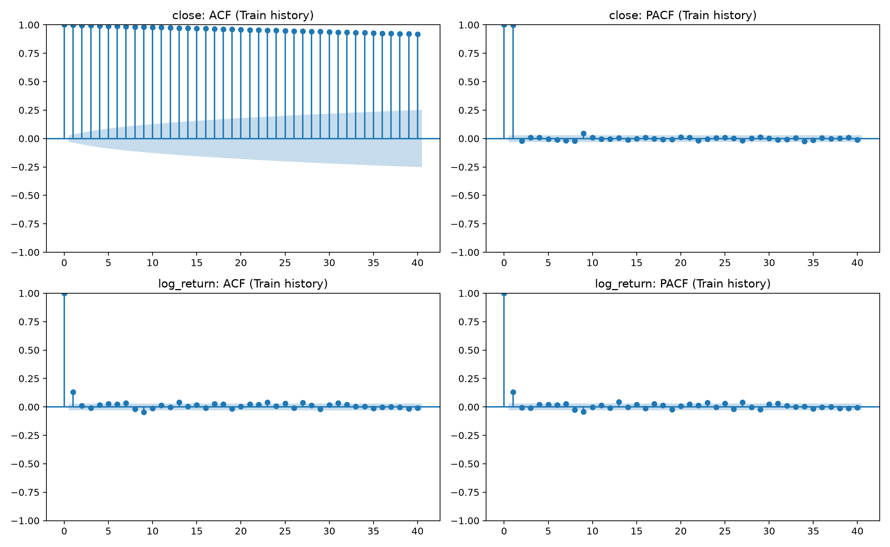
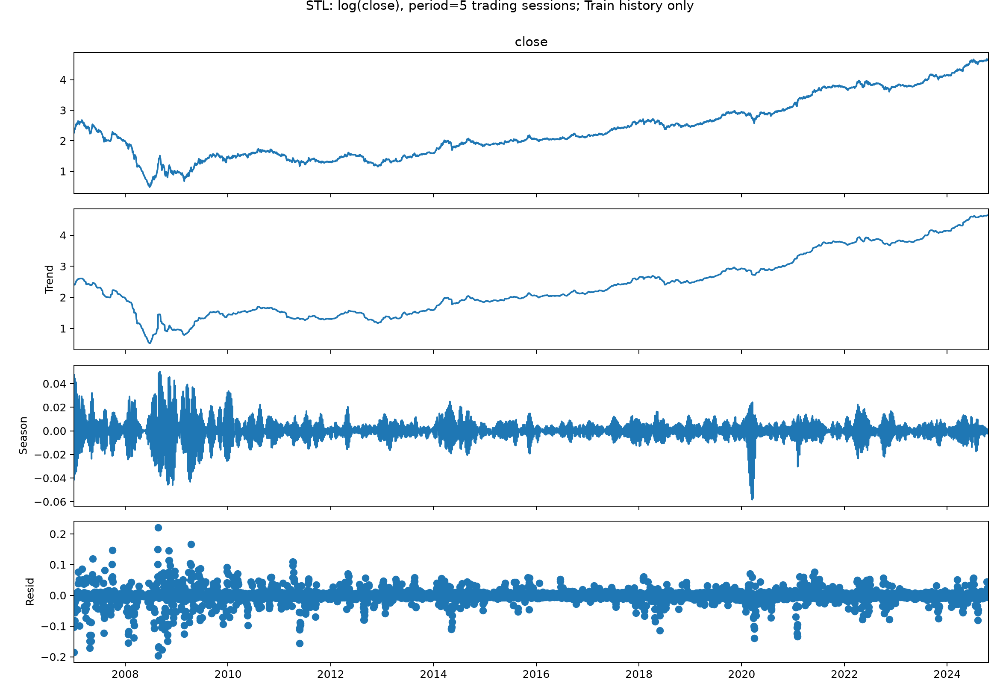

## Cross-validation Mean ± Std

Các cột mean và std trình bày riêng để dễ tra cứu; ghép lại thành mean ± std.
| feature_set | model | balanced_accuracy_mean | balanced_accuracy_std | accuracy_mean | accuracy_std | f1_up_mean | f1_up_std |
| --- | --- | --- | --- | --- | --- | --- | --- |
| Branch_1_Price_Only | Majority baseline | 0.5 | 0 | 0.543725 | 0.0238287 | 0.704186 | 0.0200149 |
| Branch_1_Price_Only | Logistic Regression | 0.534721 | 0.0225531 | 0.515403 | 0.0372453 | 0.393984 | 0.172245 |
| Branch_1_Price_Only | SVC | 0.513182 | 0.035425 | 0.50124 | 0.0287256 | 0.43622 | 0.168366 |
| Branch_1_Price_Only | Random Forest | 0.519601 | 0.0174594 | 0.496298 | 0.0211318 | 0.325161 | 0.206318 |
| Branch_1_Price_Only | XGBoost | 0.525684 | 0.0364335 | 0.520533 | 0.0309996 | 0.515693 | 0.0438111 |
| Branch_1_Price_Only | HistGradientBoosting | 0.550485 | 0.0189608 | 0.543699 | 0.0129491 | 0.532977 | 0.0551595 |
| Branch_1_Price_Only | LSTM L=10 | 0.515864 | 0.0356279 | 0.517227 | 0.0353233 | 0.551659 | 0.0904153 |
| Branch_1_Price_Only | LSTM L=20 | 0.519379 | 0.0362353 | 0.520155 | 0.0349603 | 0.552494 | 0.0893838 |
| Branch_1_Price_Only | LSTM L=30 | 0.522381 | 0.0344292 | 0.523106 | 0.0324896 | 0.556029 | 0.0852692 |
| Branch_1_Price_Only | LSTM L=60 | 0.514643 | 0.0397681 | 0.516301 | 0.0401866 | 0.551111 | 0.0940823 |
| Branch_1_Price_Only | GRU L=10 | 0.529088 | 0.023259 | 0.513592 | 0.0262967 | 0.414647 | 0.118328 |
| Branch_1_Price_Only | GRU L=20 | 0.54194 | 0.0265906 | 0.526983 | 0.0324458 | 0.442527 | 0.0812283 |
| Branch_1_Price_Only | GRU L=30 | 0.540258 | 0.0258915 | 0.525946 | 0.0310153 | 0.45167 | 0.068161 |
| Branch_1_Price_Only | GRU L=60 | 0.534916 | 0.0212925 | 0.524191 | 0.0227507 | 0.504134 | 0.0864988 |
| Branch_1_Price_Only | ARIMA | 0.500589 | 0.00131805 | 0.543725 | 0.0238287 | 0.703502 | 0.0189882 |
| Branch_2_Macro_Fundamental | Majority baseline | 0.5 | 0 | 0.543725 | 0.0238287 | 0.704186 | 0.0200149 |
| Branch_2_Macro_Fundamental | Logistic Regression | 0.514254 | 0.0115835 | 0.52306 | 0.0455992 | 0.42367 | 0.349745 |
| Branch_2_Macro_Fundamental | SVC | 0.514139 | 0.0331993 | 0.52795 | 0.052151 | 0.556556 | 0.252168 |
| Branch_2_Macro_Fundamental | Random Forest | 0.52414 | 0.0249404 | 0.505054 | 0.0235992 | 0.407018 | 0.144957 |
| Branch_2_Macro_Fundamental | XGBoost | 0.528255 | 0.00964433 | 0.527256 | 0.0119254 | 0.563871 | 0.0599239 |
| Branch_2_Macro_Fundamental | HistGradientBoosting | 0.534305 | 0.0260568 | 0.527881 | 0.0326166 | 0.536651 | 0.0792718 |
| Branch_2_Macro_Fundamental | LSTM L=10 | 0.500746 | 0.0100379 | 0.518655 | 0.0203926 | 0.625337 | 0.0539384 |
| Branch_2_Macro_Fundamental | LSTM L=20 | 0.509775 | 0.0195125 | 0.525434 | 0.0153646 | 0.627059 | 0.0509275 |
| Branch_2_Macro_Fundamental | LSTM L=30 | 0.508711 | 0.0189589 | 0.525397 | 0.0123687 | 0.62978 | 0.049526 |
| Branch_2_Macro_Fundamental | LSTM L=60 | 0.504797 | 0.0217062 | 0.522269 | 0.00521219 | 0.627682 | 0.047603 |
| Branch_2_Macro_Fundamental | GRU L=10 | 0.515625 | 0.0216355 | 0.531829 | 0.0236078 | 0.636746 | 0.029461 |
| Branch_2_Macro_Fundamental | GRU L=20 | 0.521356 | 0.0251918 | 0.539798 | 0.0289499 | 0.648334 | 0.0197874 |
| Branch_2_Macro_Fundamental | GRU L=30 | 0.518272 | 0.0229415 | 0.537864 | 0.0283893 | 0.648359 | 0.0226293 |
| Branch_2_Macro_Fundamental | GRU L=60 | 0.513024 | 0.0213772 | 0.536759 | 0.0324844 | 0.65502 | 0.0348313 |
| Branch_2_Macro_Fundamental | SARIMAX | 0.498833 | 0.025364 | 0.525432 | 0.0280051 | 0.567384 | 0.22847 |
| feature_set | model | log_return_rmse_mean | log_return_rmse_std | mae_mean | mae_std | rmse_mean | rmse_std |
| --- | --- | --- | --- | --- | --- | --- | --- |
| Branch_1_Price_Only | Last-Close Baseline | 0.0172501 | 0.00342911 | 0.56303 | 0.285039 | 0.801573 | 0.388637 |
| Branch_1_Price_Only | Linear Regression | 0.0234798 | 0.00993973 | 0.717278 | 0.313516 | 1.01864 | 0.429988 |
| Branch_1_Price_Only | Ridge Regression | 0.0176117 | 0.00346686 | 0.574531 | 0.276951 | 0.81494 | 0.379628 |
| Branch_1_Price_Only | SVR | 0.0174265 | 0.00350539 | 0.57027 | 0.282374 | 0.806866 | 0.38851 |
| Branch_1_Price_Only | Random Forest Regressor | 0.0173908 | 0.00331716 | 0.567703 | 0.274311 | 0.807136 | 0.377958 |
| Branch_1_Price_Only | XGBoost Regressor | 0.0177495 | 0.0029563 | 0.582192 | 0.265702 | 0.826661 | 0.372532 |
| Branch_1_Price_Only | HistGradientBoosting Regressor | 0.0179406 | 0.00319794 | 0.592598 | 0.27617 | 0.839838 | 0.394586 |
| Branch_1_Price_Only | LSTM L=10 | 0.0174941 | 0.00338369 | 0.580379 | 0.284642 | 0.814372 | 0.391527 |
| Branch_1_Price_Only | LSTM L=20 | 0.0174937 | 0.00338068 | 0.580895 | 0.285625 | 0.81462 | 0.391859 |
| Branch_1_Price_Only | LSTM L=30 | 0.0174948 | 0.00337455 | 0.580784 | 0.286207 | 0.814952 | 0.392889 |
| Branch_1_Price_Only | LSTM L=60 | 0.0174704 | 0.00336106 | 0.579176 | 0.286876 | 0.813854 | 0.393783 |
| Branch_1_Price_Only | GRU L=10 | 0.0177897 | 0.00346456 | 0.578233 | 0.279499 | 0.825242 | 0.388068 |
| Branch_1_Price_Only | GRU L=20 | 0.0177908 | 0.00346853 | 0.577748 | 0.279191 | 0.825376 | 0.387599 |
| Branch_1_Price_Only | GRU L=30 | 0.017781 | 0.00346515 | 0.577346 | 0.279206 | 0.824977 | 0.387589 |
| Branch_1_Price_Only | GRU L=60 | 0.0177163 | 0.00344398 | 0.575496 | 0.280514 | 0.822501 | 0.388702 |
| Branch_1_Price_Only | ARIMA | 0.017192 | 0.00348057 | 0.563246 | 0.283638 | 0.798749 | 0.385612 |
| Branch_2_Macro_Fundamental | Last-Close Baseline | 0.0172501 | 0.00342911 | 0.56303 | 0.285039 | 0.801573 | 0.388637 |
| Branch_2_Macro_Fundamental | Linear Regression | 0.0286088 | 0.00874597 | 0.975236 | 0.35011 | 1.27193 | 0.503398 |
| Branch_2_Macro_Fundamental | Ridge Regression | 0.0193412 | 0.00445207 | 0.661184 | 0.314891 | 0.908038 | 0.42283 |
| Branch_2_Macro_Fundamental | SVR | 0.0173481 | 0.00344002 | 0.571043 | 0.282134 | 0.80564 | 0.38866 |
| Branch_2_Macro_Fundamental | Random Forest Regressor | 0.0174367 | 0.0033269 | 0.569108 | 0.272381 | 0.808902 | 0.377726 |
| Branch_2_Macro_Fundamental | XGBoost Regressor | 0.0180677 | 0.00314967 | 0.592584 | 0.258784 | 0.837665 | 0.368212 |
| Branch_2_Macro_Fundamental | HistGradientBoosting Regressor | 0.0180979 | 0.00324465 | 0.594779 | 0.263957 | 0.842144 | 0.380178 |
| Branch_2_Macro_Fundamental | LSTM L=10 | 0.0175142 | 0.00348033 | 0.580414 | 0.290149 | 0.817015 | 0.400001 |
| Branch_2_Macro_Fundamental | LSTM L=20 | 0.017545 | 0.00347635 | 0.581899 | 0.290984 | 0.819009 | 0.40211 |
| Branch_2_Macro_Fundamental | LSTM L=30 | 0.0175143 | 0.00345714 | 0.580897 | 0.290688 | 0.817382 | 0.401769 |
| Branch_2_Macro_Fundamental | LSTM L=60 | 0.01753 | 0.00342544 | 0.581315 | 0.29052 | 0.818074 | 0.401551 |
| Branch_2_Macro_Fundamental | GRU L=10 | 0.0173109 | 0.00331277 | 0.571871 | 0.281538 | 0.805796 | 0.387618 |
| Branch_2_Macro_Fundamental | GRU L=20 | 0.0172908 | 0.00330561 | 0.56962 | 0.282584 | 0.804885 | 0.388144 |
| Branch_2_Macro_Fundamental | GRU L=30 | 0.0172819 | 0.00333485 | 0.568049 | 0.282947 | 0.804173 | 0.388723 |
| Branch_2_Macro_Fundamental | GRU L=60 | 0.0172726 | 0.00333802 | 0.566727 | 0.283392 | 0.803304 | 0.387538 |
| Branch_2_Macro_Fundamental | SARIMAX | 0.018948 | 0.00438124 | 0.621141 | 0.246768 | 0.855295 | 0.350458 |

## Test phân loại

Tỷ lệ trong bảng là[0,1], nhân100 để đọc phần trăm.

| feature_set | model | accuracy | balanced_accuracy | precision_up | recall_up | f1_up | roc_auc |
| --- | --- | --- | --- | --- | --- | --- | --- |
| Branch_1_Price_Only | Majority baseline | 0.493392 | 0.5 | 0.493392 | 1 | 0.660767 | 0.5 |
| Branch_1_Price_Only | Logistic Regression | 0.572687 | 0.572089 | 0.572816 | 0.526786 | 0.548837 | 0.567702 |
| Branch_1_Price_Only | SVC | 0.488987 | 0.490761 | 0.486111 | 0.625 | 0.546875 | 0.497981 |
| Branch_1_Price_Only | Random Forest | 0.524229 | 0.522865 | 0.522222 | 0.419643 | 0.465347 | 0.590062 |
| Branch_1_Price_Only | XGBoost | 0.537445 | 0.540334 | 0.521472 | 0.758929 | 0.618182 | 0.524301 |
| Branch_1_Price_Only | HistGradientBoosting | 0.528634 | 0.529193 | 0.520325 | 0.571429 | 0.544681 | 0.550621 |
| Branch_1_Price_Only | LSTM L=10 | 0.519824 | 0.521312 | 0.510791 | 0.633929 | 0.565737 | 0.532143 |
| Branch_1_Price_Only | LSTM L=20 | 0.537445 | 0.539286 | 0.524138 | 0.678571 | 0.59144 | 0.531677 |
| Branch_1_Price_Only | LSTM L=30 | 0.54185 | 0.543401 | 0.528571 | 0.660714 | 0.587302 | 0.531832 |
| Branch_1_Price_Only | LSTM L=60 | 0.53304 | 0.534472 | 0.521739 | 0.642857 | 0.576 | 0.530435 |
| Branch_1_Price_Only | GRU L=10 | 0.572687 | 0.573486 | 0.559055 | 0.633929 | 0.594142 | 0.5625 |
| Branch_1_Price_Only | GRU L=20 | 0.581498 | 0.582415 | 0.565891 | 0.651786 | 0.605809 | 0.562888 |
| Branch_1_Price_Only | GRU L=30 | 0.581498 | 0.582415 | 0.565891 | 0.651786 | 0.605809 | 0.563354 |
| Branch_1_Price_Only | GRU L=60 | 0.581498 | 0.582415 | 0.565891 | 0.651786 | 0.605809 | 0.563665 |
| Branch_1_Price_Only | ARIMA | 0.488987 | 0.495419 | 0.491071 | 0.982143 | 0.654762 | 0.472516 |
| Branch_2_Macro_Fundamental | Majority baseline | 0.493392 | 0.5 | 0.493392 | 1 | 0.660767 | 0.5 |
| Branch_2_Macro_Fundamental | Logistic Regression | 0.502203 | 0.507182 | 0.497487 | 0.883929 | 0.636656 | 0.500854 |
| Branch_2_Macro_Fundamental | SVC | 0.506608 | 0.510481 | 0.5 | 0.803571 | 0.616438 | 0.493401 |
| Branch_2_Macro_Fundamental | Random Forest | 0.555066 | 0.554464 | 0.553398 | 0.508929 | 0.530233 | 0.595575 |
| Branch_2_Macro_Fundamental | XGBoost | 0.546256 | 0.548797 | 0.528662 | 0.741071 | 0.6171 | 0.52205 |
| Branch_2_Macro_Fundamental | HistGradientBoosting | 0.519824 | 0.521894 | 0.510067 | 0.678571 | 0.582375 | 0.529115 |
| Branch_2_Macro_Fundamental | LSTM L=10 | 0.488987 | 0.494488 | 0.490385 | 0.910714 | 0.6375 | 0.54604 |
| Branch_2_Macro_Fundamental | LSTM L=20 | 0.488987 | 0.494488 | 0.490385 | 0.910714 | 0.6375 | 0.516925 |
| Branch_2_Macro_Fundamental | LSTM L=30 | 0.493392 | 0.498952 | 0.492823 | 0.919643 | 0.641745 | 0.523214 |
| Branch_2_Macro_Fundamental | LSTM L=60 | 0.502203 | 0.50788 | 0.49763 | 0.9375 | 0.650155 | 0.520497 |
| Branch_2_Macro_Fundamental | GRU L=10 | 0.493392 | 0.499068 | 0.492891 | 0.928571 | 0.643963 | 0.513975 |
| Branch_2_Macro_Fundamental | GRU L=20 | 0.493392 | 0.499185 | 0.492958 | 0.9375 | 0.646154 | 0.514519 |
| Branch_2_Macro_Fundamental | GRU L=30 | 0.497797 | 0.503533 | 0.495283 | 0.9375 | 0.648148 | 0.510637 |
| Branch_2_Macro_Fundamental | GRU L=60 | 0.497797 | 0.503533 | 0.495283 | 0.9375 | 0.648148 | 0.511724 |
| Branch_2_Macro_Fundamental | SARIMAX | 0.493392 | 0.5 | 0.493392 | 1 | 0.660767 | 0.517857 |

## Test hồi quy

| feature_set | model | log_return_mae | log_return_rmse | mae | rmse | mape_percent | directional_accuracy_nonflat_percent | tolerance_accuracy_0_5_percent | tolerance_accuracy_1_percent | tolerance_accuracy_2_percent |
| --- | --- | --- | --- | --- | --- | --- | --- | --- | --- | --- |
| Branch_1_Price_Only | Last-Close Baseline | 0.0126887 | 0.0183976 | 1.22497 | 1.73983 | 1.27132 | 0 | 32.906 | 54.7009 | 81.6239 |
| Branch_1_Price_Only | Linear Regression | 0.0131685 | 0.0184721 | 1.27346 | 1.76013 | 1.32063 | 51.5419 | 28.2051 | 48.7179 | 81.6239 |
| Branch_1_Price_Only | Ridge Regression | 0.0128808 | 0.0184679 | 1.2455 | 1.75336 | 1.2925 | 52.4229 | 30.7692 | 52.9915 | 81.1966 |
| Branch_1_Price_Only | SVR | 0.0135863 | 0.0193159 | 1.31457 | 1.83233 | 1.36506 | 47.1366 | 26.0684 | 52.5641 | 80.7692 |
| Branch_1_Price_Only | Random Forest Regressor | 0.0130408 | 0.0188068 | 1.25931 | 1.78113 | 1.30905 | 48.0176 | 32.0513 | 54.2735 | 80.3419 |
| Branch_1_Price_Only | XGBoost Regressor | 0.0130695 | 0.0187539 | 1.26208 | 1.77745 | 1.31231 | 51.9824 | 31.6239 | 52.5641 | 81.1966 |
| Branch_1_Price_Only | HistGradientBoosting Regressor | 0.0135193 | 0.0195456 | 1.30171 | 1.85474 | 1.35652 | 53.304 | 33.7607 | 52.1368 | 76.4957 |
| Branch_1_Price_Only | LSTM L=10 | 0.0130446 | 0.0187292 | 1.25932 | 1.77399 | 1.30918 | 50.6608 | 31.6239 | 54.7009 | 81.6239 |
| Branch_1_Price_Only | LSTM L=20 | 0.0130052 | 0.0186993 | 1.25566 | 1.77154 | 1.30494 | 51.1013 | 30.3419 | 55.1282 | 81.6239 |
| Branch_1_Price_Only | LSTM L=30 | 0.0129861 | 0.0186853 | 1.25377 | 1.77013 | 1.30293 | 51.5419 | 30.3419 | 55.1282 | 81.6239 |
| Branch_1_Price_Only | LSTM L=60 | 0.012984 | 0.0186816 | 1.25366 | 1.76999 | 1.30269 | 52.8634 | 30.3419 | 55.1282 | 81.6239 |
| Branch_1_Price_Only | GRU L=10 | 0.0126604 | 0.0183533 | 1.22257 | 1.73734 | 1.26947 | 52.4229 | 34.188 | 53.8462 | 82.0513 |
| Branch_1_Price_Only | GRU L=20 | 0.0126419 | 0.0183584 | 1.22057 | 1.73725 | 1.26738 | 53.7445 | 33.7607 | 54.2735 | 82.0513 |
| Branch_1_Price_Only | GRU L=30 | 0.0126434 | 0.0183628 | 1.2207 | 1.73759 | 1.26751 | 53.304 | 33.7607 | 54.2735 | 82.0513 |
| Branch_1_Price_Only | GRU L=60 | 0.0126496 | 0.0183709 | 1.22131 | 1.73836 | 1.26821 | 54.185 | 33.7607 | 54.2735 | 82.0513 |
| Branch_1_Price_Only | ARIMA | 0.0128294 | 0.0185196 | 1.2392 | 1.75371 | 1.28721 | 48.8987 | 33.7607 | 54.2735 | 81.6239 |
| Branch_2_Macro_Fundamental | Last-Close Baseline | 0.0126887 | 0.0183976 | 1.22497 | 1.73983 | 1.27132 | 0 | 32.906 | 54.7009 | 81.6239 |
| Branch_2_Macro_Fundamental | Linear Regression | 0.0173003 | 0.0232817 | 1.65712 | 2.18453 | 1.75179 | 48.0176 | 20.9402 | 36.7521 | 69.6581 |
| Branch_2_Macro_Fundamental | Ridge Regression | 0.0155038 | 0.0212471 | 1.48929 | 2.00106 | 1.56632 | 48.8987 | 26.0684 | 41.453 | 73.5043 |
| Branch_2_Macro_Fundamental | SVR | 0.0136461 | 0.0193035 | 1.31982 | 1.83091 | 1.37219 | 48.0176 | 27.7778 | 48.7179 | 79.9145 |
| Branch_2_Macro_Fundamental | Random Forest Regressor | 0.013157 | 0.0189591 | 1.2699 | 1.79432 | 1.3218 | 48.8987 | 30.7692 | 54.7009 | 80.3419 |
| Branch_2_Macro_Fundamental | XGBoost Regressor | 0.0141876 | 0.0200886 | 1.36713 | 1.89664 | 1.43026 | 48.0176 | 27.7778 | 48.2906 | 76.9231 |
| Branch_2_Macro_Fundamental | HistGradientBoosting Regressor | 0.0154359 | 0.0213953 | 1.4856 | 2.02028 | 1.5584 | 48.8987 | 24.7863 | 45.2991 | 73.0769 |
| Branch_2_Macro_Fundamental | LSTM L=10 | 0.0135008 | 0.0191839 | 1.30503 | 1.81862 | 1.35872 | 48.4581 | 29.9145 | 50.8547 | 80.7692 |
| Branch_2_Macro_Fundamental | LSTM L=20 | 0.0136964 | 0.0193562 | 1.32391 | 1.83524 | 1.37898 | 48.8987 | 30.3419 | 50 | 79.0598 |
| Branch_2_Macro_Fundamental | LSTM L=30 | 0.0137098 | 0.019362 | 1.32519 | 1.83587 | 1.3804 | 48.8987 | 29.9145 | 50.4274 | 79.0598 |
| Branch_2_Macro_Fundamental | LSTM L=60 | 0.0136946 | 0.019352 | 1.32387 | 1.83518 | 1.37889 | 48.4581 | 29.9145 | 50.8547 | 79.4872 |
| Branch_2_Macro_Fundamental | GRU L=10 | 0.0139571 | 0.0196701 | 1.34661 | 1.86233 | 1.4062 | 48.0176 | 28.2051 | 47.0085 | 76.9231 |
| Branch_2_Macro_Fundamental | GRU L=20 | 0.0141425 | 0.0198396 | 1.36452 | 1.87938 | 1.42532 | 48.8987 | 27.3504 | 46.5812 | 76.0684 |
| Branch_2_Macro_Fundamental | GRU L=30 | 0.0141054 | 0.0197953 | 1.36042 | 1.87433 | 1.42139 | 48.4581 | 28.6325 | 45.7265 | 76.0684 |
| Branch_2_Macro_Fundamental | GRU L=60 | 0.0141174 | 0.0197842 | 1.3617 | 1.87357 | 1.42252 | 48.0176 | 28.2051 | 45.7265 | 76.0684 |
| Branch_2_Macro_Fundamental | SARIMAX | 0.0135918 | 0.0193112 | 1.30928 | 1.82473 | 1.36877 | 49.3392 | 31.1966 | 51.7094 | 76.4957 |

Mô hình được chọn bằng CV cho hướng: **HistGradientBoosting / Branch_1_Price_Only**, Test BA=0.5292. Mô hình giá: **ARIMA / Branch_1_Price_Only**, Test MAE=1.2392, RMSE=1.7537, log return RMSE=0.018520. Đây không nhất thiết là mô hình đứng đầu Test.

## Ablation cùng cohort

G1 gồm close/volume hiện tại, returns 1/2/5/10/20 và biến đổi khối lượng; G2 thêm SMA/EMA/RSI/MACD/Bollinger/volatility; G3 thêm trường OHLC và cấu trúc nến; G4 thêm thị trường/vĩ mô; G5 excluded; G6 thêm 5 biến tài chính. Không điền số cho G5 hoặc gọi G4=G5 là cải thiện ngành.

**Phân loại:**

| group | feature_count | cv_mean | cv_std | accuracy | balanced_accuracy | f1_up | roc_auc |
| --- | --- | --- | --- | --- | --- | --- | --- |
| G1 | 9 | 0.538965 | 0.0280571 | 0.506608 | 0.506988 | 0.517241 | 0.51545 |
| G2 | 25 | 0.534905 | 0.0268813 | 0.546256 | 0.547283 | 0.576132 | 0.54014 |
| G3 | 32 | 0.525684 | 0.0364335 | 0.537445 | 0.540334 | 0.618182 | 0.524301 |
| G4 | 38 | 0.527727 | 0.013695 | 0.54185 | 0.544682 | 0.620438 | 0.531444 |
| G6 | 43 | 0.528255 | 0.00964433 | 0.546256 | 0.548797 | 0.6171 | 0.52205 |

**Hồi quy:**

| group | feature_count | cv_mean | cv_std | log_return_rmse | mae | rmse | mape_percent |
| --- | --- | --- | --- | --- | --- | --- | --- |
| G1 | 9 | 0.0176919 | 0.00337238 | 0.0188083 | 1.25062 | 1.77851 | 1.30012 |
| G2 | 25 | 0.0175809 | 0.0032544 | 0.018784 | 1.26435 | 1.77921 | 1.31554 |
| G3 | 32 | 0.0177495 | 0.0029563 | 0.0187539 | 1.26208 | 1.77745 | 1.31231 |
| G4 | 38 | 0.0179711 | 0.00314394 | 0.019921 | 1.35452 | 1.88089 | 1.41687 |
| G6 | 43 | 0.0180677 | 0.00314967 | 0.0200886 | 1.36713 | 1.89664 | 1.43026 |

G5: excluded; không có dữ liệu ngành đủ tin cậy để đánh giá riêng. Đầy đủ các metric còn lại nằm trong `reports/ablation_summary.csv`.

Với classification, G1: balanced_accuracy=0.50699, G2: balanced_accuracy=0.54728, G3: balanced_accuracy=0.54033, G4: balanced_accuracy=0.54468, G6: balanced_accuracy=0.54880. So sánh này chỉ phản ánh XGBoost và cửa sổ hiện tại; không chứng minh nhân quả của vĩ mô.

Với regression, G1: log_return_rmse=0.01881, G2: log_return_rmse=0.01878, G3: log_return_rmse=0.01875, G4: log_return_rmse=0.01992, G6: log_return_rmse=0.02009. So sánh này chỉ phản ánh XGBoost và cửa sổ hiện tại; không chứng minh nhân quả của vĩ mô.

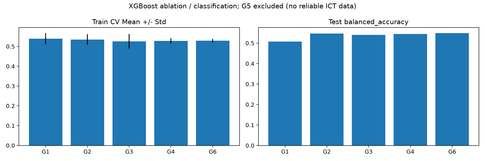
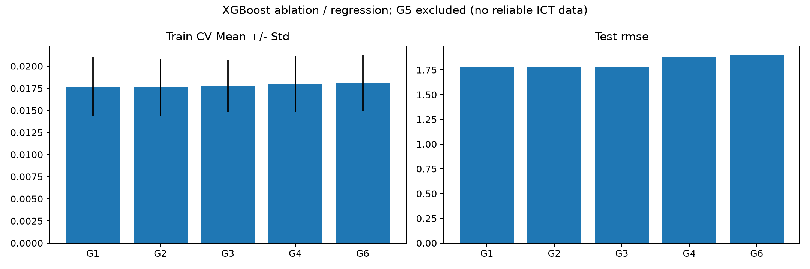

## LSTM/GRU và độ dài cửa sổ

| feature_set | task | model | cv_score | balanced_accuracy | log_return_rmse | mae | rmse |
| --- | --- | --- | --- | --- | --- | --- | --- |
| Branch_1_Price_Only | classification | LSTM L=10 | 0.515864 | 0.521312 | — | — | — |
| Branch_1_Price_Only | classification | LSTM L=20 | 0.519379 | 0.539286 | — | — | — |
| Branch_1_Price_Only | classification | LSTM L=30 | 0.522381 | 0.543401 | — | — | — |
| Branch_1_Price_Only | classification | LSTM L=60 | 0.514643 | 0.534472 | — | — | — |
| Branch_1_Price_Only | classification | GRU L=10 | 0.529088 | 0.573486 | — | — | — |
| Branch_1_Price_Only | classification | GRU L=20 | 0.54194 | 0.582415 | — | — | — |
| Branch_1_Price_Only | classification | GRU L=30 | 0.540258 | 0.582415 | — | — | — |
| Branch_1_Price_Only | classification | GRU L=60 | 0.534916 | 0.582415 | — | — | — |
| Branch_1_Price_Only | regression | LSTM L=10 | 0.0174941 | — | 0.0187292 | 1.25932 | 1.77399 |
| Branch_1_Price_Only | regression | LSTM L=20 | 0.0174937 | — | 0.0186993 | 1.25566 | 1.77154 |
| Branch_1_Price_Only | regression | LSTM L=30 | 0.0174948 | — | 0.0186853 | 1.25377 | 1.77013 |
| Branch_1_Price_Only | regression | LSTM L=60 | 0.0174704 | — | 0.0186816 | 1.25366 | 1.76999 |
| Branch_1_Price_Only | regression | GRU L=10 | 0.0177897 | — | 0.0183533 | 1.22257 | 1.73734 |
| Branch_1_Price_Only | regression | GRU L=20 | 0.0177908 | — | 0.0183584 | 1.22057 | 1.73725 |
| Branch_1_Price_Only | regression | GRU L=30 | 0.017781 | — | 0.0183628 | 1.2207 | 1.73759 |
| Branch_1_Price_Only | regression | GRU L=60 | 0.0177163 | — | 0.0183709 | 1.22131 | 1.73836 |
| Branch_2_Macro_Fundamental | classification | LSTM L=10 | 0.500746 | 0.494488 | — | — | — |
| Branch_2_Macro_Fundamental | classification | LSTM L=20 | 0.509775 | 0.494488 | — | — | — |
| Branch_2_Macro_Fundamental | classification | LSTM L=30 | 0.508711 | 0.498952 | — | — | — |
| Branch_2_Macro_Fundamental | classification | LSTM L=60 | 0.504797 | 0.50788 | — | — | — |
| Branch_2_Macro_Fundamental | classification | GRU L=10 | 0.515625 | 0.499068 | — | — | — |
| Branch_2_Macro_Fundamental | classification | GRU L=20 | 0.521356 | 0.499185 | — | — | — |
| Branch_2_Macro_Fundamental | classification | GRU L=30 | 0.518272 | 0.503533 | — | — | — |
| Branch_2_Macro_Fundamental | classification | GRU L=60 | 0.513024 | 0.503533 | — | — | — |
| Branch_2_Macro_Fundamental | regression | LSTM L=10 | 0.0175142 | — | 0.0191839 | 1.30503 | 1.81862 |
| Branch_2_Macro_Fundamental | regression | LSTM L=20 | 0.017545 | — | 0.0193562 | 1.32391 | 1.83524 |
| Branch_2_Macro_Fundamental | regression | LSTM L=30 | 0.0175143 | — | 0.019362 | 1.32519 | 1.83587 |
| Branch_2_Macro_Fundamental | regression | LSTM L=60 | 0.01753 | — | 0.019352 | 1.32387 | 1.83518 |
| Branch_2_Macro_Fundamental | regression | GRU L=10 | 0.0173109 | — | 0.0196701 | 1.34661 | 1.86233 |
| Branch_2_Macro_Fundamental | regression | GRU L=20 | 0.0172908 | — | 0.0198396 | 1.36452 | 1.87938 |
| Branch_2_Macro_Fundamental | regression | GRU L=30 | 0.0172819 | — | 0.0197953 | 1.36042 | 1.87433 |
| Branch_2_Macro_Fundamental | regression | GRU L=60 | 0.0172726 | — | 0.0197842 | 1.3617 | 1.87357 |

Cấu hình tuần tự tốt nhất theo CV cho classification: **GRU L=20 / Branch_1_Price_Only**, CV=0.541940. Mộtseed và12 epoch là giới hạn cần kiểm tra thêm.

Cấu hình tuần tự tốt nhất theo CV cho regression: **GRU L=60 / Branch_2_Macro_Fundamental**, CV=0.017273. Mộtseed và12 epoch là giới hạn cần kiểm tra thêm.

## Đường dự báo và giải thích mô hình

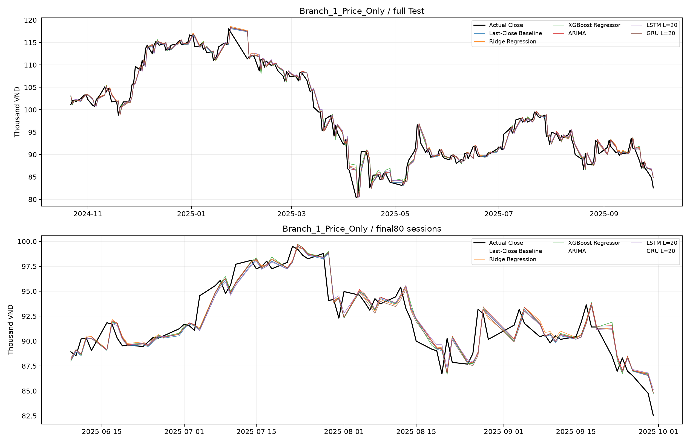
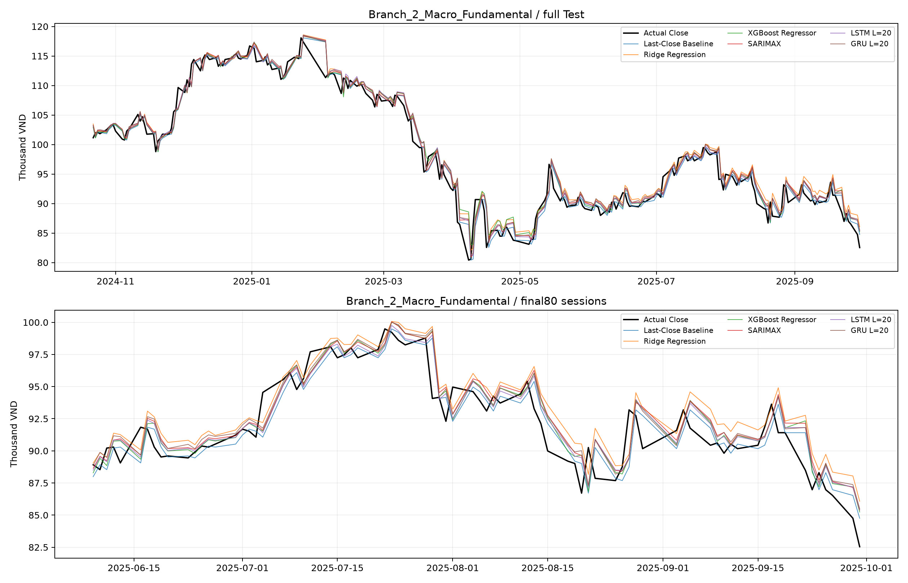

Các đường là dự báo1bước trên cùngTest; panel dưới phóng80phiên. Hai mô hình LSTM/GRU L20 trong hình chỉ là cấu hình minh họa cố định, không mặc định là tốt nhất.

SHAP (classification) top 10:

| feature | mean_abs_shap |
| --- | --- |
| close_location_in_range | 0.10319 |
| current_volume | 0.102918 |
| sma_5_ratio | 0.0793668 |
| gold_vnd_per_ounce | 0.0791369 |
| candle_body_pct | 0.0573422 |
| candle_range_pct | 0.0569288 |
| macd_signal_ratio | 0.054167 |
| log_volume_zscore_20d | 0.0522581 |
| return_10d | 0.0469727 |
| return_5d | 0.0432218 |

Permutation (classification) top 10:

| feature | importance_mean | importance_std |
| --- | --- | --- |
| close_location_in_range | 0.04533 | 0.0178146 |
| sma_5_ratio | 0.025132 | 0.0128218 |
| macd_signal_ratio | 0.0250854 | 0.00996033 |
| candle_body_pct | 0.0191498 | 0.00836188 |
| return_2d | 0.0180474 | 0.0102726 |
| sma_10_ratio | 0.0173447 | 0.00882486 |
| candle_range_pct | 0.0146856 | 0.020675 |
| return_5d | 0.0125388 | 0.0103937 |
| ema_5_ratio | 0.0101281 | 0.00927339 |
| log_volume_change_1d | 0.00968168 | 0.0183253 |

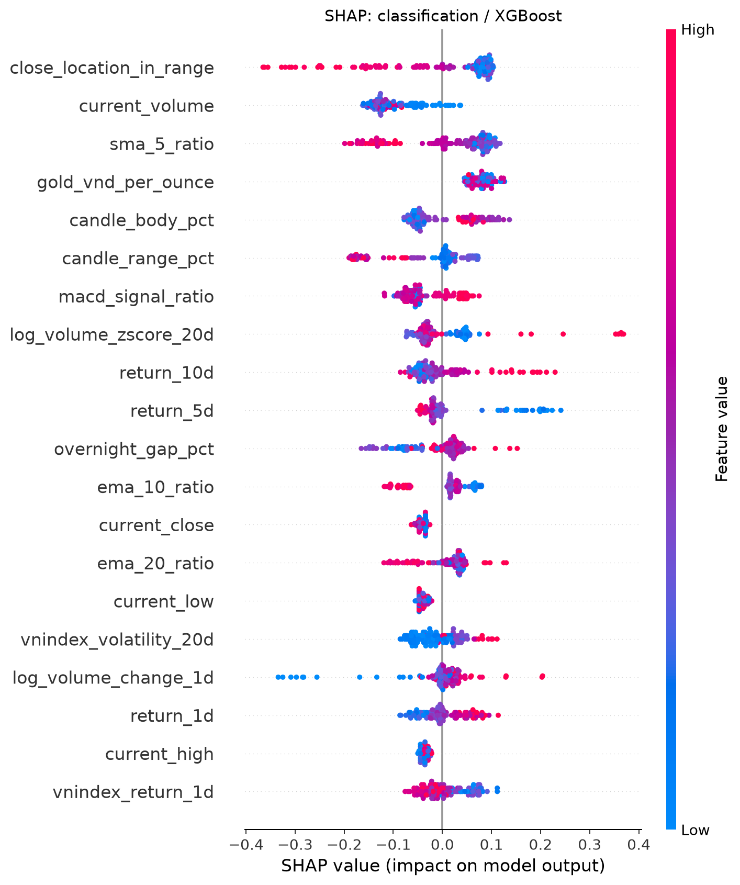
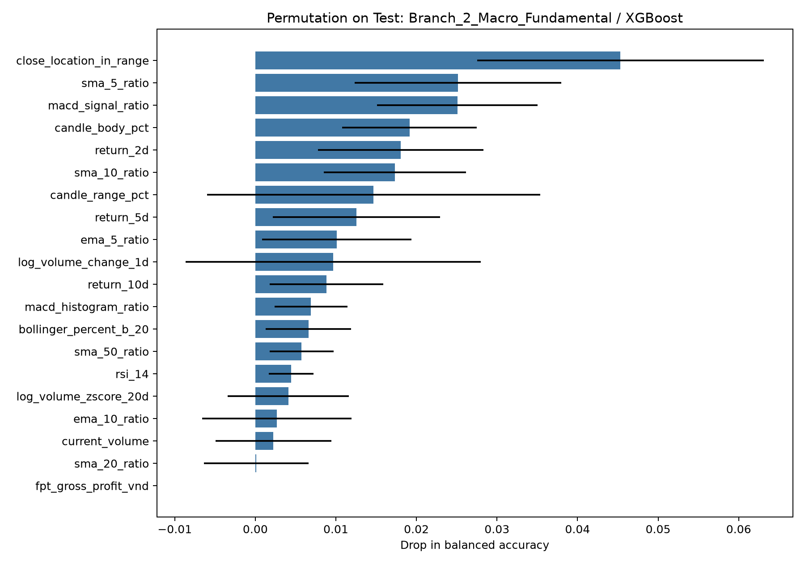

SHAP (regression) top 10:

| feature | mean_abs_shap |
| --- | --- |
| sma_5_ratio | 0.000872541 |
| return_1d | 0.000285753 |
| candle_body_pct | 0.000279361 |
| volatility_20d | 0.000225244 |
| ema_5_ratio | 0.000185987 |
| return_20d | 0.000145575 |
| ema_10_ratio | 0.000124471 |
| return_5d | 0.000119439 |
| macd_ratio | 0.000116644 |
| return_2d | 0.00010257 |

Permutation (regression) top 10:

| feature | importance_mean | importance_std |
| --- | --- | --- |
| sma_5_ratio | 8.13383e-05 | 9.08887e-05 |
| close_location_in_range | 2.12087e-05 | 8.64121e-06 |
| macd_signal_ratio | 1.47728e-05 | 1.20773e-05 |
| return_5d | 1.13276e-05 | 1.30568e-05 |
| volatility_20d | 5.37589e-06 | 3.17005e-05 |
| log_volume_change_1d | 1.66058e-06 | 4.02936e-06 |
| ema_50_ratio | 1.47199e-06 | 5.78917e-06 |
| current_high | 0 | 0 |
| current_low | 0 | 0 |
| current_open | -1.54328e-07 | 2.86622e-06 |

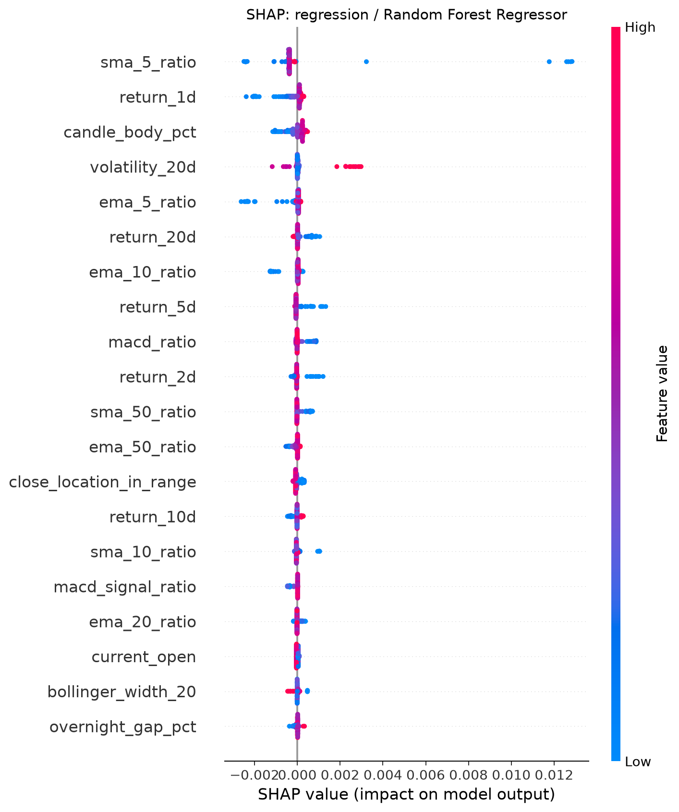
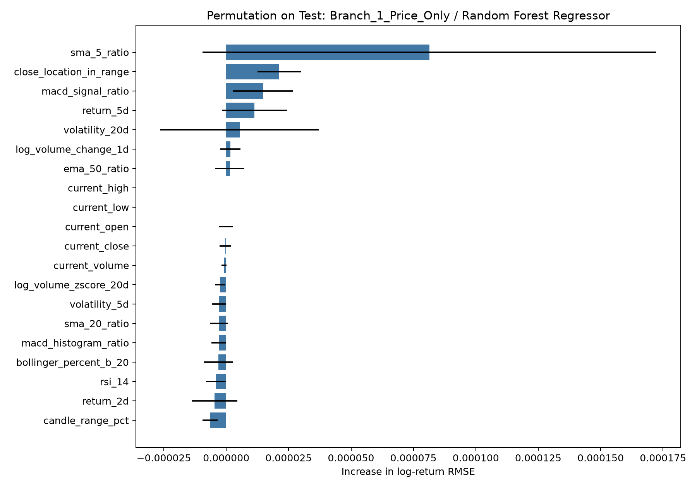

Cây được chọn theo CV trước khi xem Test. SHAP dùng tối đa 100 mẫu Train làm background, giải thích 150 mẫu Test theo vị trí cố định. SHAP nằm trên đầu ra raw của mô hình, không tự diễn giải là điểm phần trăm xác suất. Permutation lặp 10 lần, seed 42; phân loại đo mức giảm BA, hồi quy đo mức tăng RMSE log return. Giá trị âm có thể do nhiễu/đặc trưng hại trong tập này. Biến tương quan chia sẻ tín hiệu; hoán vị phá vỡ quan hệ giữa biến và phụ thuộc thời gian. Các hình mô tả mô hình, không chứng minh nguyên nhân biến động chứng khoán. Không loại đặc trưng hay chỉnh lại mô hình dựa trên Test sau khi giải thích.

## Giới hạn và hướng phát triển

Không khẳng định mô hình phức tạp chắc chắn vượt baseline. Return nhỏ làm dự báo giá hôm nay đã khá mạnh. Điểm hướng gần 0.5 đòi hỏi đánh giá độ bất định, nhiều giai đoạn và chi phí giao dịch; đồ án hiện không backtest lợi nhuận. Một mã, một seed, lưới nhỏ, dữ liệu điều chỉnh sau sự kiện và độ trễ công bố giả định còn hạn chế. Kiểm tra convergence của SARIMAX trước khi coi tham số đáng tin cậy. Theo dõi một giai đoạn chưa quan sát sẽ có giá trị hơn việc tiếp tục tối ưu trên cùng Test.

## Tái lập và tài liệu phương pháp

```bash
python -m pip install -r requirements.txt
python src/fetch_data.py --verify
python src/fetch_supplemental.py --from-cache
python src/eda.py
python src/prepare.py
python src/time_series_analysis.py
python src/train.py
python src/explain.py
python src/predict.py
python -m pytest -q
```

Có thể làm mới chỉ số bằng `python src/fetch_supplemental.py --download-market`; khi thay nguồn phải huấn luyện lại. Notebook 00 chạy trọn quy trình; 08 phân tích chuỗi; 09 giải thích. File joblib đánh giá và triển khai có phạm vi fit khác nhau, không thay lẫn khi chấm Test.

Nguồn phương pháp: [statsmodels ADF/KPSS](https://www.statsmodels.org/stable/examples/notebooks/generated/stationarity_detrending_adf_kpss.html), [TimeSeriesSplit](https://scikit-learn.org/stable/modules/generated/sklearn.model_selection.TimeSeriesSplit.html), [TreeExplainer](https://shap.readthedocs.io/en/latest/generated/shap.TreeExplainer.html), [PyTorch LSTM](https://docs.pytorch.org/docs/stable/generated/torch.nn.LSTM.html).

### Kiểm định thực thi

Toàn bộ 46 bài kiểm thử đạt, bao gồm căn nhãn, không thay đổi đặc trưng quá khứ khi sửa tương lai, fit scaler trong Train, chống bỏ qua phiên trong cửa sổ và kiểm tra cập nhật trạng thái thống kê. Cả 40 lần fit thống kê trong CV đều có cờ hội tụ; các cảnh báo thư viện được giữ trong metadata. Đây là kiểm tra tối ưu số, không phải bằng chứng mô hình thống kê phù hợp hoàn toàn với dữ liệu.

Các hình ma trận nhầm lẫn theo từng nhánh:

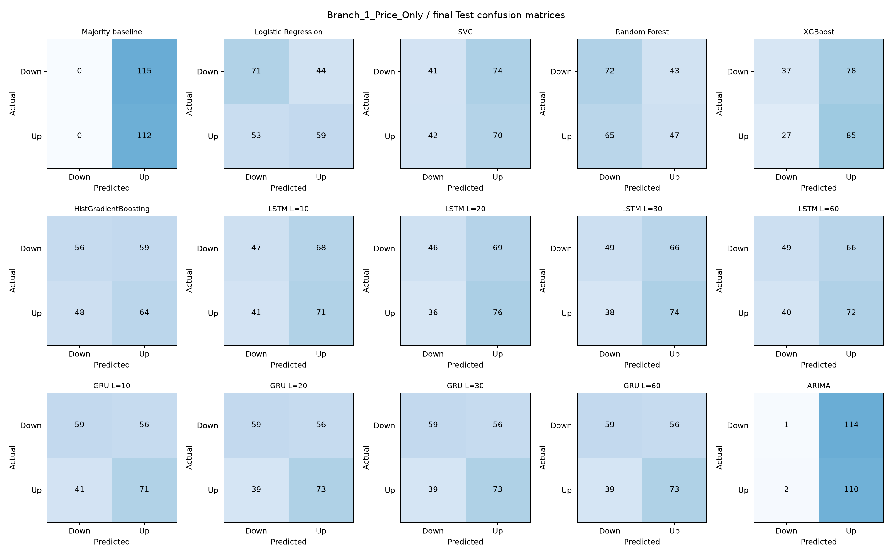
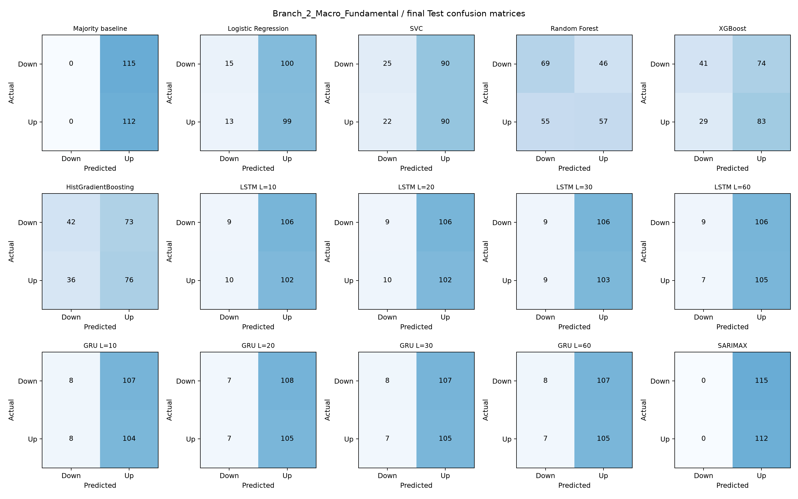

Môi trường thực thi cụ thể được ghi trong `reports/environment_versions.json`. Thư viện có phiên bản khác có thể làm sai số số học thay đổi; nên chạy lại pipeline thay vì nạp tùy ý mô hình joblib từ một môi trường khác.

Đã chạy cả 10 notebook bằng kernel mới trong bản sao cách ly; hai bảng metrics khớp trong dung sai 1e-10, dự báo JSON giống hệt và hash dữ liệu gốc không đổi. Tổng đóng góp SHAP cộng với giá trị nền đã được kiểm tra khớp đầu ra mô hình; sai lệch số học tối đa được lưu trong `explainability_summary.json`.
