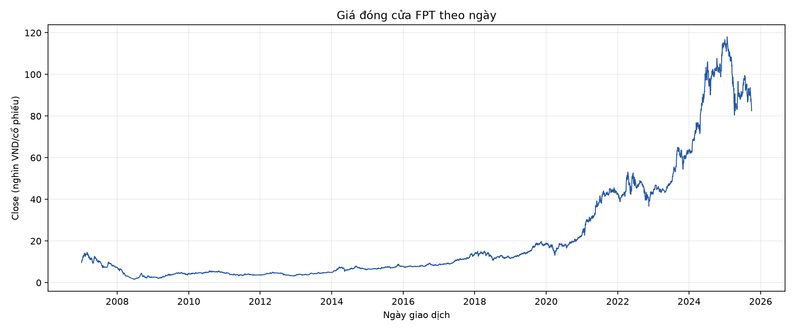
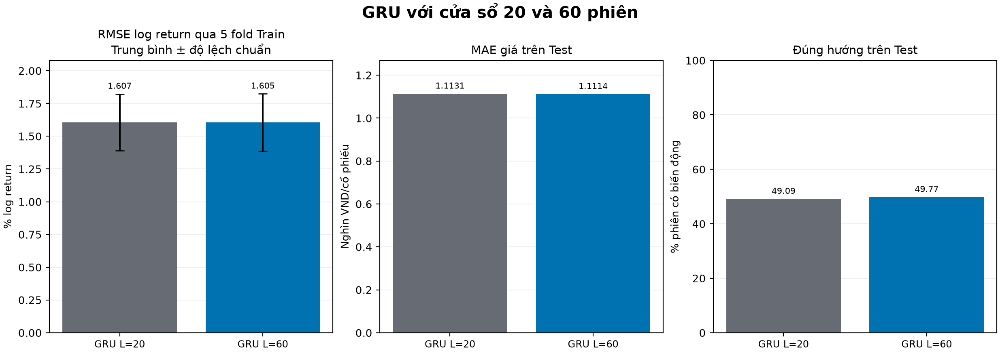
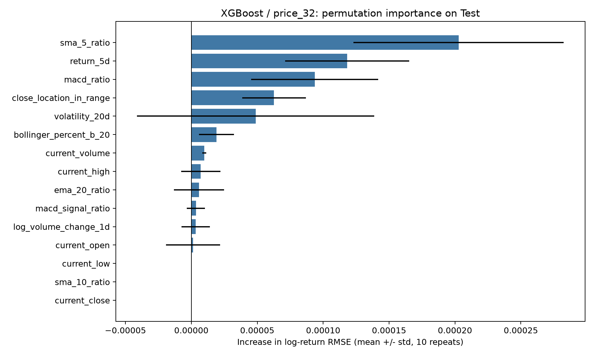

# Dự báo biến động cổ phiếu FPT ở phiên kế tiếp bằng học máy và mô hình chuỗi thời gian

Báo cáo đồ án CS114 — bản thực nghiệm từ năm 2013, cập nhật ngày 19/11/2026. Mọi số liệu bên dưới lấy từ các CSV hiện hành trong `reports/`.

**Các phát hiện chính**

- **Cùng 3.031 phiên mục tiêu** từ 07/08/2013 đến 30/09/2025 cho các cấu hình. Mỗi mô hình dự báo log return để suy ra giá và chiều biến động của phiên kế tiếp.
- **ARIMA(0,0,0) được chọn qua Train CV** với RMSE log return 0,015860. MAE giá trên Test là 1,1106 nghìn VND, gần mức 1,1097 của Last-Close.
- **XGBoost 38 biến có độ đúng hướng 55,00%**, so với 52,95% ở 32 và 42 biến. MAE giá tăng nhẹ từ 1,1100 lên 1,1164 rồi 1,1167 nghìn VND.

## 1. Bài toán: một mục tiêu học, hai cách đọc kết quả

Sau khi phiên t kết thúc, dùng thông tin đã có để dự báo phiên giao dịch quan sát được kế tiếp t+1:

$$r_{t+1}=\ln(C_{t+1}/C_t),\qquad \widehat C_{t+1}=C_t\exp(\widehat r_{t+1}).$$

Mọi mô hình học `next_log_return`. Dự báo dương → Tăng; âm → Giảm; đúng bằng 0 → Đứng giá. Không ép dự báo 0 thành Tăng, không có bộ phân loại hoặc xác suất tăng riêng. Ví dụ giá hôm nay 100, dự báo `ln(1,01) ≈ 0,00995` thì giá dự báo 101 và hướng Tăng.

## 2. Dữ liệu và căn thời điểm công bố

### 2.1. Nguồn thực tế và cách thu thập

| Nguồn | Phạm vi và quan sát | Cách dùng |
|---|---|---|
| FPT OHLCV, Vietcap qua vnstock | 4.671 hàng lưu, 2007–30/09/2025 | 4.669 phiên sau lọc lịch HOSE. Giá nghìn VND/cổ phiếu, khối lượng tính bằng cổ phiếu. |
| VN-Index, DNSE và CafeF | 4.668 giá đóng cửa sau bổ sung 33 phiên và sửa 16 mức giá | Tính log return và độ biến động 20 phiên. |
| USD/VND, Investing.com | 4.893 quan sát, 2007–30/09/2025 | VND trên một USD. |
| XAU/USD, bản xuất Investing.com | 4.858 giá ngày, 01/01/2007–30/09/2025 | Nhân với tỷ giá để có VND mỗi ounce vàng quốc tế. |
| CPI năm, World Bank WDI `FP.CPI.TOTL.ZG` | 20 năm 2005–2024 | Tỷ lệ lạm phát cả năm, đơn vị %. |
| GDP năm, World Bank WDI `NY.GDP.MKTP.CD` | 20 năm 2005–2024 | GDP danh nghĩa cả năm, USD hiện hành. |
| Kết quả kinh doanh FPT, Vietcap qua vnstock | 50 quý liên tục 2013Q1–2025Q2 trong phạm vi dùng | Doanh thu thuần, lợi nhuận gộp, EBIT và lợi nhuận sau thuế của cổ đông công ty mẹ. |

Đối chiếu lịch từ năm 2013 cho thấy DNSE thiếu 33 phiên có giao dịch FPT. Dùng giá đóng cửa CafeF cho các phiên thiếu và 16 mức khác nhau trong các khoảng đối chiếu năm 2020. Báo cáo phiên của các công ty chứng khoán xác nhận các mức CafeF được kiểm tra chéo, như 869,91 điểm ngày 15/07/2020 và 903,98 điểm ngày 29/09/2020. Sau hiệu chỉnh, các phiên FPT trong phạm vi từ 2013 đều có giá đóng cửa VN-Index. Hai ngày HOSE đóng cửa được loại khỏi lịch phiên trước khi tính nhãn. [Lịch sử CafeF](https://cafef.vn/du-lieu/lich-su-giao-dich-vnindex-1.chn) · [Bản tin Funan](https://funan.com.vn/en/diem-tin-giao-dich-15072020.409463) · [Xác nhận lịch HOSE](https://baochinhphu.vn/hose-giao-dich-tro-lai-sau-hai-ngay-dong-cua-102233882.htm)

Tệp bổ sung gồm tệp vàng nhóm cung cấp và số CPI/GDP năm 2005–2024. Báo cáo tài chính quý có khoảng trống 2007Q3–2012Q4 trước phạm vi chính. Trước ngày 15/05/2013 cũng chưa đủ bốn chỉ tiêu quý theo quy tắc giả định độ trễ. [Từ điển dữ liệu](../data/README.md) · [Kiểm toán Chi tiết](../reports/data_quality_review.json)

### 2.2. Ý nghĩa và giả thuyết sử dụng các biến

| Cấp dữ liệu | Nội dung | Số biến |
|---|---|---:|
| Giá và kỹ thuật | 5 OHLCV hiện tại + 23 chỉ báo + 4 biến nến | 32 |
| Thêm thị trường/vĩ mô | Thêm 2 biến VN-Index, USD/VND, vàng, CPI, GDP | 38 |
| Thêm tài chính FPT | Thêm doanh thu thuần, lợi nhuận gộp, EBIT, lợi nhuận sau thuế cổ đông mẹ | 42 |

Các biến giá mô tả trạng thái giao dịch; biến thị trường mô tả bối cảnh chung; biến tài chính mô tả hoạt động kinh doanh. Việc thêm chúng là một giả thuyết được kiểm tra bằng thí nghiệm 32 → 38 → 42, không phải mặc định biến nào cũng cải thiện dự báo.

| Biến bổ trợ | Ý nghĩa/đơn vị | Mục đích thử nghiệm |
|---|---|---|
| `vnindex_return_1d` | Logarithm tỷ số hai mức đóng cửa VN-Index liên tiếp trong nguồn; không có đơn vị | Mô tả hướng chuyển động thị trường gần nhất trong lịch đã đối chiếu |
| `vnindex_volatility_20d` | Độ lệch chuẩn 20 log return thị trường, chia phương sai cho 20 | Mô tả giai đoạn thị trường bình lặng hay biến động mạnh |
| `usd_vnd_rate` | VND để mua một USD; tỷ giá tăng nghĩa là cần nhiều VND hơn | Thử thông tin bối cảnh tỷ giá, có thể liên quan thu nhập/chi phí ngoại tệ |
| `gold_vnd_per_ounce` | XAU/USD nhân USD/VND đã căn thời điểm; VND/ounce vàng quốc tế | Thử thông tin từ một thị trường tài sản khác |
| `cpi_annual_inflation_pct` | Lạm phát CPI cả năm, đơn vị % | Bối cảnh lạm phát trong năm gần nhất đủ điều kiện sử dụng |
| `gdp_usd` | GDP cả năm theo USD hiện hành | Mô tả quy mô kinh tế dài hạn; không thay cho tốc độ tăng GDP thực |
| `fpt_net_revenue_vnd` | Doanh thu sau các khoản giảm trừ, VND/quý | Mô tả quy mô hoạt động kinh doanh |
| `fpt_gross_profit_vnd` | Doanh thu thuần trừ giá vốn, VND/quý | Mô tả phần còn lại sau chi phí trực tiếp, chưa trừ mọi chi phí |
| `fpt_ebit_vnd` | Lợi nhuận trước thuế + trị tuyệt đối chi phí lãi vay, VND/quý | Xấp xỉ lợi nhuận trước lãi vay và thuế theo quy tắc của dự án |
| `fpt_parent_net_profit_vnd` | Lợi nhuận sau thuế thuộc cổ đông công ty mẹ, VND/quý | Phân biệt lợi ích thuộc cổ đông FPT với phần của cổ đông không kiểm soát |

Ví dụ để phân biệt các chỉ tiêu tài chính: doanh thu thuần 100, giá vốn 70 thì lợi nhuận gộp là 30; lợi nhuận trước thuế 20 và chi phí lãi vay 2 cho EBIT theo quy tắc dự án là 22. Sau thuế còn 16, trong đó 2 thuộc cổ đông không kiểm soát thì phần của cổ đông công ty mẹ là 14. Đây là ví dụ giả định, các số thật nằm trong CSV tài chính. Một số liệu quý lặp trên nhiều hàng ngày vẫn chỉ là **một quan sát kinh doanh của quý đó**.

### 2.3. Ngày hiệu lực, dữ liệu thiếu và cửa sổ chung

Giá VN-Index, USD/VND và vàng được dùng sau một ngày lịch, tối đa 10 ngày từ lúc khả dụng. Báo cáo tài chính dùng theo giả định cuối quý cộng 45 ngày, giữ tối đa 150 ngày. CPI và GDP dùng theo giả định cuối năm cộng 180 ngày, giữ tối đa 550 ngày. Ví dụ số 2024 dùng từ phiên 30/06/2025 theo quy tắc này. Ghép lùi theo thời điểm khả dụng. Số CPI 3,6211 được hiểu là 3,6211%. Các ngày công bố và phiên bản số liệu lịch sử chưa xác minh đầy đủ.

Tệp giá lưu 4.671 hàng từ 02/01/2007 đến 30/09/2025. Pipeline bỏ hai ngày HOSE đóng cửa 23–24/01/2018, còn 4.669 phiên. Sau 49 phiên tích lũy cho SMA50, bảng kỹ thuật có 4.620 hàng. Chuỗi chung đủ 42 biến từ 15/05/2013. Phiên đầu vào 06/08/2013 có đủ 60 phiên liên tiếp và được gán nhãn bằng ngày mục tiêu 07/08/2013. Bảng chung có 3.032 hàng gồm 3.031 nhãn và đầu vào 30/09/2025 dành cho dự báo.

Cả ba cấp dữ liệu dùng cùng ngày và được kiểm tra tính liên tiếp bằng `session_index`. Pipeline báo lỗi nếu còn thiếu một biến bổ trợ từ khi báo cáo quý I/2013 có thể dùng. ARIMA dùng lịch sử log return. SARIMAX thêm 10 biến bổ trợ.

### 2.4. EDA: kiểm tra gì, rồi quyết định xử lý thế nào?

EDA (Exploratory Data Analysis) là bước xem dữ liệu trước khi học: kiểm tra các con số có nghĩa hợp lý, hiểu thang đo và tìm các đặc điểm ảnh hưởng đến cách tạo đầu vào. Không phải cứ vẽ nhiều biểu đồ là hoàn thành EDA.

| Kiểm tra/biểu đồ | Kết quả quan sát | Ý nghĩa đối với xử lý |
|---|---|---|
| Kiểu ngày, sắp xếp, ngày trùng, ô thiếu | 4.669 phiên sau kiểm tra lịch, không thiếu và không trùng | Chuẩn hóa ngày, sắp tăng dần; lỗi đầu vào nghiêm trọng được báo thay vì tự đoán giá trị |
| Quan hệ OHLC | 3 hàng bất nhất: 17/08/2007, 10/06/2009, 07/12/2009 | Ghi rõ ngày và giữ nguyên nguồn; nằm trước mẫu thí nghiệm chung |
| Khối lượng bằng 0 và độ lớn | 0 phiên có volume bằng 0 sau lọc lịch; lớn nhất 23.514.300 cổ phiếu | Không coi 0 là ô thiếu; dùng `log(1+volume)` để biến đổi hữu hạn và giảm chênh lệch thang đo |
| Đường giá đóng cửa | Giá từ 1,61525 đến 118,073 nghìn VND | Mức giá thay đổi đáng kể theo giai đoạn; xem thêm tỷ lệ và log return thay vì chỉ độ chênh tuyệt đối |
| Phân phối simple return | Trung bình 0,0644%; độ lệch chuẩn 1,9193%; hai phân vị 1%/99% khoảng −4,9473%/+4,9717% | Không tự cắt mọi biến động lớn; lỗi dự báo ở đuôi phân phối cần được phân tích riêng |
| Tần số hướng của phiên kế tiếp | 2.118 tăng, 2.074 giảm, 476 không đổi | Phân biệt các phiên thật sự đổi giá khi đọc độ đúng hướng; tổng 4.668 chuyển tiếp |
| Độ phủ nguồn bổ trợ | Mốc đầu khác nhau, có khoảng trống nội bộ | Ghép theo hiệu lực, giới hạn độ cũ, rồi xác định mẫu chung |

Biểu đồ volume dùng trục `symlog`: phần lớn được nén theo logarithm, vùng gần 0 vẫn biểu diễn được. Đây là **cách vẽ**, không thay đổi CSV. Biểu đồ phân phối lợi nhuận dùng `C_t/C_(t-1) − 1`; trục 0,01 tương ứng 1%, khác với nhãn log return. Độ lệch chuẩn trong thống kê EDA chia cho `n−1`, còn cửa sổ đặc trưng biến động chia cho `n`; hai quy ước được ghi rõ, không trộn lẫn.

EDA toàn kỳ phục vụ mô tả snapshot; kiểm định chuỗi thời gian chính ở mục 3 chỉ dùng lịch sử đến cuối Train. Dữ liệu được giữ ở dạng giá trị gốc và đặc trưng dẫn xuất. Không có bước tự động loại outlier hoặc chuẩn hóa toàn bộ dữ liệu trước chia tập.

### 2.5. Tại sao dùng các công thức đặc trưng?

| Nhóm | Phép biến đổi chính | Thông tin muốn đưa cho mô hình |
|---|---|---|
| Lợi nhuận 1/2/5/10/20 phiên | `C_t/C_(t-k) − 1` | Đà thay đổi trên nhiều độ dài; đây là lợi nhuận cộng dồn k phiên, không phải dịch cột lợi nhuận một phiên |
| SMA và EMA | `C_t/trung bình − 1` | Giá đang lệch khỏi mức gần đây bao nhiêu; SMA cân đều, EMA đặt trọng số lớn hơn cho dữ liệu gần |
| RSI | So phần tăng và giảm đã làm mượt, lưu về thang 0–1 | Sức tăng tương đối so với sức giảm gần đây; không mặc định quá mua sẽ giảm ngay |
| MACD | EMA12 trừ EMA26; đường tín hiệu EMA9; chia cho giá hiện tại | Chênh lệch xu hướng ngắn/dài và sự thay đổi của chênh lệch ấy |
| Bollinger | Vị trí trong dải trung bình ±2 độ lệch chuẩn, độ rộng chia trung bình | Vị trí tương đối và mức phân tán gần đây; không phải khoảng dự báo bảo đảm 95% |
| Volatility | Độ lệch chuẩn lợi nhuận 5/20 phiên | Mức dao động, không tự cho biết hướng tiếp theo |
| Khối lượng | Chênh lệch log-volume và khoảng cách so trung bình 20 phiên | Hoạt động giao dịch có tăng hoặc bất thường so lịch sử gần không |
| Nến OHLC | Biên độ, thân nến, khoảng nhảy mở cửa, vị trí đóng cửa | Diễn biến trong phiên mà riêng close không mô tả hết |

Ví dụ giá 105, SMA20 bằng 100 thì `sma_20_ratio = 105/100 − 1 = 0,05`: cao hơn trung bình 5%. Tỷ lệ tương đối giúp so sánh các giai đoạn có mức giá khác nhau. Nếu 20 ngày volume cùng một mức, độ lệch chuẩn bằng 0 làm z-score không xác định; code giữ thiếu rồi loại hàng không đủ chỉ báo, không chia cho 0 hoặc điền bằng dữ liệu tương lai.

Ridge dùng `StandardScaler` để đưa các cột về thang có thể so sánh: `z=(x−trung bình Train)/độ lệch chuẩn Train`. Đây là chuẩn hóa đầu vào sau khi tạo đặc trưng; khác với z-score khối lượng tính bằng cửa sổ quá khứ của từng phiên. Công thức, trường hợp biên và các phép tính mini được giải thích đầy đủ tại [EDA và đặc trưng](EDA_VA_DAC_TRUNG.md); [cẩm nang](CAM_NANG_HIEU_DU_AN.md) nối các bước này với mô hình và cách đọc kết quả.

## 3. Đặc điểm chuỗi thời gian

Phân tích chính dùng 4.214 mức giá và 4.213 log return từ lịch sử đến cuối Train 29/11/2023. ADF dùng hằng số với độ trễ theo AIC. KPSS dùng giả thuyết dừng mức quanh hằng số và độ trễ tự động.

| Chuỗi | ADF statistic | ADF p | KPSS statistic | KPSS p | Diễn giải ở mức 5% |
|---|---:|---:|---:|---:|---|
| Close | 2,5645 | 0,9991 | 6,9677 | < 0,01 | Không bác bỏ nghiệm đơn vị, bác bỏ dừng mức |
| Log return | −9,8117 | 5,63 × 10⁻¹⁷ | 0,5349 | 0,0338 | Bác bỏ nghiệm đơn vị và bác bỏ dừng mức |

ADF và KPSS có giả thuyết gốc khác nhau. Kết quả hỗ trợ mô hình hóa biến động tương đối thay vì mức giá có xu thế; **không chứng minh log return dừng hoàn toàn**, không chứng minh chắc chắn dự báo tốt hơn và không dùng KPSS làm kiểm định cụm biến động. Xem tài liệu [ADF](https://www.statsmodels.org/stable/generated/statsmodels.tsa.stattools.adfuller.html) và [KPSS](https://www.statsmodels.org/stable/generated/statsmodels.tsa.stattools.kpss.html).

ACF mô tả liên hệ với các độ trễ; PACF mô tả liên hệ còn lại sau kiểm soát độ trễ trung gian. Dải 95% giúp đọc từng độ trễ, không phải bằng chứng mọi đỉnh đều có ý nghĩa khi khảo sát nhiều lag. Log return đặt biến động vào cùng thang tương đối; giá được khôi phục bằng giá hiện tại nên cây không cần ngoại suy trực tiếp mức giá tuyệt đối.

## 4. Năm phương pháp đại diện

| Phương pháp | Câu hỏi nghiên cứu | Cấu hình khảo sát |
|---|---|---|
| Last-Close Baseline | Giữ giá hôm nay đã đủ tốt chưa? | Log return luôn bằng 0 |
| Ridge Regression | Quan hệ tuyến tính có kiểm soát trọng số có hữu ích không? | StandardScaler + Ridge, alpha 10 hoặc 100 |
| XGBoost Regressor | Quy tắc phi tuyến có cải thiện không? | 120 cây, sâu 2 hoặc 3, learning rate 0,04 |
| ARIMA | Lịch sử lợi nhuận tự nó dự báo được gì? | Bậc (0,0,0) hoặc (1,0,0), có hằng số |
| GRU | Học bộ nhớ nhiều phiên có hữu ích không? | 1 lớp, 16 nút ẩn, L=20 hoặc 60, 12 epoch |

Ridge chọn alpha `100.0`; XGBoost chọn độ sâu `2`. XGBoost cố định `subsample=0.85`, `colsample_bytree=0.85`, `min_child_weight=8`, `reg_lambda=3`, seed 42, 1 luồng. GRU dùng Adam, learning rate 0,001, weight decay 0,0001, batch 64, cắt gradient ở 1. Nhãn log return được nhân 100 khi học GRU/thống kê và chia lại 100 khi trả kết quả; không đổi đơn vị báo cáo.

ARIMA và SARIMAX thử bậc (0,0,0)/(1,0,0), không mùa vụ. Cả hai có thành phần hằng số; SARIMAX biểu diễn bằng một cột ngoại sinh 1 để cập nhật từng phiên ổn định. SARIMAX thêm 10 biến bổ trợ đã chuẩn hóa bằng Train. Cập nhật trạng thái chỉ sau khi kết quả phiên được quan sát, giữ tham số đã fit trong thời gian Test.

## 5. Thiết kế đánh giá

**Train 2.576 mẫu (07/08/2013–29/11/2023)** và **Test 455 mẫu (30/11/2023–30/09/2025)**. Chia 85%/15% theo ngày mục tiêu. Hồi quy chấm 455 mẫu. Đúng hướng chấm 440 phiên đổi giá, dự báo đứng giá tính sai trên các phiên này.

Train dùng `TimeSeriesSplit(n_splits=5, gap=1)`. Số hàng học lần lượt là 430, 859, 1.288, 1.717 và 2.146, với 429 hàng kiểm định mỗi fold. CV báo trung bình và độ lệch chuẩn mẫu. StandardScaler chỉ học từ phần Train của từng lượt fit.

Chọn siêu tham số và L bằng **RMSE log return CV nhỏ nhất**, khóa lựa chọn trong `experiment_plan.json`, rồi fit toàn bộ Train và chấm Test. StandardScaler chỉ học từ Train của mỗi fold; GRU dùng các phiên ngữ cảnh quá khứ trong cửa sổ Train. Sau khi lưu kết quả đánh giá, mô hình chính được CV chọn học lại trên toàn bộ giai đoạn có nhãn, gồm các phiên ngữ cảnh liên tục đối với mô hình thống kê để tạo dự báo mới nhất. Artefact học lại không dùng để chấm lại Test.

Gọi sai số giá phiên i là `e_i = giá dự báo − giá thực tế`:

- **MAE** = trung bình `|e_i|`; **RMSE** = căn bậc hai của trung bình `e_i²`, phạt mạnh lỗi lớn. Cả hai có đơn vị nghìn VND/cổ phiếu.
- **CV RMSE log return** dùng cùng công thức trên lợi nhuận logarit, không có đơn vị giá. Không đọc 0,017 thành 0,017 nghìn VND.
- **Đúng hướng** = số dự báo có dấu đúng / số phiên thực tế đổi giá × 100. Dấu 0 không trùng dấu +1 hoặc −1.
- **Dung sai ±1%** = tỷ lệ phiên có `|e_i| / giá thực tế ≤ 0,01`. MAE/MAPE và dung sai dùng cả phiên đứng giá.

CSV giữ thêm Test MAE/RMSE log return, MAPE giá, dung sai ±0,5% và ±2%. Không dùng MAPE trên log return vì các giá trị gần 0 làm mẫu số không ổn định. Bảng chính có một cột tên và năm cột độ đo.

Lịch chia chi tiết nằm ở `training_summary.json`; toàn bộ ứng viên và điểm từng fold ở `cv_candidate_summary.csv`, `cv_fold_metrics.csv`. Cách chia dùng [TimeSeriesSplit](https://scikit-learn.org/stable/modules/generated/sklearn.model_selection.TimeSeriesSplit.html).

## 6. Kết quả ba thí nghiệm

### 6.1. Thí nghiệm 1 — Năm phương pháp trên dữ liệu giá

| Mô hình / cấu hình | CV RMSE log return | Test MAE giá (nghìn VND) | Test RMSE giá (nghìn VND) | Đúng hướng | Dung sai ±1% |
|---|---:|---:|---:|---:|---:|
| Last-Close Baseline | 0.015890 ± 0.002139 | 1.1097 | 1.5623 | 0.00% | 55.16% |
| Ridge Regression | 0.016166 ± 0.002189 | 1.1229 | 1.5794 | 48.41% | 54.73% |
| XGBoost | 0.016390 ± 0.002035 | 1.1100 | 1.5610 | 52.95% | 55.60% |
| ARIMA | 0.015860 ± 0.002130 | 1.1106 | 1.5636 | 52.27% | 55.16% |
| GRU L=60 | 0.016054 ± 0.002182 | 1.1114 | 1.5618 | 49.77% | 55.16% |

ARIMA(0,0,0) có CV RMSE 0,015860, thấp hơn nhẹ mức 0,015890 của Last-Close. Cấu hình này học một log return dương cố định từ Train. Độ đúng hướng 52,27% của ARIMA chính là tỷ lệ 230 phiên tăng trong 440 phiên Test đổi giá. MAE Test của ARIMA là 1,1106 nghìn VND. Last-Close có MAE 1,1097 nghìn VND và luôn trả đứng giá. XGBoost 32 biến có RMSE giá 1,5610 nghìn VND, thấp nhất trong bảng năm phương pháp.

Mỗi điểm giá là một dự báo một bước sử dụng giá phiên ngay trước đã quan sát.

### 6.2. Thí nghiệm 2 — Tác động dữ liệu bổ trợ

| Mô hình / cấu hình | CV RMSE log return | Test MAE giá (nghìn VND) | Test RMSE giá (nghìn VND) | Đúng hướng | Dung sai ±1% |
|---|---:|---:|---:|---:|---:|
| price_32 | 0.016390 ± 0.002035 | 1.1100 | 1.5610 | 52.95% | 55.60% |
| macro_38 | 0.016409 ± 0.001915 | 1.1164 | 1.5707 | 55.00% | 54.95% |
| financial_42 | 0.016473 ± 0.001815 | 1.1167 | 1.5730 | 52.95% | 54.95% |

Cùng cấu hình XGBoost trên cùng các phiên, thêm khối thị trường/vĩ mô nâng độ đúng hướng từ 52,95% lên 55,00%, đồng thời MAE giá tăng từ 1,1100 lên 1,1164 nghìn VND. Thêm bốn chỉ tiêu FPT cho MAE 1,1167 và độ đúng hướng 52,95%. Mỗi độ đo trả lời một câu hỏi khác nhau. Chênh lệch này mô tả mẫu Test hiện tại.

**Đối sánh thống kê mở rộng**

| Mô hình / cấu hình | CV RMSE log return | Test MAE giá (nghìn VND) | Test RMSE giá (nghìn VND) | Đúng hướng | Dung sai ±1% |
|---|---:|---:|---:|---:|---:|
| ARIMA | 0.015860 ± 0.002130 | 1.1106 | 1.5636 | 52.27% | 55.16% |
| SARIMAX | 0.016629 ± 0.000984 | 1.2753 | 1.7415 | 52.27% | 47.69% |

ARIMA và SARIMAX cùng chọn bậc (0,0,0) từ lưới Train CV. SARIMAX dùng 10 biến bổ trợ và đạt RMSE giá 1,7415 nghìn VND, so với 1,5636 của ARIMA. Cả hai đúng hướng 52,27%. Bảng chi tiết hội tụ và cảnh báo được lưu cùng kết quả CV.

### 6.3. Thí nghiệm 3 — Bộ nhớ GRU

| Mô hình / cấu hình | CV RMSE log return | Test MAE giá (nghìn VND) | Test RMSE giá (nghìn VND) | Đúng hướng | Dung sai ±1% |
|---|---:|---:|---:|---:|---:|
| GRU L=20 | 0.016068 ± 0.002157 | 1.1131 | 1.5624 | 49.09% | 56.26% |
| GRU L=60 | 0.016054 ± 0.002182 | 1.1114 | 1.5618 | 49.77% | 55.16% |

CV chọn GRU L=60 (0,016054 so với 0,016068 ở L=20). Hai sai số CV gần nhau. MAE Test của L=60 là 1,1114 nghìn VND, của L=20 là 1,1131. L=20 có dung sai ±1% 56,26% và L=60 đạt 55,16%. Hai cấu hình giữ cùng kiến trúc, seed và số epoch.

Tổng cộng **9 cấu hình đánh giá duy nhất**, được tái dùng giữa các bảng; có 9 artefact Train-only và 1 artefact học lại để dự báo, không phải 62 mô hình. SARIMAX là mở rộng của thí nghiệm 2, không thêm vào bảng năm phương pháp chính.

## 7. Giải thích mô hình và phân tích lỗi

### 7.1. Permutation Importance

Giải thích XGBoost 32 biến đã học Train. Xáo trộn từng cột trên Test 10 lần; lấy mức tăng RMSE log return trung bình và độ lệch chuẩn. Cột làm sai số tăng nhiều hơn được mô hình sử dụng hữu ích hơn trên mẫu này. Giá trị âm nghĩa việc tráo cột làm sai số giảm; không sửa mô hình sau khi xem biểu đồ. Phương pháp theo [tài liệu scikit-learn](https://scikit-learn.org/stable/modules/permutation_importance.html).

Ba cột có mức tăng RMSE log return trung bình cao nhất khi bị tráo là **ema_10_ratio, macd_ratio, return_5d**. Bảng đầy đủ nằm ở `permutation_importance.csv`. Các biến có tương quan có thể thay thế nhau khi dự báo.

### 7.2. Ba ca sai số giá lớn nhất

Chọn tự động ba sai số tuyệt đối lớn nhất của mô hình chính được CV chọn (**ARIMA**), không lựa ca bằng câu chuyện tin tức. Đơn vị các cột giá là nghìn VND/cổ phiếu.

| Ngày mục tiêu | Giá hôm trước | Giá thực tế | Giá dự báo | Sai số tuyệt đối | FPT thực tế | VN-Index cùng phiên |
|---|---:|---:|---:|---:|---:|---:|
| 2025-04-03 | 93.3561 | 86.8508 | 93.4497 | 6.5990 | -6.97% | -6.68% |
| 2025-04-16 | 88.7678 | 82.5641 | 88.8568 | 6.2926 | -6.99% | -1.42% |
| 2025-02-03 | 117.3808 | 111.3369 | 117.4984 | 6.1616 | -5.15% | -0.95% |

Cả ba phiên FPT giảm mạnh trong khi ARIMA(0,0,0) dự báo tăng khoảng 0,10%. Ngày 03/04/2025, FPT và VN-Index cùng giảm trên 6%. Ngày 16/04, FPT giảm 6,99% và VN-Index giảm 1,42%. Sau kỳ nghỉ, đầu vào 24/01 dự báo phiên 03/02. Các số VN-Index cùng phiên chỉ mô tả bối cảnh sau khi chấm.

### Phụ lục bổ trợ

SHAP dùng 100 hàng Train làm nền, giải thích 150 hàng Test của cùng XGBoost; biểu đồ không thay cho phân tích permutation chính.

STL trên log(close) với chu kỳ quy ước 5 phiên chỉ nhằm mô tả xu thế/phần dư, không đưa thành phần phân rã vào đặc trưng và không coi chu kỳ đó là mùa vụ đã được chứng minh.

## Giới hạn nghiên cứu & Hướng phát triển

Đây là thực nghiệm học thuật trên một mã cổ phiếu, không phải khuyến nghị đầu tư. Các ngày Test đã từng được xem ở thiết kế trước; phiên bản này chọn bằng Train CV nhưng không được gọi là một holdout mới chưa từng quan sát. Thí nghiệm này cũng không cô lập tác động của đổi mục tiêu so với dự báo giá trực tiếp, nên không kết luận quan hệ nhân quả hoặc “giải quyết triệt để” dự báo chứng khoán.

Giá snapshot đã điều chỉnh. Độ trễ 45 ngày của báo cáo quý và 180 ngày của CPI/GDP là giả định. Số liệu WDI có thể đã được điều chỉnh sau ngày nghiên cứu. Dữ liệu năm/quý lặp trên nhiều phiên vẫn là một quan sát của kỳ đó. GRU chạy một seed và 12 epoch. Permutation theo cột có thể phá cấu trúc thời gian.

Ba hàng OHLC bất nhất và một ngày FPT chưa khớp lịch chỉ số còn nằm trước cửa sổ huấn luyện. So với lần chạy cũ, phiên bản này đổi cả nguồn, biến đầu vào và thời kỳ Test. Vì thế phép so kết quả giữa hai phiên bản không ước lượng riêng ảnh hưởng của số mẫu Train.

Các bước tiếp theo: đóng băng thiết kế để kiểm tra giai đoạn mới, bổ sung ngày công bố/vintage thực, thử nhiều seed và độ trễ, đánh giá độ bất định, rồi mới cân nhắc mô phỏng giao dịch với phí và trượt giá. Dự báo điểm gần đúng chưa đồng nghĩa chiến lược có lợi nhuận.
