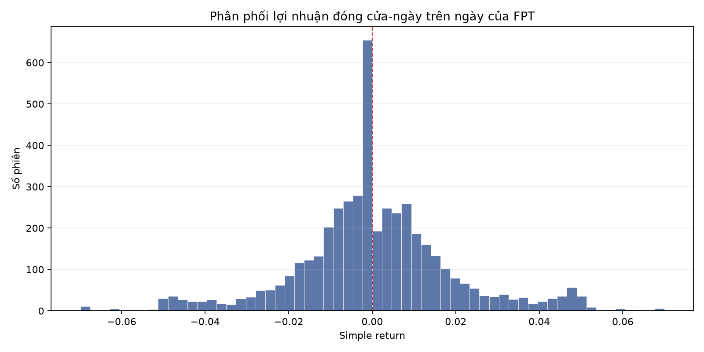
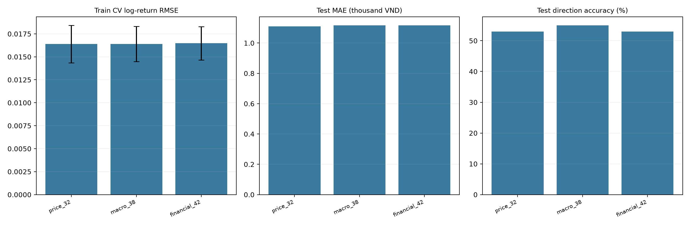
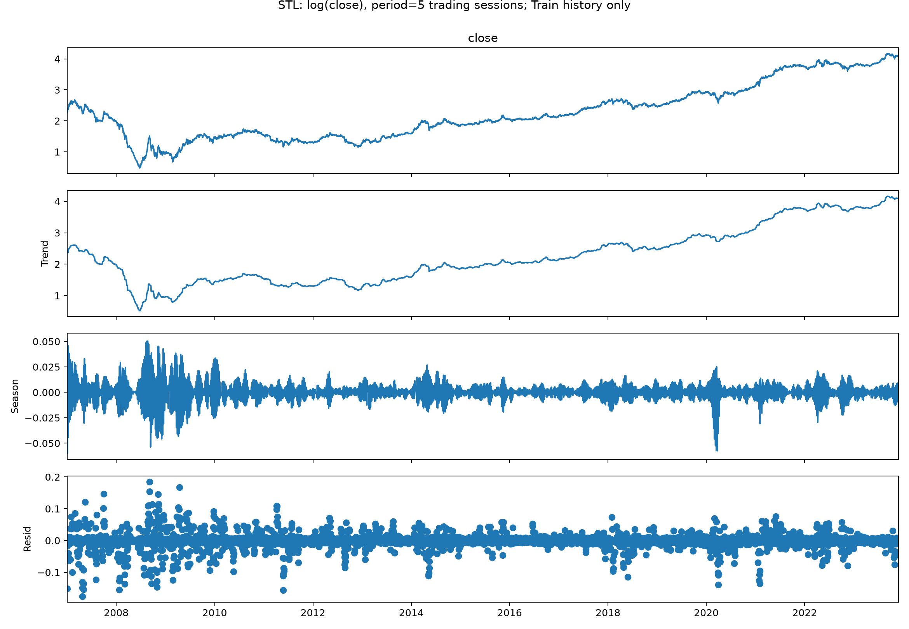

# Dự báo biến động cổ phiếu FPT ở phiên kế tiếp bằng học máy và mô hình chuỗi thời gian

Báo cáo đồ án CS114 — bản thực nghiệm rút gọn ngày 19/11/2026. Mọi số liệu bên dưới lấy từ các CSV hiện hành trong `reports/`.

**Các phát hiện chính**

- **Một mục tiêu, hai đầu ra:** chỉ học log return; giá và hướng đều suy ra từ cùng dự báo. Không còn mô hình phân loại riêng.
- **Lựa chọn bằng Train CV:** ARIMA có CV RMSE thấp nhất trong năm đại diện (0.017192); Test MAE giá 1.2392. Baseline đạt MAE 1.2250, nên mô hình được CV chọn chưa vượt baseline về MAE trên giai đoạn Test.
- **Thêm dữ liệu chưa tự động tốt hơn:** XGBoost 32 → 43 biến có Test RMSE log return 0.018754 → 0.020089; đúng hướng 51.98% → 48.02%. GRU chọn **GRU L=60** bằng CV.

## 1. Bài toán: một mục tiêu học, hai cách đọc kết quả

Sau khi phiên t kết thúc, dùng thông tin đã có để dự báo phiên giao dịch quan sát được kế tiếp t+1:

$$r_{t+1}=\ln(C_{t+1}/C_t),\qquad \widehat C_{t+1}=C_t\exp(\widehat r_{t+1}).$$

Mọi mô hình học `next_log_return`. Dự báo dương → Tăng; âm → Giảm; đúng bằng 0 → Đứng giá. Không ép dự báo 0 thành Tăng, không có bộ phân loại hoặc xác suất tăng riêng. Ví dụ giá hôm nay 100, dự báo `ln(1,01) ≈ 0,00995` thì giá dự báo 101 và hướng Tăng.

## 2. Dữ liệu và căn thời điểm công bố

### 2.1. Nguồn thực tế và cách thu thập

OHLCV FPT gồm **4.671 phiên**, 02/01/2007–30/09/2025, lấy qua VCI/vnstock. Giá là nghìn VND/cổ phiếu; volume là số cổ phiếu. Không có ô thiếu/ngày trùng; 2 phiên volume bằng 0 và 3 bất nhất OHLC được giữ, ghi audit. Các bất nhất nằm trước cohort thực nghiệm.

Nguồn bổ trợ: VN-Index từ DNSE (4.635 phiên), USD/VND, XAU/USD và lịch CPI từ bản xuất Investing.com; GDP danh nghĩa USD từ World Bank; báo cáo quý VCI và công bố cổ phiếu lưu hành FPT. `fetch_supplemental.py --from-cache` chuẩn hóa snapshot, không có nghĩa tải lại mọi website. Vàng VND/ounce = XAU/USD × USD/VND, không phải giá vàng miếng trong nước. Chi tiết nguồn, schema và các bước xuất CSV tại [data/README.md](../data/README.md).

Quy trình có ba hình thức thu thập: (1) gọi thư viện/API cho giá FPT và VN-Index; (2) chuẩn hóa bản CSV xuất từ trang tài chính/lịch kinh tế cho tỷ giá, vàng, CPI và GDP; (3) chuyển báo cáo tài chính và thông tin công bố của doanh nghiệp thành các bảng kỳ báo cáo. Script hiện tại tự động kiểm tra, chuẩn hóa và ghép các bản lưu. Phần trích số cổ phiếu từ công bố FPT là bước kiểm chứng thủ công có URL theo từng hàng, không được mô tả thành một API tải mọi nguồn tự động.

| Nguồn/chuỗi | Phạm vi số liệu gốc | Phiên FPT đầu có giá trị sau căn thời điểm | Số ô thiếu trên 4.671 phiên FPT |
|---|---|---|---:|
| VN-Index → log return | 02/01/2007–30/09/2025 | 04/01/2007 | 7 |
| VN-Index → biến động 20 phiên | Cùng chuỗi VN-Index | 31/01/2007 | 26 |
| USD/VND | 01/01/2007–30/09/2025 | 02/01/2007 | 0 |
| XAU/USD → vàng VND/ounce | 01/01/2019–30/09/2025 | 02/01/2019 | 2.988 |
| CPI so cùng kỳ | Công bố 27/12/2018–06/09/2025 | 28/12/2018 | 2.987 |
| GDP danh nghĩa USD | Năm 2010–2024 | 29/06/2011 | 1.110 |
| Bốn chỉ tiêu lợi nhuận/doanh thu | Quý I/2007–quý II/2025, 52 quý có khoảng trống | 15/05/2007 | 1.407 mỗi cột |
| Số cổ phiếu lưu hành | 10 mốc tham chiếu 2017–07/2025 | 02/07/2018 | 2.859 |

Số thiếu được đếm **sau ghép lên lịch giao dịch FPT**, không phải số ô trống trong CSV gốc. Trong đó có lỗ giữa chuỗi: hai biến VN-Index thiếu ở 01–05/02/2021; mỗi biến tài chính có 1.322 phiên thiếu sau ngày hợp lệ đầu tiên. Vì thế chỉ lấy giao của ngày bắt đầu/kết thúc các nguồn chưa đủ để bảo đảm bảng huấn luyện liên tục.

Rà soát bổ sung bằng `src/audit_data_quality.py` cho thấy **36 ngày có trong FPT nhưng không có hàng nguồn VN-Index**, nhiều hơn số ô thiếu sau ghép vì quy tắc giữ giá trị cũ che các khoảng ngắn. Có 17 đoạn return được tính giữa hai hàng nguồn trải qua ngày FPT bị khuyết; tại các đoạn này, tên `vnindex_return_1d` không bảo đảm lợi nhuận đúng một phiên. Chưa điền/sửa nguồn trong đợt tài liệu này. Danh sách ngày và 22 quý tài chính chưa có nằm ở [data_quality_review.json](../reports/data_quality_review.json); quy trình bổ sung nằm ở [hướng dẫn kiểm tra dữ liệu](HUONG_DAN_KIEM_TRA_VA_BO_SUNG_DU_LIEU.md).

Mốc đầu của bản vàng/CPI/GDP phản ánh phần lịch sử đã thu thập, không được diễn giải thành giới hạn lịch sử của nhà cung cấp. Mở rộng về 2007 đòi hỏi thu thập đồng bộ các nguồn và ngày công bố, không chỉ kéo dài vàng/CPI.

### 2.2. Ý nghĩa và giả thuyết sử dụng các biến

| Cấp dữ liệu | Nội dung | Số biến |
|---|---|---:|
| Giá và kỹ thuật | 5 OHLCV hiện tại + 23 chỉ báo + 4 biến nến | 32 |
| Thêm thị trường/vĩ mô | Thêm 2 biến VN-Index, USD/VND, vàng, CPI, GDP | 38 |
| Thêm tài chính FPT | Thêm doanh thu thuần, lợi nhuận gộp, EBIT, lợi nhuận sau thuế cổ đông mẹ, số cổ phiếu | 43 |

Các biến giá mô tả trạng thái giao dịch; biến thị trường mô tả bối cảnh chung; biến tài chính mô tả hoạt động kinh doanh. Việc thêm chúng là một giả thuyết được kiểm tra bằng thí nghiệm 32 → 38 → 43, không phải mặc định biến nào cũng cải thiện dự báo.

| Biến bổ trợ | Ý nghĩa/đơn vị | Mục đích thử nghiệm |
|---|---|---|
| `vnindex_return_1d` | Logarithm tỷ số hai mức đóng cửa VN-Index liên tiếp trong nguồn; không có đơn vị | Mô tả hướng chuyển động thị trường gần nhất; đoạn mất ngày có thể phản ánh nhiều phiên |
| `vnindex_volatility_20d` | Độ lệch chuẩn 20 log return thị trường, chia phương sai cho 20 | Mô tả giai đoạn thị trường bình lặng hay biến động mạnh |
| `usd_vnd_rate` | VND để mua một USD; tỷ giá tăng nghĩa là cần nhiều VND hơn | Thử thông tin bối cảnh tỷ giá, có thể liên quan thu nhập/chi phí ngoại tệ |
| `gold_vnd_per_ounce` | XAU/USD nhân USD/VND đã căn thời điểm; VND/ounce vàng quốc tế | Thử thông tin từ một thị trường tài sản khác |
| `cpi_yoy_pct` | Tỷ lệ tăng giá tiêu dùng so cùng kỳ, đơn vị %; 3,24 nghĩa là 3,24% | Mô tả môi trường lạm phát, không phải lợi nhuận hay giá trị CPI tuyệt đối |
| `gdp_usd` | GDP cả năm theo USD hiện hành | Mô tả quy mô kinh tế dài hạn; không thay cho tốc độ tăng GDP thực |
| `fpt_net_revenue_vnd` | Doanh thu sau các khoản giảm trừ, VND/quý | Mô tả quy mô hoạt động kinh doanh |
| `fpt_gross_profit_vnd` | Doanh thu thuần trừ giá vốn, VND/quý | Mô tả phần còn lại sau chi phí trực tiếp, chưa trừ mọi chi phí |
| `fpt_ebit_vnd` | Lợi nhuận trước thuế + trị tuyệt đối chi phí lãi vay, VND/quý | Xấp xỉ lợi nhuận trước lãi vay và thuế theo quy tắc của dự án |
| `fpt_parent_net_profit_vnd` | Lợi nhuận sau thuế thuộc cổ đông công ty mẹ, VND/quý | Phân biệt lợi ích thuộc cổ đông FPT với phần của cổ đông không kiểm soát |
| `fpt_shares_outstanding` | Số cổ phiếu lưu hành tại mốc đã ghi nhận | Bổ sung bối cảnh thay đổi quy mô vốn/cổ phiếu; không dùng như tín hiệu chắc chắn tăng/giảm |

Ví dụ để phân biệt các chỉ tiêu tài chính: doanh thu thuần 100, giá vốn 70 thì lợi nhuận gộp là 30; lợi nhuận trước thuế 20 và chi phí lãi vay 2 cho EBIT theo quy tắc dự án là 22. Sau thuế còn 16, trong đó 2 thuộc cổ đông không kiểm soát thì phần của cổ đông công ty mẹ là 14. Đây là ví dụ giả định, các số thật nằm trong CSV tài chính. Một số liệu quý lặp trên nhiều hàng ngày vẫn chỉ là **một quan sát kinh doanh của quý đó**.

### 2.3. Ngày hiệu lực, dữ liệu thiếu và cửa sổ chung

Ghép lùi từ ngày có hiệu lực: nguồn ngày + 1 ngày lịch; CPI theo ngày công bố + 1; báo cáo quý cuối quý + 45; GDP cuối năm + 180. Cổ phiếu lưu hành theo mốc công bố/tham chiếu trong CSV + 1 ngày, không áp máy móc độ trễ quý. Hết hạn giữ thì trở lại thiếu (ngày 10, CPI 65, quý 150, GDP/cổ phiếu 550 ngày). Không nội suy qua kỳ tương lai, không `bfill`.

Ví dụ báo cáo quý II/2025 có ngày kỳ là 30/06/2025, ngày hiệu lực giả định là 14/08/2025. Ngày 13/08 vẫn chỉ được dùng báo cáo cũ còn hạn; từ 14/08 mới được lấy số quý II. GDP 2024 có ngày kỳ 31/12/2024, cộng 180 ngày thành 29/06/2025; phiên FPT đầu sau mốc này là 30/06/2025. Dữ liệu ngày 30/09/2025 của nguồn có độ trễ một ngày chưa được dùng làm biến bổ trợ cho đầu vào ngày 30/09. Quy tắc này bảo thủ hơn việc giả định mọi thị trường đóng cửa đồng thời.

Sau chỉ báo và yêu cầu 60 phiên liên tiếp đủ 43 biến, còn 1.560 hàng, gồm 1.559 nhãn và hàng cuối chưa biết kết quả. Mọi phương pháp dùng cùng ngày đánh giá. ARIMA không dùng 32 cột giá như ML; nó dùng riêng lịch sử log return. ARIMA/SARIMAX giữ các phiên ngữ cảnh trung gian để cập nhật chuỗi liên tục; do đó số quan sát fit thống kê có thể lớn hơn số hàng cohort ML, được lưu trong manifest. Các khoảng thiếu ngoại sinh trong ngữ cảnh SARIMAX được điền median học trên Train, không dùng số của tương lai.

Luồng số lượng hàng: **4.671 phiên gốc → 4.622 hàng đủ chỉ báo → 1.560 hàng đủ ngữ cảnh đa nguồn → 1.559 hàng có nhãn**. 49 hàng đầu chưa đủ cửa sổ SMA50; đây là thiếu lịch sử tính toán, không phải dữ liệu nguồn bị lỗi. Bảng giá/kỹ thuật bắt đầu ngày đầu vào 20/03/2007. Bảng so sánh chung bắt đầu ngày đầu vào 02/04/2019, nhãn thuộc phiên 03/04/2019. Hàng cuối 30/09/2025 giữ để dự báo, không tự tạo đáp án cho phiên tương lai.

Chuỗi 60 phiên được kiểm tra cả số hàng đủ biến và chỉ số phiên gốc `session_index`. Không nối hai đoạn bị đứt thành một chuỗi giả liên tục. Tiêu chí chung làm mất một phần lịch sử giá nhưng giữ cho phép so sánh dữ liệu và độ dài cửa sổ dùng cùng các ngày. Các lựa chọn thay thế như dùng mẫu dài hơn cho riêng dữ liệu giá thuộc một thiết kế thí nghiệm khác.

### 2.4. EDA: kiểm tra gì, rồi quyết định xử lý thế nào?

EDA (Exploratory Data Analysis) là bước xem dữ liệu trước khi học: kiểm tra các con số có nghĩa hợp lý, hiểu thang đo và tìm các đặc điểm ảnh hưởng đến cách tạo đầu vào. Không phải cứ vẽ nhiều biểu đồ là hoàn thành EDA.

| Kiểm tra/biểu đồ | Kết quả quan sát | Ý nghĩa đối với xử lý |
|---|---|---|
| Kiểu ngày, sắp xếp, ngày trùng, ô thiếu | 4.671 hàng; không thiếu và không trùng | Chuẩn hóa ngày, sắp tăng dần; lỗi đầu vào nghiêm trọng được báo thay vì tự đoán giá trị |
| Quan hệ OHLC | 3 hàng bất nhất: 17/08/2007, 10/06/2009, 07/12/2009 | Ghi rõ ngày và giữ nguyên nguồn; nằm trước mẫu thí nghiệm chung |
| Khối lượng bằng 0 và độ lớn | 2 phiên bằng 0; lớn nhất 23.514.300 cổ phiếu | Không coi 0 là ô thiếu; dùng `log(1+volume)` để biến đổi hữu hạn và giảm chênh lệch thang đo |
| Đường giá đóng cửa | Giá từ 1,61525 đến 118,073 nghìn VND | Mức giá thay đổi đáng kể theo giai đoạn; xem thêm tỷ lệ và log return thay vì chỉ độ chênh tuyệt đối |
| Phân phối simple return | Trung bình 0,0644%; độ lệch chuẩn 1,9189%; hai phân vị 1%/99% khoảng −4,9473%/+4,9716% | Không tự cắt mọi biến động lớn; lỗi dự báo ở đuôi phân phối cần được phân tích riêng |
| Tần số hướng của phiên kế tiếp | 2.118 tăng, 2.074 giảm, 478 không đổi | Phân biệt các phiên thật sự đổi giá khi đọc độ đúng hướng; tổng 4.670 chuyển tiếp |
| Độ phủ nguồn bổ trợ | Mốc đầu khác nhau, có khoảng trống nội bộ | Ghép theo hiệu lực, giới hạn độ cũ, rồi xác định mẫu chung |

Biểu đồ volume dùng trục `symlog`: phần lớn được nén theo logarithm, vùng gần 0 vẫn biểu diễn được. Đây là **cách vẽ**, không thay đổi CSV. Biểu đồ phân phối lợi nhuận dùng `C_t/C_(t-1) − 1`; trục 0,01 tương ứng 1%, khác với nhãn log return. Độ lệch chuẩn trong thống kê EDA chia cho `n−1`, còn cửa sổ đặc trưng biến động chia cho `n`; hai quy ước được ghi rõ, không trộn lẫn.

EDA toàn kỳ phục vụ mô tả snapshot; kiểm định chuỗi thời gian chính ở mục 3 chỉ dùng lịch sử đến cuối Train. Dữ liệu được giữ ở dạng giá trị gốc và đặc trưng dẫn xuất. Không có bước tự động loại outlier hoặc chuẩn hóa toàn bộ dữ liệu trước chia tập.

### 2.5. Tại sao dùng các công thức đặc trưng?

| Nhóm | Phép biến đổi chính | Thông tin muốn đưa cho mô hình |
|---|---|---|
| Lợi nhuận 1/2/5/10/20 phiên | `C_t/C_(t-k) − 1` | Đà thay đổi trên nhiều độ dài; đây là lợi nhuận cộng dồn k phiên, không phải dịch cột lợi nhuận một phiên |
| SMA và EMA | `C_t/trung bình − 1` | Giá đang lệch khỏi mức gần đây bao nhiêu; SMA cân đều, EMA đặt trọng số lớn hơn cho dữ liệu gần |
| RSI | So phần tăng và giảm đã làm mượt, lưu về thang 0–1 | Sức tăng tương đối so với sức giảm gần đây; không mặc định quá mua sẽ giảm ngay |
| MACD | EMA12 trừ EMA26; đường tín hiệu EMA9; chia cho giá hiện tại | Chênh lệch xu hướng ngắn/dài và sự thay đổi của chênh lệch ấy |
| Bollinger | Vị trí trong dải trung bình ±2 độ lệch chuẩn, độ rộng chia trung bình | Vị trí tương đối và mức phân tán gần đây; không phải khoảng dự báo bảo đảm 95% |
| Volatility | Độ lệch chuẩn lợi nhuận 5/20 phiên | Mức dao động, không tự cho biết hướng tiếp theo |
| Khối lượng | Chênh lệch log-volume và khoảng cách so trung bình 20 phiên | Hoạt động giao dịch có tăng hoặc bất thường so lịch sử gần không |
| Nến OHLC | Biên độ, thân nến, khoảng nhảy mở cửa, vị trí đóng cửa | Diễn biến trong phiên mà riêng close không mô tả hết |

Ví dụ giá 105, SMA20 bằng 100 thì `sma_20_ratio = 105/100 − 1 = 0,05`: cao hơn trung bình 5%. Tỷ lệ tương đối giúp so sánh các giai đoạn có mức giá khác nhau. Nếu 20 ngày volume cùng một mức, độ lệch chuẩn bằng 0 làm z-score không xác định; code giữ thiếu rồi loại hàng không đủ chỉ báo, không chia cho 0 hoặc điền bằng dữ liệu tương lai.

Ridge dùng `StandardScaler` để đưa các cột về thang có thể so sánh: `z=(x−trung bình Train)/độ lệch chuẩn Train`. Đây là chuẩn hóa đầu vào sau khi tạo đặc trưng; khác với z-score khối lượng tính bằng cửa sổ quá khứ của từng phiên. Công thức, trường hợp biên và các phép tính mini được giải thích đầy đủ tại [EDA và đặc trưng](EDA_VA_DAC_TRUNG.md); [cẩm nang](CAM_NANG_HIEU_DU_AN.md) nối các bước này với mô hình và cách đọc kết quả.

## 3. Đặc điểm chuỗi thời gian

Phân tích chính dùng lịch sử đến cuối Train 21/10/2024: 4.437 mức giá, 4.436 log return. ADF dùng hằng số, chọn độ trễ theo AIC; KPSS kiểm tra dừng mức quanh hằng số, độ trễ tự động.

| Chuỗi | ADF statistic | ADF p | KPSS statistic | KPSS p | Diễn giải ở mức 5% |
|---|---:|---:|---:|---:|---|
| Close | 4,8215 | 1,0000 | 6,7466 | < 0,01 | Không bác bỏ nghiệm đơn vị; bác bỏ dừng mức |
| Log return | −10,1030 | 1,05 × 10⁻¹⁷ | 0,6688 | 0,0164 | Bác bỏ nghiệm đơn vị nhưng vẫn bác bỏ dừng mức |

ADF và KPSS có giả thuyết gốc khác nhau. Kết quả hỗ trợ mô hình hóa biến động tương đối thay vì mức giá có xu thế; **không chứng minh log return dừng hoàn toàn**, không chứng minh chắc chắn dự báo tốt hơn và không dùng KPSS làm kiểm định cụm biến động. Xem tài liệu [ADF](https://www.statsmodels.org/stable/generated/statsmodels.tsa.stattools.adfuller.html) và [KPSS](https://www.statsmodels.org/stable/generated/statsmodels.tsa.stattools.kpss.html).

ACF mô tả liên hệ với các độ trễ; PACF mô tả liên hệ còn lại sau kiểm soát độ trễ trung gian. Dải 95% giúp đọc từng độ trễ, không phải bằng chứng mọi đỉnh đều có ý nghĩa khi khảo sát nhiều lag. Log return đặt biến động vào cùng thang tương đối; giá được khôi phục bằng giá hiện tại nên cây không cần ngoại suy trực tiếp mức giá tuyệt đối.

## 4. Năm phương pháp đại diện

| Phương pháp | Câu hỏi nghiên cứu | Cấu hình khảo sát |
|---|---|---|
| Last-Close Baseline | Giữ giá hôm nay đã đủ tốt chưa? | Log return luôn bằng 0 |
| Ridge Regression | Quan hệ tuyến tính có kiểm soát trọng số có hữu ích không? | StandardScaler + Ridge, alpha 10 hoặc 100 |
| XGBoost Regressor | Quy tắc phi tuyến có cải thiện không? | 120 cây, sâu 2 hoặc 3, learning rate 0,04 |
| ARIMA | Lịch sử lợi nhuận tự nó dự báo được gì? | Bậc (0,0,0) hoặc (1,0,0), có hằng số |
| GRU | Học bộ nhớ nhiều phiên có hữu ích không? | 1 lớp, 16 nút ẩn, L=20 hoặc 60, 12 epoch |

Ridge chọn alpha `100.0`; XGBoost chọn độ sâu `2`. XGBoost cố định `subsample=0.85`, `colsample_bytree=0.85`, `min_child_weight=8`, `reg_lambda=3`, seed 42, 1 luồng. GRU dùng Adam, learning rate 0,001, weight decay 0,0001, batch 64, cắt gradient ở 1. Nhãn log return được nhân 100 khi học GRU/thống kê và chia lại 100 khi trả kết quả; không đổi đơn vị báo cáo.

ARIMA và SARIMAX thử bậc (0,0,0)/(1,0,0), không mùa vụ. Cả hai có thành phần hằng số; SARIMAX biểu diễn bằng một cột ngoại sinh 1 để cập nhật từng phiên ổn định. SARIMAX thêm 11 biến bổ trợ đã chuẩn hóa bằng Train. Cập nhật trạng thái chỉ sau khi kết quả phiên được quan sát, giữ tham số đã fit trong thời gian Test.

## 5. Thiết kế đánh giá

Sắp theo ngày mục tiêu: **Train 1.325 mẫu (03/04/2019–21/10/2024)**, **Test 234 mẫu (22/10/2024–30/09/2025)**. Test có 227 phiên đổi giá và 7 phiên đứng giá. Hồi quy giữ tất cả; đúng hướng chỉ chấm 227 phiên đổi giá, với dự báo bằng 0 tính sai.

Trong Train dùng `TimeSeriesSplit(n_splits=5, gap=1)`: phần học mở rộng, chừa một hàng trước đoạn kiểm định. Số hàng học lần lượt 224, 444, 664, 884, 1.104; mỗi đoạn kiểm định có 220 hàng. Trung bình ± độ lệch chuẩn mẫu (`ddof=1`) mô tả biến động qua fold, không phải khoảng tin cậy độc lập. Các fold có cùng số hàng nhưng độ dài lịch có thể khác do nguồn bổ trợ thiếu.

Chọn siêu tham số và L bằng **RMSE log return CV nhỏ nhất**, khóa lựa chọn trong `experiment_plan.json`, rồi fit toàn bộ Train và chấm Test. StandardScaler chỉ học từ Train của mỗi fold; GRU dùng các phiên ngữ cảnh quá khứ trong cửa sổ Train. Sau khi lưu kết quả đánh giá, mô hình chính được CV chọn học lại trên toàn bộ giai đoạn có nhãn, gồm các phiên ngữ cảnh liên tục đối với mô hình thống kê để tạo dự báo mới nhất. Artefact học lại không dùng để chấm lại Test.

Gọi sai số giá phiên i là `e_i = giá dự báo − giá thực tế`:

- **MAE** = trung bình `|e_i|`; **RMSE** = căn bậc hai của trung bình `e_i²`, phạt mạnh lỗi lớn. Cả hai có đơn vị nghìn VND/cổ phiếu.
- **CV RMSE log return** dùng cùng công thức trên lợi nhuận logarit, không có đơn vị giá. Không đọc 0,017 thành 0,017 nghìn VND.
- **Đúng hướng** = số dự báo có dấu đúng / số phiên thực tế đổi giá × 100. Dấu 0 không trùng dấu +1 hoặc −1.
- **Dung sai ±1%** = tỷ lệ phiên có `|e_i| / giá thực tế ≤ 0,01`. MAE/MAPE và dung sai dùng cả phiên đứng giá.

CSV giữ thêm Test MAE/RMSE log return, MAPE giá, dung sai ±0,5% và ±2%. Không dùng MAPE trên log return vì các giá trị gần 0 làm mẫu số không ổn định. Bảng chính có một cột tên và năm cột độ đo.

Lịch chia chi tiết nằm ở `training_summary.json`; toàn bộ ứng viên và điểm từng fold ở `cv_candidate_summary.csv`, `cv_fold_metrics.csv`. Cách chia dùng [TimeSeriesSplit](https://scikit-learn.org/stable/modules/generated/sklearn.model_selection.TimeSeriesSplit.html).

## 6. Kết quả ba thí nghiệm

### 6.1. Thí nghiệm 1 — Năm phương pháp trên dữ liệu giá

| Mô hình / cấu hình | CV RMSE log return | Test MAE giá (nghìn VND) | Test RMSE giá (nghìn VND) | Đúng hướng (%) | Dung sai ±1% (%) |
|---|---:|---:|---:|---:|---:|
| Last-Close Baseline | 0.017250 ± 0.003429 | 1.2250 | 1.7398 | 0.00% | 54.70% |
| Ridge Regression | 0.017612 ± 0.003467 | 1.2455 | 1.7534 | 52.42% | 52.99% |
| XGBoost | 0.017750 ± 0.002956 | 1.2621 | 1.7774 | 51.98% | 52.56% |
| ARIMA | 0.017192 ± 0.003481 | 1.2392 | 1.7537 | 48.90% | 54.27% |
| GRU L=60 | 0.017716 ± 0.003444 | 1.2213 | 1.7384 | 54.19% | 54.27% |

GRU trong bảng là cấu hình được chọn bằng CV ở thí nghiệm 3. Mô hình phục vụ dự báo mới nhất là **ARIMA**. Baseline không học quan hệ đầu vào và ARIMA chỉ dùng chuỗi lợi nhuận; chúng cùng đánh giá trên những ngày như mô hình 32 biến.

Baseline có thể gần giá thực tế vì hai phiên liên tiếp thường có mức giá tương tự, nhưng luôn đoán đứng giá nên đúng hướng bằng 0 trên các phiên thực tế có đổi giá. GRU L=60 có MAE Test 1,2213, thấp hơn baseline 1,2250 khoảng 0,30%; chênh lệch nhỏ này chưa được kiểm định ý nghĩa thống kê. Giảm RMSE log return không đảm bảo giảm MAE giá: phép mũ và mức giá hiện tại làm hai thước đo khác trọng số. Các đường giá là dự báo một bước lặp lại với giá phiên trước đã quan sát, không phải đường dự báo nhiều bước từ một mốc cố định.

### 6.2. Thí nghiệm 2 — Tác động dữ liệu bổ trợ

| Mô hình / cấu hình | CV RMSE log return | Test MAE giá (nghìn VND) | Test RMSE giá (nghìn VND) | Đúng hướng (%) | Dung sai ±1% (%) |
|---|---:|---:|---:|---:|---:|
| price_32 | 0.017750 ± 0.002956 | 1.2621 | 1.7774 | 51.98% | 52.56% |
| macro_38 | 0.017971 ± 0.003144 | 1.3545 | 1.8809 | 48.02% | 48.29% |
| financial_43 | 0.018068 ± 0.003150 | 1.3671 | 1.8966 | 48.02% | 48.29% |

XGBoost dùng cùng cấu hình đã chọn trên 32 biến; chỉ thay cột đầu vào. Tất cả phiên và fold giữ nguyên. Đây là phép kiểm tra thêm nhóm dữ liệu, không đồng thời tinh chỉnh lại thuật toán từng nhóm. Ở thiết lập hiện tại, MAE tăng từ 1,2621 lên 1,3545 rồi 1,3671; đúng hướng giảm từ 51,98% xuống 48,02%. Dữ liệu bổ trợ chưa mang lại lợi ích ở cả biên độ và hướng suy ra. Tần suất thưa, độ trễ công bố và tương quan giữa các chỉ tiêu là những giả thuyết giải thích cần kiểm tra, không phải nguyên nhân đã được chứng minh.

**Đối sánh thống kê mở rộng**

| Mô hình / cấu hình | CV RMSE log return | Test MAE giá (nghìn VND) | Test RMSE giá (nghìn VND) | Đúng hướng (%) | Dung sai ±1% (%) |
|---|---:|---:|---:|---:|---:|
| ARIMA | 0.017192 ± 0.003481 | 1.2392 | 1.7537 | 48.90% | 54.27% |
| SARIMAX | 0.019182 ± 0.004857 | 1.3623 | 1.8751 | 49.34% | 48.72% |

ARIMA chọn bậc `[1, 0, 0]`, SARIMAX chọn `[0, 0, 0]` từ cùng lưới Train CV. Đây là đối sánh hai phương pháp với/không có ngoại sinh, không tuyên bố đã giữ cố định mọi hệ số hay chứng minh tác động nhân quả. Các fit thống kê trong CV và Test đều hội tụ. SARIMAX có RMSE giá 1,8751, cao hơn ARIMA 1,7537; thêm ngoại sinh chưa giúp giảm sai số trong đối sánh này. Chi tiết hội tụ trong `evaluation_manifest.json` và `cv_fold_metrics.csv`.

### 6.3. Thí nghiệm 3 — Bộ nhớ GRU

| Mô hình / cấu hình | CV RMSE log return | Test MAE giá (nghìn VND) | Test RMSE giá (nghìn VND) | Đúng hướng (%) | Dung sai ±1% (%) |
|---|---:|---:|---:|---:|---:|
| GRU L=20 | 0.017791 ± 0.003469 | 1.2206 | 1.7372 | 53.74% | 54.27% |
| GRU L=60 | 0.017716 ± 0.003444 | 1.2213 | 1.7384 | 54.19% | 54.27% |

CV chọn **GRU L=60**, dù L=20 có MAE Test thấp hơn một chút (1,2206 so với 1,2213). Đây là lý do cần khóa lựa chọn bằng Train trước khi đọc Test. L=20 gần một tháng, L=60 gần ba tháng giao dịch. Hai cấu hình giữ cùng kiến trúc, seed và số epoch; chỉ khác lượng ngữ cảnh. Không kết luận cửa sổ ngắn hoặc dài luôn tốt hơn từ một cổ phiếu và một lần khởi tạo. Kết quả thể hiện lợi ích có điều kiện của cửa sổ trong thiết lập hiện tại.

Tổng cộng **9 cấu hình đánh giá duy nhất**, được tái dùng giữa các bảng; có 9 artefact Train-only và 1 artefact học lại để dự báo, không phải 62 mô hình. SARIMAX là mở rộng của thí nghiệm 2, không thêm vào bảng năm phương pháp chính.

## 7. Giải thích mô hình và phân tích lỗi

### 7.1. Permutation Importance

Giải thích XGBoost 32 biến đã học Train. Xáo trộn từng cột trên Test 10 lần; lấy mức tăng RMSE log return trung bình và độ lệch chuẩn. Cột làm sai số tăng nhiều hơn được mô hình sử dụng hữu ích hơn trên mẫu này. Giá trị âm nghĩa việc tráo cột làm sai số giảm; không sửa mô hình sau khi xem biểu đồ. Phương pháp theo [tài liệu scikit-learn](https://scikit-learn.org/stable/modules/permutation_importance.html).

Ba cột đứng đầu theo điểm đo: **sma_5_ratio, return_5d, macd_ratio**. Bảng đầy đủ ở `permutation_importance.csv`. Các đặc trưng tương quan có thể thay thế nhau, nên thứ hạng không phải đánh giá độc lập giá trị kinh tế của từng biến.

### 7.2. Ba ca sai số giá lớn nhất

Chọn tự động ba sai số tuyệt đối lớn nhất của mô hình chính được CV chọn (**ARIMA**), không lựa ca bằng câu chuyện tin tức. Đơn vị các cột giá là nghìn VND/cổ phiếu.

| Ngày mục tiêu | Giá hôm trước | Giá thực tế | Giá dự báo | Sai số tuyệt đối | FPT thực tế | VN-Index cùng phiên |
|---|---:|---:|---:|---:|---:|---:|
| 2025-04-03 | 93.3561 | 86.8508 | 93.5224 | 6.6717 | -6.97% | -6.68% |
| 2025-04-16 | 88.7678 | 82.5641 | 88.8457 | 6.2815 | -6.99% | -1.42% |
| 2025-02-03 | 117.3808 | 111.3369 | 117.5323 | 6.1955 | -5.15% | -0.95% |

- **03/04/2025:** FPT giảm 6,97%, VN-Index giảm 6,68%; ARIMA dự báo tăng khoảng 0,18%. Mô hình không theo kịp một phiên giảm mạnh trên cả cổ phiếu và thị trường, sai số giá 6,6717 nghìn VND.
- **16/04/2025:** FPT giảm 6,99% trong khi VN-Index giảm 1,42%; dự báo ARIMA tăng 0,09%. Mức giảm FPT lớn hơn thị trường rõ rệt, nên chỉ nhìn chỉ số chung cũng chưa giải thích đủ. Sai số giá 6,2815 nghìn VND.
- **03/02/2025:** FPT giảm 5,15%, VN-Index giảm 0,95%; dự báo tăng 0,13%. Phiên đầu vào là 24/01/2025, cho thấy “phiên kế tiếp” không luôn là ngày lịch tiếp theo. Sai số giá 6,1955 nghìn VND.

Ở những phiên này, dự báo log return gần mức trung bình lịch sử không theo kịp biên độ thực tế. VN-Index cùng phiên mô tả bối cảnh thị trường sau sự kiện; nó không được đưa ngược vào đầu vào phiên trước. Sự đồng biến hoặc lệch chiều với thị trường là quan sát, chưa xác định được tin tức gây ra sai số. Giả thuyết cần kiểm tra tiếp là thay đổi chế độ biến động hoặc cú sốc chưa thể hiện trong đầu vào đến phiên t. Không gán một sự kiện cụ thể làm nguyên nhân khi chưa có nguồn xác minh.

### Phụ lục bổ trợ

SHAP dùng 100 hàng Train làm nền, giải thích 150 hàng Test của cùng XGBoost; biểu đồ không thay cho phân tích permutation chính.

STL trên log(close) với chu kỳ quy ước 5 phiên chỉ nhằm mô tả xu thế/phần dư, không đưa thành phần phân rã vào đặc trưng và không coi chu kỳ đó là mùa vụ đã được chứng minh.

### Khảo sát bổ sung nguồn lịch sử từ 2007

Đợt kiểm tra nguồn ngày 19/11/2026 đã tải 249 tháng chỉ số CPI (2005–09/2025), tính được 237 tháng CPI cùng kỳ; tải 20 năm GDP (2005–2024), 7 năm vàng rời và 5 PDF báo cáo FPT cũ. Phần trùng CPI lệch tối đa 0,039790 điểm phần trăm theo cách suy đoán tháng tham chiếu; GDP lệch tối đa 0,013363%; vàng lệch tương đối tuyệt đối trung bình 0,132181% trên 260 ngày trùng. Đây là phép kiểm tra nguồn dữ liệu, không phải kết quả đánh giá mô hình mới. Tải lại VN-Index vẫn cho 4.635 phiên và cùng 36 ngày thiếu so với lịch FPT.

Dữ liệu nằm ở [data/research/history_2007](../data/research/history_2007/), được dựng và kiểm định bằng `python src/fetch_historical_candidates.py`. [Báo cáo tìm nguồn](DU_LIEU_TU_2007.md) trình bày URL, công thức, phạm vi, đối chiếu và các PDF đã xem. Vàng còn thiếu năm; lịch công bố/phiên bản CPI, GDP và chuỗi tài chính chưa hoàn chỉnh. Vì vậy đợt này giữ nguyên đầu vào, cửa sổ CV/Test, mô hình và toàn bộ bảng điểm ở trên.

## Giới hạn nghiên cứu & Hướng phát triển

Đây là thực nghiệm học thuật trên một mã cổ phiếu, không phải khuyến nghị đầu tư. Các ngày Test đã từng được xem ở thiết kế trước; phiên bản này chọn bằng Train CV nhưng không được gọi là một holdout mới chưa từng quan sát. Thí nghiệm này cũng không cô lập tác động của đổi mục tiêu so với dự báo giá trực tiếp, nên không kết luận quan hệ nhân quả hoặc “giải quyết triệt để” dự báo chứng khoán.

Giá snapshot đã điều chỉnh; ngày công bố quý/GDP có phần giả định và chưa có đầy đủ phiên bản số liệu từng công bố. Cửa sổ so sánh bị thu hẹp vì nguồn bổ trợ bắt đầu muộn. Dữ liệu năm/quý lặp trên nhiều ngày không tạo thêm từng ấy quan sát kinh tế độc lập. Lưới tham số nhỏ, GRU một seed và 12 epoch cố định; kết quả không đại diện cho mọi cấu hình của từng họ mô hình. Permutation theo cột có thể phá cấu trúc thời gian và đánh giá thấp các biến tương quan, nên không dùng như tác động nhân quả.

Kiểm toán mới cho thấy lịch nguồn VN-Index chưa đầy đủ và ba hàng OHLC FPT bất nhất; các hàng OHLC này ở ngoài mẫu chung nhưng vẫn cần đối chiếu. Return thị trường qua đoạn mất ngày có thể mang nghĩa nhiều phiên, ảnh hưởng diễn giải phép thêm biến. Vì vậy không quy toàn bộ chênh lệch 32 → 38 → 43 cho việc bản thân dữ liệu vĩ mô/tài chính hữu ích hay vô ích. Cần kiểm chứng/sửa nguồn, đóng băng phiên bản mới rồi chạy lại đánh giá.

Các bước tiếp theo: đóng băng thiết kế để kiểm tra giai đoạn mới, bổ sung ngày công bố/vintage thực, thử nhiều seed và độ trễ, đánh giá độ bất định, rồi mới cân nhắc mô phỏng giao dịch với phí và trượt giá. Dự báo điểm gần đúng chưa đồng nghĩa chiến lược có lợi nhuận.
