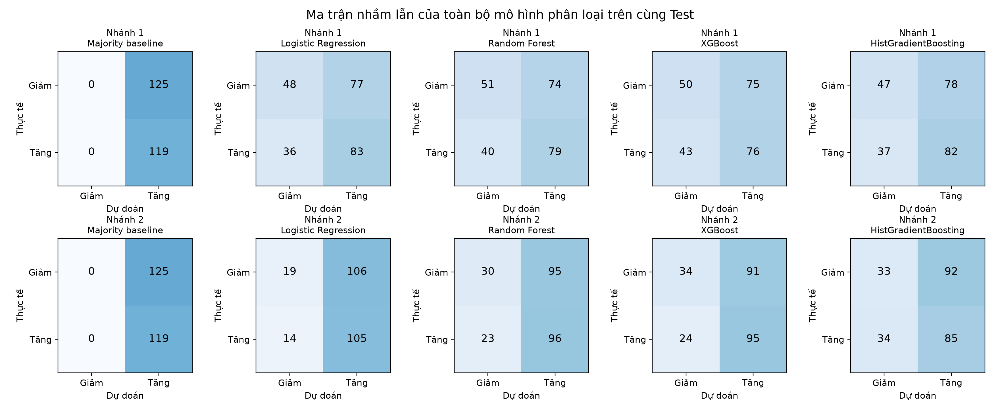
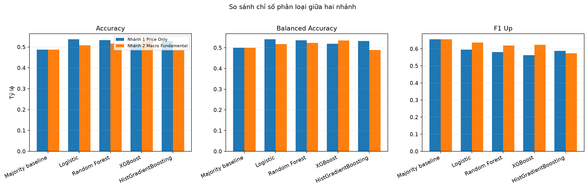
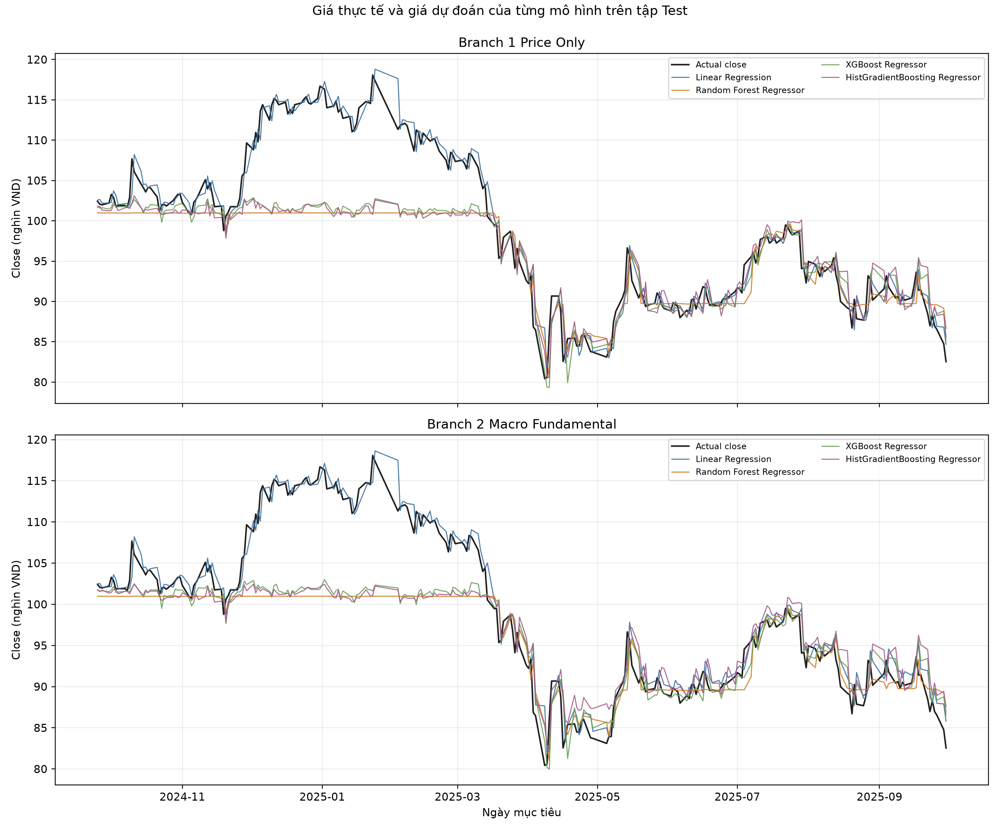
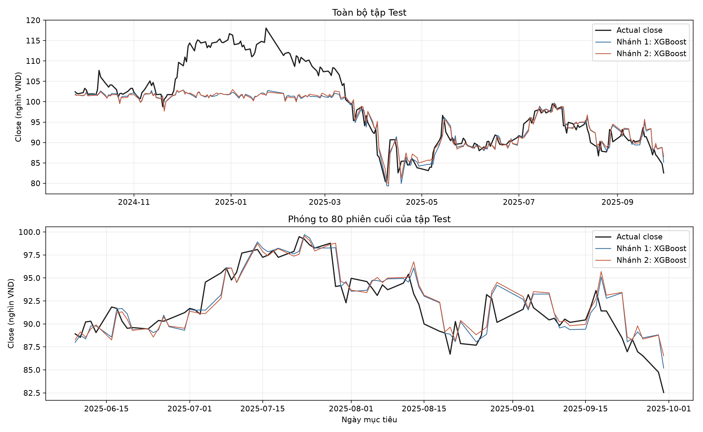
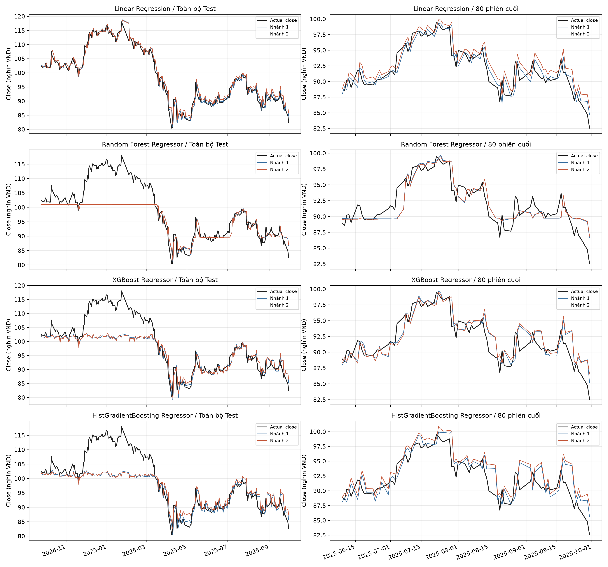
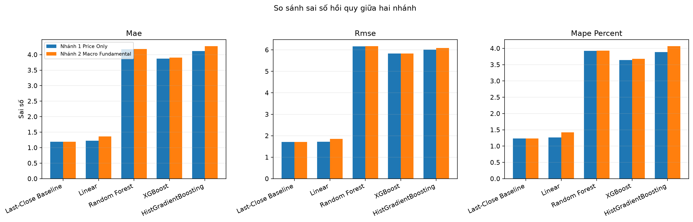

# Báo cáo thực nghiệm CS114: Dự đoán hướng và giá đóng cửa FPT phiên kế tiếp

## Tóm tắt

Dự án nghiên cứu hai bài toán có giám sát: phân loại giá đóng cửa phiên kế tiếp Tăng/Giảm và hồi quy mức giá đóng cửa phiên kế tiếp. Dữ liệu giá được giới hạn tại **30/09/2025**, gồm 4.671 phiên từ 02/01/2007. Hai nhánh được xây dựng để đo tác động của dữ liệu đầu vào: Nhánh 1 có 32 biến từ OHLCV và chỉ báo kỹ thuật; Nhánh 2 có 44 biến, bổ sung 12 trường vĩ mô, ngành và tài chính doanh nghiệp.

Các nguồn bổ trợ có phạm vi ngắn hơn chuỗi giá. Để đối sánh công bằng, cả hai nhánh dùng cùng 1.682 mẫu có nhãn với ngày mục tiêu từ 03/01/2019 đến 30/09/2025. Phép chia theo thời gian giữ 1.429 mẫu đầu làm Train và 253 mẫu cuối làm Test. Phân loại loại riêng phiên đứng giá, còn 1.339 Train và 244 Test.

Trong Test 25/09/2024–30/09/2025, Logistic Regression Nhánh 1 đạt Accuracy 53,69%, Balanced Accuracy 54,07%; XGBoost Nhánh 2 đạt 52,87% và 53,52%. Last-Close Baseline có MAE 1,1942 nghìn VND/cổ phiếu, thấp nhất trong các mô hình hồi quy thử nghiệm. Dữ liệu bổ trợ chưa nâng điểm phân loại tốt nhất của nhánh giá, và các mô hình hồi quy học máy chưa vượt baseline về MAE. Kết luận chỉ áp dụng cho một mã cổ phiếu, một cửa sổ Test và giao thức đã thực hiện.

## 1. Bài toán và thời điểm dự báo

Tại cuối phiên giao dịch `t`, mô hình được dùng dữ liệu của chính phiên đó và các thông tin đã có hiệu lực trước hoặc tại thời điểm ấy. Phiên mục tiêu `t+1` là phiên FPT kế tiếp có trong dữ liệu; không mặc định là ngày lịch tiếp theo.

| Bài toán | Nhãn cần học | Các phiên không đổi |
|---|---|---|
| Phân loại | Tăng = 1 khi close(t+1) > close(t); Giảm = 0 khi close(t+1) < close(t) | Giữ trong dữ liệu gốc, loại khi huấn luyện và chấm phân loại |
| Hồi quy | Giá đóng cửa close(t+1), đơn vị nghìn VND/cổ phiếu | Giữ lại |

Các nhãn `next_close`, `next_return`, `direction` và `target_date` không thuộc đầu vào mô hình. Hàng cuối cùng ở 30/09/2025 chưa có nhãn phiên kế tiếp trong phạm vi nghiên cứu; hàng đó chỉ dùng minh họa dự báo sau khi huấn luyện.

Hai bài toán được chấm riêng. Dự đoán giá gần đúng chưa đảm bảo đoán đúng chiều, và đoán đúng chiều chưa đảm bảo sai số giá nhỏ.

## 2. Dữ liệu và kiểm toán

### 2.1. OHLCV FPT

Nguồn giá là VCI/Vietcap qua thư viện vnstock. Snapshot chuẩn có sáu cột:

| Cột | Ý nghĩa | Đơn vị |
|---|---|---|
| time | Ngày giao dịch FPT | YYYY-MM-DD |
| open | Giá mở cửa | nghìn VND/cổ phiếu |
| high | Giá cao nhất phiên | nghìn VND/cổ phiếu |
| low | Giá thấp nhất phiên | nghìn VND/cổ phiếu |
| close | Giá đóng cửa | nghìn VND/cổ phiếu |
| volume | Khối lượng giao dịch | cổ phiếu |

Chuỗi giá giữ thang lịch sử của nhà cung cấp. Phiên bản archive trước đã căn OHLC bằng hệ số 0,8875 khi nối các cửa sổ dữ liệu; cắt về năm 2025 không hoàn tác thang giá này. Vì vậy, giá trong báo cáo không được mô tả như giá niêm yết chưa điều chỉnh hoặc bản giá từng quan sát chính xác tại mọi thời điểm lịch sử. Khối lượng không bị nhân hệ số. Lineage và hash được lưu tại `reports/data_lineage.json`.

| Chỉ tiêu kiểm toán | Kết quả |
|---|---:|
| Số phiên OHLCV | 4.671 |
| Khoảng ngày | 02/01/2007–30/09/2025 |
| Giá trị thiếu | 0 ô |
| Ngày trùng | 0 |
| Volume bằng 0 | 2 phiên |
| Dòng OHLC bất nhất | 3 |
| Close nhỏ nhất / lớn nhất | 1,61525 / 118,073 nghìn VND |
| Volume lớn nhất | 23.514.300 cổ phiếu |
| Lợi nhuận ngày trung bình | 0,0644% |
| Độ lệch chuẩn lợi nhuận ngày | 1,9189% |
| Lợi nhuận ngày nhỏ nhất / lớn nhất | −6,9896% / 6,9922% |
| Nhãn trên toàn snapshot | 2.118 Tăng; 2.074 Giảm; 478 đứng giá |

Ba dòng OHLC bất nhất ngày 17/08/2007, 10/06/2009, 07/12/2009 được giữ và đánh dấu để truy vết. Chúng nằm trước cohort chung 2019–2025 dùng cho đối sánh; không tác động trực tiếp tới các mẫu trong thí nghiệm hai nhánh. Chi tiết nằm tại `reports/data_audit.json`.


### 2.2. Nguồn vĩ mô, ngành và tài chính doanh nghiệp

Đợt thực nghiệm này tái xử lý các **snapshot CSV cố định**, không khẳng định đã tải trực tuyến thành công tất cả nguồn trong lần chạy. `src/fetch_supplemental.py` chuẩn hóa ngày và đơn vị, cắt phạm vi, tạo ngày hiệu lực, giới hạn thời gian giữ giá trị cũ rồi ghép vào phiên FPT.

| Dữ liệu | Nhà cung cấp / cách xuất | Phạm vi snapshot dùng |
|---|---|---|
| USD/VND | Investing.com, CSV lịch sử | 4.893 quan sát, 01/01/2007–30/09/2025 |
| Vàng XAU/USD | Investing.com, CSV lịch sử | 1.755 quan sát, 01/01/2019–30/09/2025 |
| CPI cùng kỳ Việt Nam | Lịch công bố trên Investing.com | 81 lần công bố, 27/12/2018–06/09/2025 |
| GDP danh nghĩa Việt Nam | World Bank, mã NY.GDP.MKTP.CD | 15 năm, 2010–2024; loại dự báo 2025 |
| Vốn hóa và P/E nhóm công nghệ | Bảng lịch sử của Simply Wall St | 33 snapshot, 06/02/2016–24/07/2025 |
| Báo cáo kết quả kinh doanh FPT | VCI qua vnstock, CSV báo cáo quý | 52 kỳ, 2007-Q1–2025-Q2; thiếu 2007-Q3–2012-Q4 |
| Cổ phiếu lưu hành FPT | Báo cáo thường niên và công bố tăng vốn FPT | 10 điểm thông tin có nguồn; từ báo cáo cuối 2017 tới sự kiện tháng 7/2025 |

Giá vàng được tính `gold_vnd_per_ounce = gold_usd_per_ounce × usd_vnd_rate` sau căn thời điểm. Đơn vị là VND cho một troy ounce vàng quốc tế; đây không phải giá vàng SJC trong nước. CPI lưu tỷ lệ cùng kỳ bằng phần trăm, ví dụ 3,24, còn GDP là quy mô danh nghĩa USD của cả năm, không phải tỷ lệ tăng trưởng.

Nhóm công nghệ của Simply Wall St được dùng làm biến đại diện gần ngành ICT. Thành phần và cách tính chỉ tiêu của nguồn có thể khác một chỉ số ICT chính thức. Hai trường `PE` và `Absolute PE` được giữ riêng, không coi là cùng phép tính.

EBIT được tính theo quy ước **lợi nhuận trước thuế + trị tuyệt đối chi phí lãi vay**; không thay thế bằng lợi nhuận hoạt động. Ví dụ 2025-Q2: 3.141.032.584.460 + 216.761.295.705 = **3.357.793.880.165 VND**. Đây là EBIT suy ra từ hai trường của báo cáo, không phải một cột EBIT độc lập được nhà cung cấp xác nhận.

Bảng cổ phiếu lưu hành là chuỗi các điểm thông tin đã thu thập, chưa phải lịch thay đổi đầy đủ theo từng ngày. URL công bố và căn cứ ngày có thể biết được lưu cạnh mỗi giá trị trong `data/raw/supplemental/fpt_shares_outstanding.csv`.

### 2.3. Căn chỉnh ngày hiệu lực và xử lý thiếu

Ngày trên các tệp xuất không cùng định dạng: USD/VND và vàng dùng `dd/MM/yyyy`, CPI dùng `MM/dd/yyyy`, ngành dùng `dd-MM-yyyy`. Script chỉ định định dạng riêng từng nguồn.

| Nguồn | Ngày bắt đầu được dùng | Thời gian tối đa giữ sau ngày hiệu lực |
|---|---|---:|
| USD/VND, vàng | Ngày quan sát + 1 ngày lịch | 10 ngày |
| CPI | Ngày công bố trong nguồn + 1 ngày | 65 ngày |
| GDP năm | Cuối năm + 180 ngày, giả định thực nghiệm | 550 ngày |
| Snapshot ngành | Ngày snapshot + 1 ngày | 180 ngày |
| Tài chính quý FPT | Cuối quý + 45 ngày, giả định thực nghiệm | 150 ngày |
| Cổ phiếu lưu hành | Ngày nguồn có thể biết + 1 ngày | 550 ngày |

Phép ghép lùi lấy quan sát mới nhất có hiệu lực không muộn hơn phiên FPT. Trước ngày hiệu lực và sau hạn giữ, giá trị vẫn thiếu. Không `backfill`, không nội suy tuyến tính qua kỳ tương lai, không tạo phiên giao dịch giả cho ngày nghỉ. Độ trễ một ngày cho nguồn thị trường bên ngoài giúp tránh dùng giá chốt khi phiên FPT chưa thể biết.

Báo cáo quý II/2025 có hiệu lực giả định từ 14/08/2025; báo cáo quý III chưa được dùng tại 30/09/2025. CPI công bố 06/10/2025 và GDP cả năm 2025 đã bị loại khỏi snapshot đầu vào. Giới hạn tuổi quan sát cũng ngăn báo cáo 2007-Q2 bị kéo dài qua nhiều năm thiếu dữ liệu.

Trên 4.671 phiên FPT, số ô thiếu của từng nhóm sau căn thời gian lần lượt gồm: vàng 2.988 phiên, CPI 2.987, GDP 1.110, ngành 2.262, tài chính 1.407 và cổ phiếu lưu hành 2.859. Các nguồn không có đủ lịch sử từ 2007, nên không dùng cách điền ngược để giữ bằng được toàn bộ giai đoạn. Kiểm toán chi tiết nằm trong `reports/supplemental_data_audit.json`.

Giả định tài chính +45 ngày và GDP +180 ngày chỉ mô phỏng ngày có thể dùng. Chúng chưa khôi phục các phiên bản báo cáo/GDP từng công bố ở quá khứ; dữ liệu có thể đã được điều chỉnh. Vì vậy, nghiên cứu có cơ chế chống dùng trước ngày hiệu lực giả định, nhưng chưa phải một kho dữ liệu point-in-time theo từng phiên bản hoàn chỉnh.

## 3. Đặc trưng và luồng xử lý

### 3.1. Nhánh 1: 32 biến giá và kỹ thuật

| Nhóm | Số biến | Nội dung |
|---|---:|---|
| OHLCV hiện tại | 5 | `current_open, current_high, current_low, current_close, current_volume` |
| Lợi nhuận trễ | 5 | Return 1, 2, 5, 10, 20 phiên |
| Giá so với SMA/EMA | 8 | Tỷ lệ giá so với SMA và EMA chu kỳ 5, 10, 20, 50 |
| Động lượng | 4 | RSI-14, MACD, MACD Signal, MACD Histogram |
| Bollinger | 2 | %B và độ rộng dải chu kỳ 20 |
| Biến động lợi nhuận | 2 | Độ lệch chuẩn 5 và 20 phiên |
| Khối lượng | 2 | Thay đổi log-volume và log-volume z-score 20 |
| Nến | 4 | Biên độ, thân nến, overnight gap, vị trí close |

Bốn biến nến được tính bằng `(high-low)/close`, `(close-open)/open`, `open/close(t-1)-1`, `(close-low)/(high-low)`. Khi high bằng low, vị trí close được đặt 0,5 để diễn tả nến không có biên độ.

Các cửa sổ chỉ tính lùi. RSI được chia 100; MACD và tín hiệu chia cho close để tạo các tỷ lệ. 49 phiên đầu chưa đủ lịch sử cho đặc trưng bị bỏ, còn 4.622 hàng giá có đặc trưng và 4.621 nhãn phiên kế tiếp.

### 3.2. Nhánh 2: thêm 12 biến bổ trợ

Nhánh 2 giữ nguyên 32 biến Nhánh 1 và thêm:

- USD/VND; vàng quốc tế quy đổi VND/ounce; CPI cùng kỳ; GDP năm.
- Vốn hóa nhóm công nghệ; P/E; Absolute P/E.
- Doanh thu thuần; lợi nhuận gộp; EBIT tính theo quy ước; lợi nhuận sau thuế cổ đông công ty mẹ; số cổ phiếu lưu hành FPT.

Các giá trị tần suất tháng/quý/năm được giữ sau ngày hiệu lực tới quan sát mới hoặc hạn dùng. Việc lặp một giá trị quý qua nhiều phiên không tạo thêm số kỳ báo cáo độc lập.

### 3.3. Pipeline và chống rò rỉ


`features.py` cắt giá theo cutoff trước khi dùng `shift(-1)` tạo nhãn, nên phiên sau 30/09/2025 không thể lọt vào nhãn huấn luyện. `prepare.py` chỉ cho phép các cột bổ trợ đã khai báo, kiểm tra ngày hợp lệ/duy nhất và tạo một cohort chung đủ cả 44 biến.

`train.py` huấn luyện mô hình trên Train rồi mới dự đoán Test. StandardScaler chỉ nằm trong Pipeline của Logistic Regression và Linear Regression; tham số trung bình/độ lệch chuẩn chỉ học từ Train. Mô hình cây dùng các biến số trực tiếp. Cùng siêu tham số được áp dụng cho hai nhánh; Test không được truyền làm tập dừng sớm hay dùng để tìm siêu tham số.

`predict.py` kiểm tra đúng phiên cuối raw và đủ trường cần thiết. Nếu phiên cuối thiếu đầu vào, script báo lỗi thay vì âm thầm lùi về một phiên cũ rồi gọi đó là dự báo mới nhất.

## 4. Thiết kế thực nghiệm

### 4.1. Cohort chung và chia tập

Cohort chung có **1.683 hàng** đủ đầu vào: 1.682 có nhãn và một hàng cuối chưa biết kết quả. Giá bắt đầu từ 2007 dùng cho kiểm toán và tạo lịch sử chỉ báo; phép so sánh hai nhánh bắt đầu từ đầu năm 2019 khi đủ mọi nguồn.

| Tập | Ngày mục tiêu | Số mẫu hồi quy | Số mẫu phân loại |
|---|---|---:|---:|
| Train — 85% đầu | 03/01/2019–24/09/2024 | 1.429 | 1.339 |
| Test — 15% cuối | 25/09/2024–30/09/2025 | 253 | 244 |

Ranh giới được xác định trên nhãn phiên kế tiếp của cohort chung, sau đó loại phiên đứng giá riêng cho phân loại. Test hồi quy có 9 phiên đứng giá; Test phân loại có 119 Tăng và 125 Giảm. Cả hai nhánh dùng chính xác cùng ngày, số mẫu và thứ tự.

### 4.2. Mô hình và siêu tham số

| Mô hình | Cấu hình chính | Mục đích |
|---|---|---|
| Majority Baseline | Chọn lớp phổ biến nhất ở Train | Mốc so sánh phân loại |
| Logistic Regression | StandardScaler; C=1; class_weight=balanced; max_iter=3.000 | Mô hình tuyến tính phân loại |
| Random Forest Classifier | 350 cây; max_depth=8; min_samples_leaf=20; balanced_subsample | Tương tác phi tuyến giữa biến |
| XGBClassifier | 220 cây; depth=3; learning_rate=0,04; subsample=0,85; colsample_bytree=0,85; min_child_weight=8; reg_lambda=3 | Boosting cho phân loại |
| HistGradientBoosting Classifier | 160 vòng; learning_rate=0,05; max_leaf_nodes=15; L2=1; early_stopping=False | Đối chứng boosting theo histogram |
| Last-Close Baseline | close dự báo = close hiện tại | Mốc giữ nguyên giá |
| Linear Regression | StandardScaler và hồi quy tuyến tính | Đối chứng mức giá tuyến tính |
| Random Forest Regressor | 350 cây; max_depth=8; min_samples_leaf=20 | Hồi quy bằng rừng cây |
| XGBRegressor | 240 cây; các tham số cây còn lại như XGBClassifier; objective=reg:squarederror | Hồi quy boosting |
| HistGradientBoosting Regressor | 160 vòng; learning_rate=0,05; max_leaf_nodes=15; L2=1; early_stopping=False | Hồi quy boosting theo histogram |

Các mô hình có ngẫu nhiên dùng random_state=42. Tham số chi tiết được xuất tại `reports/model_hyperparameters.json`. Mỗi mô hình hồi quy học trực tiếp close(t+1); phiên bản này chưa chuyển mục tiêu sang lợi nhuận. Không dùng LSTM/Transformer vì mục tiêu đồ án là đối sánh rõ các mô hình bảng và tác động của hai nhóm đầu vào trước.

### 4.3. Quy tắc chấm điểm và chọn mô hình

Phân loại báo cáo Accuracy, Balanced Accuracy, Precision/Recall/F1 của lớp Tăng, ROC-AUC và confusion matrix. Balanced Accuracy là trung bình Recall của hai lớp, giúp tránh chỉ ưu tiên lớp chiếm nhiều mẫu.

Hồi quy báo cáo MAE, RMSE, MAPE theo %, Directional Accuracy trên các phiên thực tế có tăng/giảm và Tolerance Accuracy. Với giá thực tế y, giá dự đoán y_hat, sai số tương đối là `abs(y_hat-y)/abs(y)`. Tolerance Accuracy tại ngưỡng e là tỷ lệ mẫu có sai số đó không lớn hơn e, với e = 0,005 / 0,01 / 0,02.

Theo yêu cầu đối sánh trực tiếp Train/Test, mô hình triển khai được chọn hậu nghiệm theo Balanced Accuracy Test cao nhất, hòa thì xét F1 lớp Tăng; hồi quy theo MAE thấp nhất, hòa thì RMSE. Đây là lựa chọn sau khi đã xem Test, nên điểm của mô hình được chọn có thể lạc quan và không còn là một đánh giá cuối độc lập. Sau khi ghi metric, mô hình được chọn được fit lại trên toàn bộ nhãn của cohort chung để minh họa dự báo; metric Test vẫn là kết quả từ bản chỉ fit Train.

## 5. Kết quả phân loại Tăng/Giảm

Các tỷ lệ dưới đây biểu diễn theo %. Nhánh 1 và 2 đều được chấm trên 244 phiên Test giống nhau.

| Nhánh | Mô hình | Accuracy | Balanced Accuracy | Precision Tăng | Recall Tăng | F1 Tăng | ROC-AUC |
|---|---|---:|---:|---:|---:|---:|---:|
| 1 | Majority Baseline | 48,77 | 50,00 | 48,77 | 100,00 | 65,56 | 50,00 |
| 1 | Logistic Regression | 53,69 | 54,07 | 51,88 | 69,75 | 59,50 | 55,25 |
| 1 | Random Forest | 53,28 | 53,59 | 51,63 | 66,39 | 58,09 | 56,28 |
| 1 | XGBoost | 51,64 | 51,93 | 50,33 | 63,87 | 56,30 | 52,30 |
| 1 | HistGradientBoosting | 52,87 | 53,25 | 51,25 | 68,91 | 58,78 | 56,23 |
| 2 | Majority Baseline | 48,77 | 50,00 | 48,77 | 100,00 | 65,56 | 50,00 |
| 2 | Logistic Regression | 50,82 | 51,72 | 49,76 | 88,24 | 63,64 | 50,77 |
| 2 | Random Forest | 51,64 | 52,34 | 50,26 | 80,67 | 61,94 | 54,98 |
| 2 | XGBoost | 52,87 | 53,52 | 51,08 | 79,83 | 62,30 | 54,82 |
| 2 | HistGradientBoosting | 48,36 | 48,91 | 48,02 | 71,43 | 57,43 | 50,92 |

Logistic Regression Nhánh 1 tốt nhất theo Balanced Accuracy, nhưng Random Forest Nhánh 1 có ROC-AUC cao nhất 56,28%. Vì các độ đo phản ánh khía cạnh khác nhau, không gọi một cấu hình là tốt nhất trên mọi tiêu chí.

Cấu hình tốt nhất Nhánh 2 thấp hơn tốt nhất Nhánh 1 khoảng **0,56 điểm phần trăm Balanced Accuracy**. So cùng thuật toán, thêm dữ liệu bổ trợ giúp XGBoost tăng khoảng 1,58 điểm, nhưng làm Logistic Regression giảm khoảng 2,36 điểm. Dữ liệu bổ trợ có thể cung cấp tín hiệu cho một mô hình và gây nhiễu hoặc lệch phân phối với mô hình khác. Một lần chia Test chưa xác định được độ ổn định của các chênh lệch nhỏ này.

Majority Baseline luôn dự đoán Tăng, nên Recall Tăng bằng 100% và F1 Tăng khá cao 65,56%; Balanced Accuracy vẫn chỉ 50%. Đây là lý do không chọn mô hình chỉ bằng F1 của một lớp.

### Confusion matrix

Logistic Regression Nhánh 1 có các số đếm sau; hàng là nhãn thật, cột là nhãn dự đoán:

| | Dự đoán Giảm | Dự đoán Tăng |
|---|---:|---:|
| Thực tế Giảm | 48 | 77 |
| Thực tế Tăng | 36 | 83 |

Mô hình đoán đúng 48 + 83 = 131/244 phiên, tương đương Accuracy 53,69%. Với lớp Tăng là lớp dương, TN=48, FP=77, FN=36, TP=83. Bảng đếm đầy đủ của mọi mô hình nằm tại `reports/confusion_matrices.csv`; dự báo từng phiên nằm tại `reports/test_direction_predictions_by_model.csv`.






## 6. Kết quả hồi quy giá đóng cửa

MAE/RMSE có đơn vị **nghìn VND/cổ phiếu**. Các cột còn lại là %. Directional Accuracy (DA) chỉ chấm các phiên thực tế có tăng/giảm, gồm 244 phiên; sai số giá và tolerance dùng đủ 253 phiên.

| Nhánh | Mô hình | MAE | RMSE | MAPE | DA | Trong ±0,5% | Trong ±1,0% | Trong ±2,0% |
|---|---|---:|---:|---:|---:|---:|---:|---:|
| 1 | Last-Close Baseline | 1,1942 | 1,7129 | 1,2342 | 0,00 | 34,39 | 55,34 | 82,61 |
| 1 | Linear Regression | 1,2247 | 1,7212 | 1,2651 | 51,23 | 32,02 | 53,75 | 82,21 |
| 1 | Random Forest Regressor | 4,1756 | 6,1680 | 3,9260 | 52,87 | 11,86 | 28,06 | 47,43 |
| 1 | XGBoost Regressor | 3,8745 | 5,8358 | 3,6401 | 50,82 | 17,39 | 30,83 | 50,59 |
| 1 | HistGradientBoosting Regressor | 4,1160 | 6,0137 | 3,8845 | 51,23 | 11,46 | 26,88 | 46,64 |
| 2 | Last-Close Baseline | 1,1942 | 1,7129 | 1,2342 | 0,00 | 34,39 | 55,34 | 82,61 |
| 2 | Linear Regression | 1,3618 | 1,8552 | 1,4205 | 47,95 | 28,06 | 47,83 | 76,28 |
| 2 | Random Forest Regressor | 4,1809 | 6,1693 | 3,9331 | 53,28 | 11,86 | 27,27 | 45,45 |
| 2 | XGBoost Regressor | 3,9044 | 5,8288 | 3,6787 | 51,23 | 16,60 | 31,23 | 50,59 |
| 2 | HistGradientBoosting Regressor | 4,2707 | 6,0852 | 4,0652 | 48,36 | 13,44 | 22,53 | 43,48 |

Last-Close Baseline tốt nhất về MAE, RMSE và MAPE ở cả hai nhánh vì giá phiên liền sau thường còn gần giá hiện tại. Nhưng giá dự đoán của baseline luôn tạo mức thay đổi bằng 0, nên không trùng dấu với bất kỳ phiên thực tế tăng/giảm nào; DA bằng 0% theo định nghĩa đã dùng. Nó vẫn đạt tolerance cao vì tiêu chí đó chỉ đo khoảng cách giá.

Linear Regression Nhánh 1 gần baseline về sai số giá nhưng chưa vượt baseline. Các mô hình cây có MAE khoảng 3,87–4,27 nghìn đồng, lớn hơn rõ rệt. Khi học giá tuyệt đối, cây phân chia miền đầu vào và dự báo từ giá trị ở các lá; khả năng ngoại suy ra vùng giá mới và bám xu hướng ngoài Train bị hạn chế. Các đường dự báo trên Test thể hiện sai lệch theo vùng mức giá. Đây là một giải thích phù hợp với cơ chế mô hình và đồ thị, chưa chứng minh là nguyên nhân duy nhất.

Nhánh 2 không làm MAE tốt hơn cho các mô hình học máy trong lần thử này. Riêng XGBoost có RMSE giảm nhẹ 5,8358 xuống 5,8288, nhưng MAE lại tăng 3,8745 lên 3,9044; thay đổi nhỏ ở một metric chưa đủ kết luận mô hình tổng thể tốt hơn.

### Biểu đồ giá thực tế và dự báo










Dự báo giá theo từng mô hình được lưu tại `reports/test_price_predictions_by_model.csv`. Đồ thị không thay thế bảng điểm: hai đường có thể nhìn khá sát trên trục giá rộng nhưng sai số vẫn vượt ngưỡng ±0,5% ở nhiều phiên.

## 7. Phân tích vai trò dữ liệu và giới hạn

Biến vĩ mô và tài chính có ý nghĩa về kinh tế nhưng thay đổi chậm hơn mục tiêu một phiên. Một quý lặp qua nhiều hàng ngày có thể cung cấp thông tin về giai đoạn kinh doanh mà không giải thích được biến động ngày kế tiếp. Mức GDP, vốn hóa hoặc doanh thu tăng dài hạn còn có thể gián tiếp biểu diễn thời gian; quan hệ học được ở Train chưa chắc giữ được trong Test.

Dữ liệu nhiều hơn cũng tăng số tham số đầu vào trong khi chỉ có 1.429 mẫu Train hồi quy và ít kỳ báo cáo độc lập. Vì vậy, dùng thêm biến không đảm bảo tăng hiệu quả. Phép đối sánh này đo tác động gộp của 12 biến bổ trợ; chưa tách riêng ảnh hưởng của CPI, tỷ giá hoặc từng chỉ tiêu doanh nghiệp.

Các giới hạn cần giữ khi diễn giải:

1. Một cổ phiếu và một cửa sổ Test chưa đại diện cho các điều kiện thị trường khác.
2. Test được dùng chọn mô hình hậu nghiệm; điểm cấu hình được chọn có thể lạc quan.
3. Giả định +45/+180 ngày chưa thay thế lịch công bố thực và lịch sử các bản sửa dữ liệu.
4. Số cổ phiếu lưu hành chỉ có 10 điểm thông tin, có thể bỏ sót thay đổi giữa hai mốc; ngày công bố của báo cáo cuối 2017 dùng giả định bảo thủ.
5. Snapshot ngành công nghệ là biến đại diện gần ICT, có thể chịu tác động của thay đổi thành phần và cách tính của nhà cung cấp.
6. Giá lịch sử được điều chỉnh; sai số theo nghìn đồng không nhất thiết trùng sai số trên giá niêm yết chưa điều chỉnh.
7. Các số liệu phân loại gần mức 50%; chưa kiểm định ý nghĩa thống kê hoặc chứng minh hiệu quả giao dịch sau phí.

Hướng phát triển hợp lý là đánh giá nhiều cửa sổ theo thời gian, dùng lịch công bố thực, bổ sung kho dữ liệu theo phiên bản và lịch sử cổ phiếu đầy đủ; sau đó so từng nhóm bổ trợ. Với hồi quy, có thể thử học return hoặc thay đổi giá rồi dựng lại close, và so với phiên bản dự báo trực tiếp giá trong báo cáo này. Chỉ mở rộng mô hình sau khi có phép đo đủ kiểm soát để biết phần cải thiện đến từ đâu.

## 8. Dự báo minh họa sau cutoff

Sau khi ghi bảng điểm Test, Logistic Regression Nhánh 1 được fit lại trên toàn bộ các nhãn phân loại trong cohort chung. Với thông tin tại **30/09/2025**:

| Trường | Kết quả |
|---|---|
| Close hiện tại | 82,54 nghìn VND/cổ phiếu theo thang snapshot |
| Mô hình phân loại | Logistic Regression, Nhánh 1 |
| Hướng dự báo | Tăng |
| Xác suất lớp Tăng | 52,79%, có điều kiện trên hai lớp Tăng/Giảm |
| Mô hình giá | Last-Close Baseline |
| Close dự báo | 82,54 nghìn VND/cổ phiếu |
| Phiên mục tiêu | Phiên giao dịch FPT kế tiếp sau 30/09/2025 |

Xác suất trên chưa được hiệu chỉnh thành một mức bảo đảm. Hai đầu ra có thể cho tín hiệu khác nhau vì mô hình phân loại và hồi quy có mục tiêu khác nhau. Đây là kết quả minh họa của đồ án, không phải khuyến nghị mua/bán. Tệp máy đọc được là `reports/latest_prediction.json`.

## 9. Tái lập kết quả và sản phẩm

Chạy từ thư mục gốc bằng snapshot đã đóng gói:

```bash
python -m pip install -r requirements.txt
python src/fetch_data.py --verify
python src/fetch_supplemental.py --from-cache
python src/eda.py
python src/prepare.py
python src/train.py
python src/predict.py
python -m pytest -q
```

`fetch_data.py --download` là tùy chọn lấy lại OHLCV qua vnstock/VCI; dịch vụ có thể cần kết nối/quyền truy cập. `fetch_supplemental.py --from-cache` tái tạo dữ liệu từ các CSV lưu trữ mà không cần tải lại website. Khi dùng tệp xuất mới phải kiểm tra schema và nguồn, cắt cutoff rồi chạy lại toàn bộ pipeline.

| Nhóm sản phẩm | Tệp chính |
|---|---|
| Kiểm toán và lineage | `reports/data_audit.json`, `reports/data_lineage.json`, `reports/supplemental_data_audit.json` |
| Bảng đặc trưng | `data/processed/fpt_next_session_features.csv`, `fpt_multisource_features.csv`, `fpt_two_branch_features.csv` |
| Thiết lập và tham số | `reports/split_metadata.json`, `reports/model_hyperparameters.json` |
| Metrics hai bài toán | `reports/classification_test_metrics.csv`, `reports/regression_test_metrics.csv` |
| Đối sánh hai nhánh | `reports/ablation_summary.csv` |
| Dự báo từng cấu hình | `reports/test_direction_predictions_by_model.csv`, `reports/test_price_predictions_by_model.csv` |
| Ma trận nhầm lẫn | `reports/confusion_matrices.csv`, `figures/05_all_confusion_matrices.png` |
| Vai trò đầu vào | `reports/feature_importance_train.csv`; chỉ là mô tả mô hình học trên Train, không diễn giải nhân quả |
| Mô hình triển khai minh họa | `models/best_classifier.joblib`, `models/best_regressor.joblib` |
| Proposal | `docs/PROPOSAL.md`, `docs/cs114_proposal.tex`, `docs/cs114_proposal.pdf` |

Cẩm nang cá nhân được lưu riêng tại `docs/CAM_NANG_HIEU_DU_AN.md`, nằm trong `.gitignore` và không xuất bản cùng repository.

## 10. Nguồn tài liệu dữ liệu

- [Tài liệu dữ liệu thị trường Vnstock](https://vnstocks.com/docs/vnstock/thi-truong-market).
- [Lịch sử USD/VND](https://vn.investing.com/currencies/usd-vnd-historical-data), [lịch sử vàng XAU/USD](https://vn.investing.com/currencies/xau-usd-historical-data), [lịch CPI Việt Nam](https://vn.investing.com/economic-calendar/vietnamese-cpi-1851).
- [World Bank — GDP Việt Nam, NY.GDP.MKTP.CD](https://data.worldbank.org/indicator/NY.GDP.MKTP.CD?locations=VN).
- [Simply Wall St — ngành công nghệ Việt Nam](https://simplywall.st/markets/vn/tech).
- [FPT — Công bố thông tin](https://fpt.com/en/ir/information-disclosures). Đường dẫn từng báo cáo cổ phiếu nằm trong CSV nguồn.
- [Từ điển dữ liệu và quy trình chuẩn hóa của dự án](../data/README.md).
