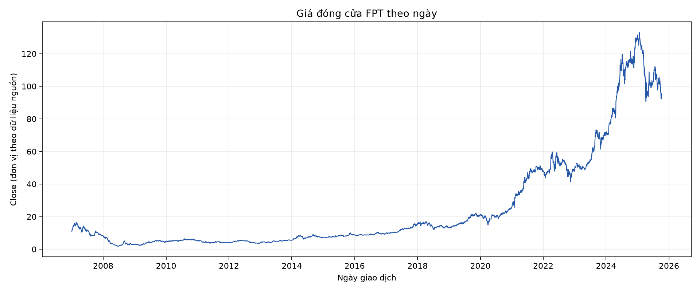
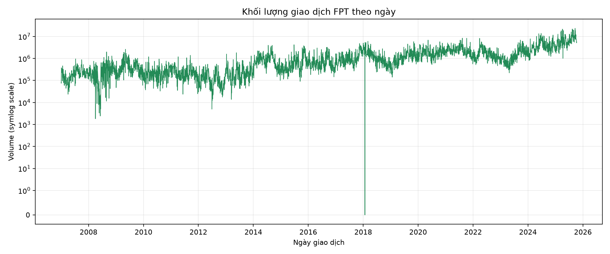
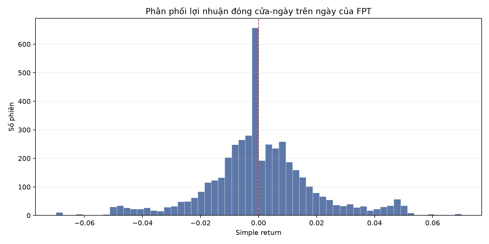
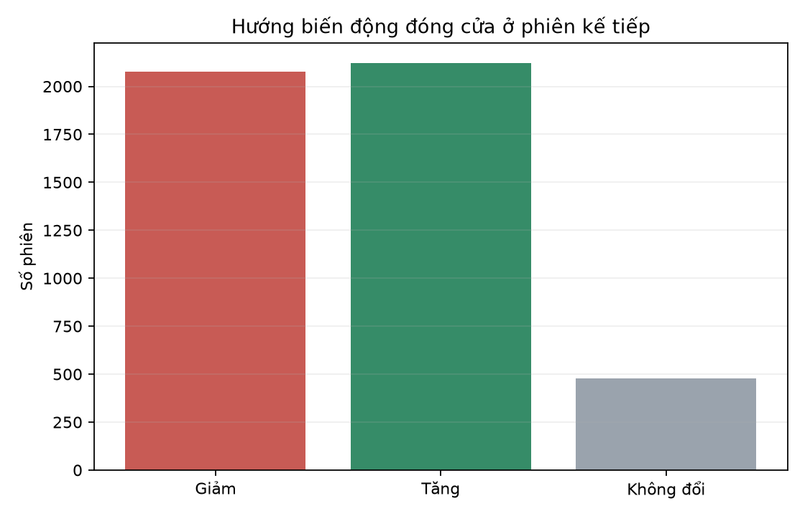
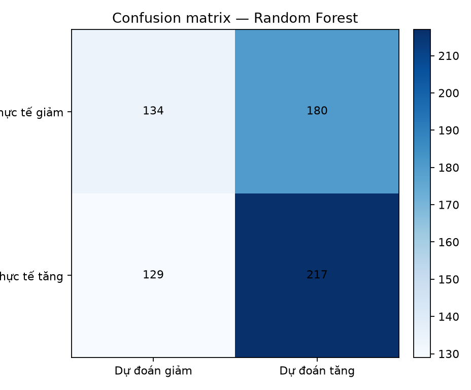
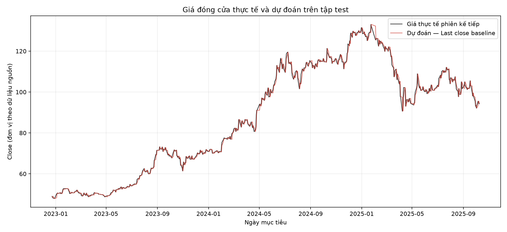

# BÁO CÁO ĐỒ ÁN MACHINE LEARNING

## Tóm tắt

Đồ án xây dựng pipeline dự đoán hướng biến động giá đóng cửa FPT ở phiên giao dịch kế tiếp bằng các đặc trưng kỹ thuật từ giá đóng cửa và khối lượng. Dữ liệu gồm 4.678 phiên từ 2007-01-02 đến 2025-10-09. Sau 49 dòng khởi động chỉ báo và một dòng cuối chưa có nhãn, có 4.628 kết quả kế tiếp dùng được cho hồi quy; loại 479 phiên giá không đổi để tạo bài toán phân loại nhị phân. Trên tập test từ 2022-12-23 đến 2025-10-09, Random Forest được chọn bằng validation đạt Accuracy 53.18%, Balanced Accuracy 52.70% và ROC-AUC 0.559. HistGradientBoosting có Balanced Accuracy test 55.28%, nhưng điểm validation thấp hơn nên không được chọn theo tập test. Kết quả cho thấy các đặc trưng trong phạm vi này chỉ đem lại mức phân loại khiêm tốn.

## 1. Bài toán và phạm vi

Mục tiêu chính là dự đoán nhãn tăng hoặc giảm của phiên kế tiếp sau khi phiên hiện tại đóng cửa. Với giá đóng cửa ở phiên `t` và phiên giao dịch kế tiếp `t+1`, lợi nhuận đơn được định nghĩa:

\[
r_{t+1}=\frac{Close_{t+1}}{Close_t}-1.
\]

`up` tương ứng với lợi nhuận dương; `down` tương ứng với lợi nhuận âm. Giá đóng cửa không đổi được giữ như một trường hợp trung tính và loại khỏi phân loại nhị phân. Trên toàn bộ dữ liệu có 2.121 phiên tăng, 2.077 phiên giảm và 479 phiên không đổi. Một thí nghiệm hồi quy giá đóng cửa phiên kế tiếp được thực hiện bổ sung; Directional Accuracy của hồi quy chỉ tính ở các phiên thực tế không đổi giá.

Phạm vi đầu vào chỉ gồm dữ liệu FPT OHLCV. Các biến vĩ mô, báo cáo tài chính và ngành trong repo nguồn không được dùng vì dữ liệu tổng hợp có tỷ lệ thiếu lớn hoặc tần suất không đồng nhất; dùng chúng cần thêm bước ghép theo ngày công bố thực tế để tránh nhìn trước dữ liệu.

## 2. Dữ liệu và EDA

Tệp `data/raw/fpt/fpt_historical_price.csv` có 4.678 hàng với sáu cột: ngày, giá mở cửa, cao nhất, thấp nhất, đóng cửa và khối lượng. Khoảng thời gian là 2007-01-02–2025-10-09. Không có missing values hoặc ngày trùng; thứ tự dữ liệu tăng dần. Có hai ngày volume bằng 0 và ba dòng vi phạm quan hệ OHLC thông thường. Các chỉ báo của mô hình chỉ dùng Close và Volume, do đó ba điểm bất nhất high/low được giữ trong CSV nhưng không tham gia tạo biến.

Lợi nhuận đóng cửa-ngày trên ngày có trung bình 0.000646, độ lệch chuẩn 0.01918, giá trị nhỏ nhất -0.06990 và lớn nhất 0.06992. Nguồn không ghi rõ đơn vị giá hoặc giá đã được điều chỉnh theo sự kiện doanh nghiệp hay chưa; các mức giá và sai số hồi quy dưới đây được hiểu theo đơn vị của tệp nguồn.

## 3. Tiền xử lý và tạo đặc trưng

Dữ liệu được đọc thành kiểu ngày, kiểm tra các cột bắt buộc, giá phải dương, volume không âm, ngày không trùng rồi sắp xếp tăng dần. Không điền dữ liệu bằng `bfill` hoặc nội suy. Các NaN ở đầu chuỗi được tạo bởi rolling window và được bỏ khi hoàn thiện bảng đặc trưng. Một hàng cuối cùng giữ đủ đặc trưng hiện tại nhưng không có giá mục tiêu phiên kế tiếp, nên không được dùng để chấm điểm.

23 đặc trưng cho phân loại gồm:

| Nhóm | Biến và ý nghĩa |
|---|---|
| Lợi nhuận trễ | Tỷ lệ đổi giá đóng cửa sau 1, 2, 5, 10, 20 phiên; tóm tắt động lượng gần đây |
| SMA/EMA | Chênh lệch tương đối giữa giá hiện tại và trung bình đơn/luỹ thừa 5, 10, 20, 50 phiên; thể hiện vị trí giá so với xu hướng gần |
| RSI-14 | Động lượng tăng so với giảm trong 14 phiên; được chia 100 để đưa về khoảng gần 0–1 |
| MACD | MACD, signal và histogram chia cho giá hiện tại; biểu thị quan hệ giữa EMA12 và EMA26 |
| Bollinger 20 | `%B` là vị trí tương đối của giá trong dải; `width` là độ rộng dải so với trung bình |
| Biến động | Độ lệch chuẩn của lợi nhuận một ngày trong cửa sổ 5 và 20 phiên |
| Khối lượng | Thay đổi một phiên của log-volume và z-score log-volume trong 20 phiên |

Mỗi cửa sổ chỉ nhìn về hiện tại và quá khứ. Đặc trưng hồi quy thêm `current_close`, vì hồi quy dự đoán mức giá cần thông tin về thang giá hiện tại. Các pipeline có StandardScaler nằm trong Logistic/Linear Regression; scaler được fit trên train, sau đó fit lại trên train+validation trước khi kiểm tra test.

## 4. Mô hình và thiết lập

### Phân loại

- **Majority baseline:** dự đoán lớp phổ biến trong train.
- **Logistic Regression:** `C=1`, `class_weight=balanced`, `max_iter=3000`, StandardScaler.
- **Random Forest:** 350 cây, `max_depth=8`, `min_samples_leaf=20`, `class_weight=balanced_subsample`.
- **HistGradientBoosting:** `learning_rate=0.05`, `max_iter=160`, `max_leaf_nodes=15`, `l2_regularization=1`, tắt early stopping nội bộ để tránh chia validation ngẫu nhiên trong mô hình.

### Hồi quy giá phụ

So sánh baseline `next_close = current_close`, Linear Regression, Random Forest Regressor và HistGradientBoosting Regressor. Hai mô hình cây hồi quy dùng `max_depth=8`/350 cây hoặc `max_leaf_nodes=15`/160 vòng boosting, với `l2_regularization=1` cho boosting.

Mọi kết quả được tạo bằng các script trong `src/`. Hạt giống ngẫu nhiên của các mô hình có yếu tố ngẫu nhiên là 42.

## 5. Chia dữ liệu và đánh giá

Chia tập theo ngày mục tiêu, không xáo trộn:

| Tập | Khoảng ngày của nhãn | Hồi quy | Phân loại sau khi bỏ nhãn không đổi |
|---|---|---:|---:|
| Train | đến 2020-03-19 | 3.239 | 2.850 |
| Validation | 2020-03-20–2022-12-22 | 694 | 646 |
| Test | 2022-12-23–2025-10-09 | 695 | 660 |

Mô hình được chọn theo validation: Balanced Accuracy cao nhất cho phân loại (tie-break bằng F1 lớp tăng), MAE thấp nhất cho hồi quy. Sau đó mô hình được huấn luyện lại trên train+validation và đánh giá trên test. Cách này giữ test ngoài quyết định chọn mô hình.

Phân loại được báo cáo bằng Accuracy, Balanced Accuracy, Precision/Recall/F1 lớp tăng, ROC-AUC và confusion matrix. Hồi quy dùng RMSE, MAE, MAPE và Directional Accuracy. Các chỉ số hồi quy đo sai số mức giá; chúng không thay thế độ đo phân loại hướng.

## 6. Kết quả

### 6.1. Phân loại tăng/giảm

| Mô hình | Accuracy | Balanced Accuracy | Precision tăng | Recall tăng | F1 tăng | ROC-AUC | Chọn theo validation |
|---|---:|---:|---:|---:|---:|---:|---|
| Majority baseline | 52.42% | 50.00% | 52.42% | 100.00% | 0.688 | 0.500 | Không |
| Logistic Regression | 52.73% | 52.29% | 54.36% | 61.27% | 0.576 | 0.537 | Không |
| Random Forest | 53.18% | 52.70% | 54.66% | 62.72% | 0.584 | 0.559 | Có |
| HistGradientBoosting | 55.45% | 55.28% | 57.30% | 58.96% | 0.581 | 0.565 | Không |

Balanced Accuracy của Random Forest cao hơn baseline 2.70 điểm phần trăm. Confusion matrix của mô hình được chọn có hàng là nhãn thực tế (giảm, tăng), cột là dự đoán (giảm, tăng):

| Thực tế \\ Dự đoán | Giảm | Tăng |
|---|---:|---:|
| Giảm | 134 | 180 |
| Tăng | 129 | 217 |

HistGradientBoosting đạt Balanced Accuracy test cao nhất trong lần chạy này, 55.28%, nhưng validation Balanced Accuracy của nó là 49.08%, thấp hơn Random Forest 51.05%. Do đó Random Forest vẫn là mô hình được chọn theo quy tắc đã định trước; giá trị test của HistGradientBoosting chỉ là kết quả so sánh sau cùng, không dùng để đổi lựa chọn. Cả hai kết quả còn gần mức ngẫu nhiên, nên chưa chứng minh khả năng dự đoán ổn định.

### 6.2. Hồi quy giá đóng cửa phiên kế tiếp

| Mô hình | RMSE | MAE | MAPE | Directional Accuracy (phiên không đổi bị bỏ) | Chọn theo validation |
|---|---:|---:|---:|---:|---|
| Last close baseline | 1.5010 | 1.0052 | 1.10% | 0.00% | Có |
| Linear Regression | 1.4989 | 1.0055 | 1.10% | 51.82% | Không |
| HistGradientBoosting | 41.3898 | 33.2772 | 32.03% | 47.73% | Không |
| Random Forest | 41.4611 | 33.3561 | 32.13% | 49.09% | Không |

Baseline giữ nguyên giá có MAE gần như Linear Regression nhưng không đưa ra thay đổi giá; vì thế Directional Accuracy của nó là 0% khi chỉ tính các phiên giá thực tế có thay đổi. Linear Regression có Directional Accuracy 51.82%, nhưng MAE không thấp hơn baseline. Hai mô hình cây hồi quy tổng quát hóa kém khi kiểm tra trên giai đoạn mà giá FPT tăng lên xa khỏi phần lớn mức giá trong train. Đây là biểu hiện của khác biệt chế độ thị trường và giới hạn của dự báo trực tiếp mức giá trên chuỗi không dừng.

## 7. Phân tích và thảo luận

Các mô hình phân loại chỉ cải thiện nhẹ so với majority baseline theo Balanced Accuracy. Việc HGB có test cao hơn nhưng validation thấp nhấn mạnh rằng hiệu quả phụ thuộc vào giai đoạn thị trường; không nên dùng test để tiếp tục điều chỉnh lựa chọn. Confusion matrix cho thấy Random Forest nhận diện 217/346 phiên tăng nhưng nhầm 180/314 phiên giảm thành tăng, phản ánh xu hướng dự đoán lớp tăng nhiều hơn.

Thí nghiệm hồi quy minh họa khác biệt giữa sai số giá và hướng: mô hình có thể đạt MAE nhỏ vì giá ngày mai thường gần giá hôm nay, trong khi baseline không nắm bắt hướng thay đổi. Ngược lại, mô hình cây hồi quy bị ảnh hưởng bởi mức giá tăng mạnh ở các năm cuối test so với dữ liệu huấn luyện. Vì câu hỏi chính là tăng/giảm, kết quả phân loại là trọng tâm của kết luận.

## 8. Hạn chế và hướng phát triển

1. Nguồn dữ liệu dừng ở 2025-10-09; dự đoán ví dụ mới nhất trong repo là dự đoán cho phiên kế tiếp của ngày này, không phải dự báo hiện tại.
2. Tập chỉ gồm một mã cổ phiếu; các phiên không phải quan sát độc lập và quan hệ thị trường có thể thay đổi theo thời gian.
3. Không dùng VN-Index, cổ phiếu cùng ngành, tin tức, CPI, tỷ giá hay báo cáo tài chính. Muốn thêm dữ liệu tần suất thấp cần ghép theo ngày công bố thực tế, không điền giá trị tương lai ngược về quá khứ.
4. Metadata nguồn không ghi rõ đơn vị và cách điều chỉnh giá. Ba bất nhất OHLC được giữ trong dữ liệu nguồn nhưng high/low không được dùng làm đặc trưng.
5. Lựa chọn mô hình dựa trên một validation window. Có thể bổ sung walk-forward validation, kiểm thử trên nhiều giai đoạn, hiệu chỉnh xác suất và phân tích theo từng chế độ thị trường.
6. Có thể thử ngưỡng trung tính dựa trên biên độ giao dịch hoặc phí giao dịch trong một thí nghiệm riêng; không nên tuyên bố khả năng sinh lợi khi chưa mô phỏng chiến lược đầy đủ.

## 9. Kết luận

Pipeline đã tạo đặc trưng kỹ thuật và so sánh được ba họ mô hình phân loại với baseline trên dữ liệu test theo thời gian. Random Forest, mô hình được chọn trên validation, đạt Balanced Accuracy 52.70%; kết quả này chỉ cao hơn baseline một mức nhỏ. HistGradientBoosting đạt 55.28% trên test nhưng validation không hỗ trợ chọn nó. Kết quả hiện tại cho thấy chỉ báo giá và khối lượng của một mã FPT chưa đủ để khẳng định khả năng phân loại hướng ổn định. Cần nhiều giai đoạn kiểm định và dữ liệu thị trường được căn chỉnh theo thời điểm công bố trước khi đưa ra kết luận mạnh hơn.

## Tài liệu tham khảo

1. Nguyen Hoang Long, Ho Tan Dung, [DS111 UIT Stock Price Analysis](https://github.com/nguyenlog205/ds111-uit-stock-price-analysis), repo cung cấp dữ liệu đầu vào và tham khảo quy trình EDA.
2. Scikit-learn, [TimeSeriesSplit](https://scikit-learn.org/stable/modules/generated/sklearn.model_selection.TimeSeriesSplit.html) và [Cross-validation for time series](https://scikit-learn.org/stable/modules/cross_validation.html#time-series-split), hướng dẫn giữ trật tự thời gian khi đánh giá.
3. Scikit-learn, [balanced_accuracy_score](https://scikit-learn.org/stable/modules/generated/sklearn.metrics.balanced_accuracy_score.html), định nghĩa Balanced Accuracy.
4. Scikit-learn, tài liệu API cho [RandomForestClassifier](https://scikit-learn.org/stable/modules/generated/sklearn.ensemble.RandomForestClassifier.html), [HistGradientBoostingClassifier](https://scikit-learn.org/stable/modules/generated/sklearn.ensemble.HistGradientBoostingClassifier.html) và [LogisticRegression](https://scikit-learn.org/stable/modules/generated/sklearn.linear_model.LogisticRegression.html).
